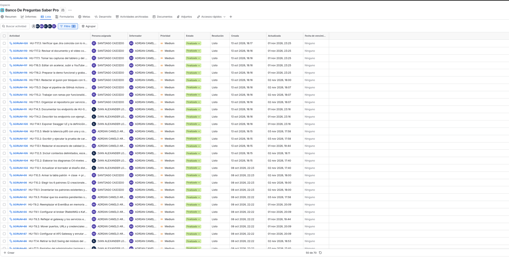
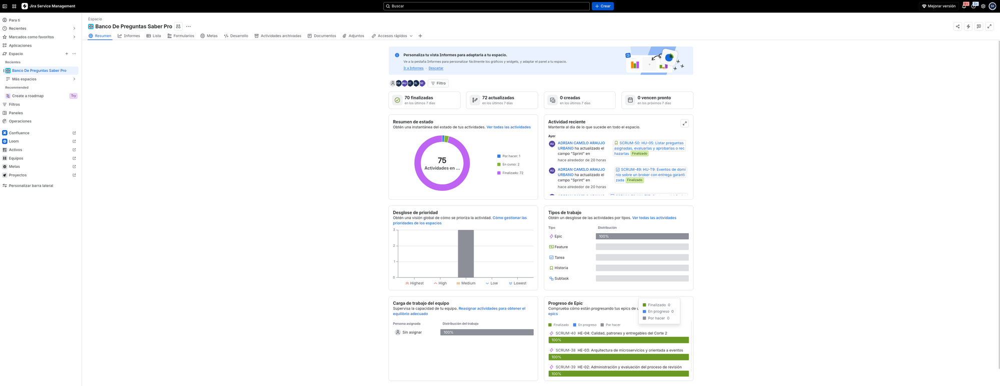
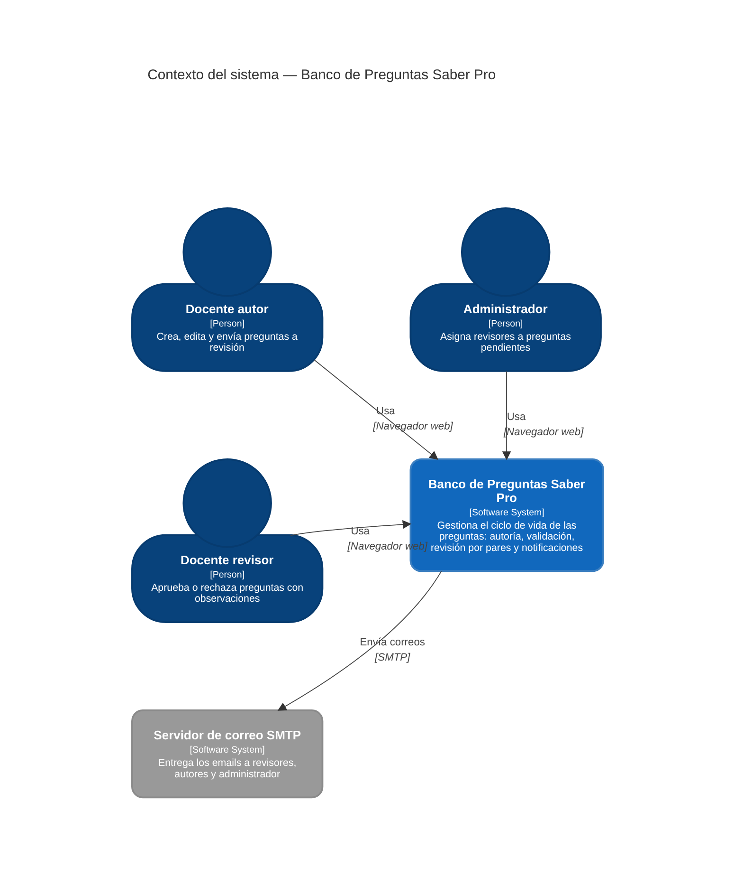
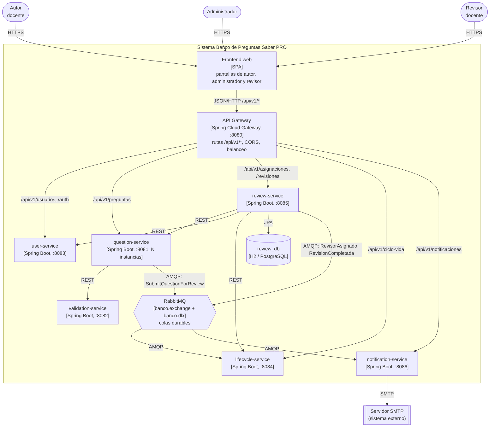
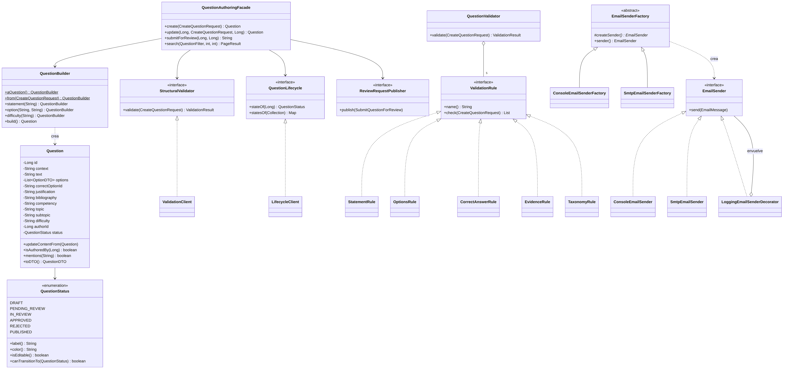
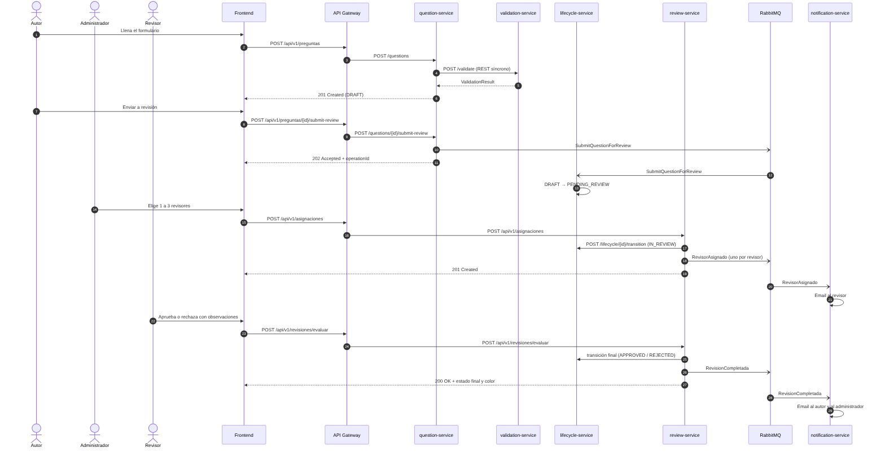
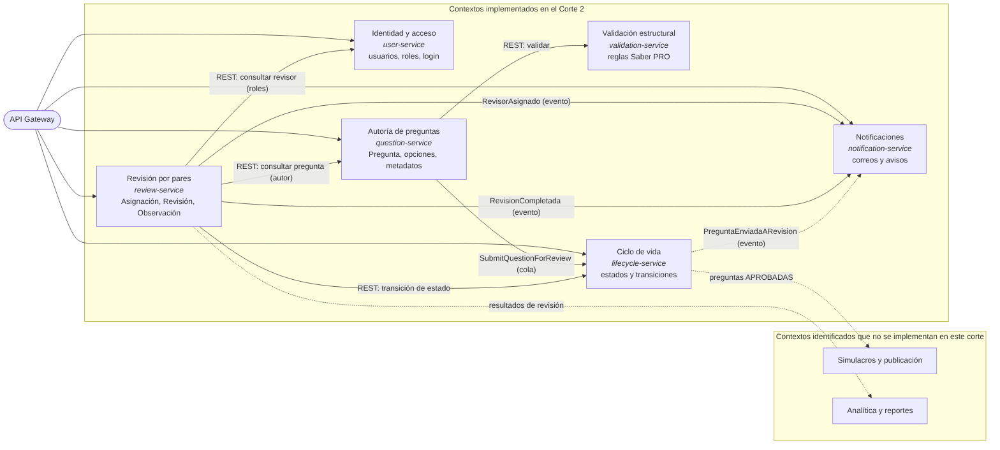

<div align="center">

# Documento de Arquitectura de Software — Banco de Preguntas Saber Pro

**Ingeniería de Software II (teoría y laboratorio)**

Segundo entregable del proyecto de curso (Corte 2): refactorización de la iteración 1 a una arquitectura de microservicios orientada a eventos, con frontend web separado del backend por una API REST.

**Presentado por:**<br>
Yeferson Santiago Caicedo Orozco<br>
Iván Alexander López Lasso<br>
Adrián Camilo Araujo Urbano<br>
Carlos Arturo Bambague

**Profesores:**<br>
Paola Andrea Bedoya Toro<br>
Libardo Pantoja

Universidad del Cauca<br>
Facultad de Ingeniería Electrónica y Telecomunicaciones<br>
Programa de Ingeniería de Sistemas

Popayán, noviembre de 2026

</div>

> Versión para entregar, con el formato de la plantilla institucional: [`DOCUMENTO_ARQUITECTURA_CORTE2.pdf`](DOCUMENTO_ARQUITECTURA_CORTE2.pdf) (fuente editable en Word: [`DOCUMENTO_ARQUITECTURA_CORTE2.docx`](DOCUMENTO_ARQUITECTURA_CORTE2.docx)).

---

## Contenido

- [Introducción](#introducción)
- [Capítulo 1 — Requisitos y planificación](#capítulo-1--requisitos-y-planificación)
  - [1. Historias de usuario de la segunda iteración](#1-historias-de-usuario-de-la-segunda-iteración)
  - [2. Planificación del Sprint 2](#2-planificación-del-sprint-2)
- [Capítulo 2 — Atributo de calidad](#capítulo-2--atributo-de-calidad)
  - [3. Escenario de calidad: escalabilidad](#3-escenario-de-calidad-escalabilidad)
- [Capítulo 3 — Arquitectura y diseño de software](#capítulo-3--arquitectura-y-diseño-de-software)
  - [4. Modelo C4 y diagramas UML](#4-modelo-c4-y-diagramas-uml)
  - [5. Diagrama de contextos delimitados](#5-diagrama-de-contextos-delimitados-bounded-contexts)
  - [6. Patrones de diseño GoF implementados](#6-patrones-de-diseño-gof-implementados)
  - [7. API REST documentada con Swagger](#7-api-rest-documentada-con-swagger)
  - [8. Pruebas unitarias automatizadas](#8-pruebas-unitarias-automatizadas)
- [Capítulo 4 — Entrega](#capítulo-4--entrega)
  - [9. Enlaces de entrega](#9-enlaces-de-entrega)
- [Referencias](#referencias)

**Tabla de ilustraciones**

- Ilustración 1. Actividades del Sprint 2 en Jira (vista Lista).
- Ilustración 2. Resumen del espacio en Jira: estado de las actividades y progreso de las épicas.
- Ilustración 3. C4 nivel 1: contexto del sistema.
- Ilustración 4. C4 nivel 2: contenedores.
- Ilustración 5. C4 nivel 3: componentes de question-service y notification-service.
- Ilustración 6. Diagrama de clases UML del contexto de Autoría y los patrones.
- Ilustración 7. Diagrama de secuencia UML del flujo HU-01 a HU-05.
- Ilustración 8. Diagrama de contextos delimitados.

**Índice de tablas**

- Tabla 1. Historias del Sprint 2 en Jira.
- Tabla 2. Escenario de calidad de escalabilidad.
- Tabla 3. Resultados de la prueba de carga con k6.
- Tabla 4. Contenedores del sistema.
- Tabla 5. Contextos delimitados y almacenamiento.
- Tabla 6. Patrones de diseño GoF implementados.
- Tabla 7. Endpoints públicos de la API REST.
- Tabla 8. Pruebas unitarias por módulo.

---

## Introducción

Este documento describe la arquitectura de la segunda iteración del **Banco de Preguntas Saber Pro**. En el corte 1 el sistema era un monolito en capas con interfaz Swing (carpeta `banco-preguntas/`). En este corte se refactorizó a una **arquitectura de microservicios orientada a eventos** (carpeta `microservicios/`) para cumplir el atributo de calidad de **escalabilidad**:

- Cada contexto delimitado es un microservicio Spring Boot independiente, con su propio almacenamiento.
- Los servicios se comunican de forma **síncrona** por REST cuando necesitan una respuesta inmediata (validar, consultar un estado) y de forma **asíncrona** por **RabbitMQ** para lo que puede ocurrir después (enviar a revisión, notificar por correo).
- Un **API Gateway** (Spring Cloud Gateway) es el único punto de entrada y puede balancear varias instancias de un servicio.
- El **frontend web** (carpeta `frontend/`) es una aplicación separada que solo habla con el backend mediante la **API REST** del gateway, documentada con **Swagger / OpenAPI 3**.

El documento se organiza en cuatro capítulos. El capítulo 1 presenta las historias de usuario con sus criterios de aceptación y la planificación del Sprint 2. El capítulo 2 define el escenario de calidad de escalabilidad. El capítulo 3 describe la arquitectura con el modelo C4 y diagramas UML, los contextos delimitados, los patrones GoF, la API REST y las pruebas. El capítulo 4 reúne los enlaces del video de sustentación y del repositorio.

---

## Capítulo 1 — Requisitos y planificación

## 1. Historias de usuario de la segunda iteración

Todas las rutas son las públicas del API Gateway (`http://localhost:8080`). Entre paréntesis está el microservicio que atiende la petición.

### 1.1. HU-01 · Crear preguntas con validación estructural (autor)

**Como** autor de preguntas **necesito** crear preguntas de selección múltiple con única respuesta acordes al Diseño Centrado en Evidencia **para** alimentar el banco de preguntas Saber Pro.

```gherkin
Escenario: creación exitosa en Borrador
  Dado un autor autenticado
  Cuando envía POST /api/v1/preguntas (question-service) con contexto (>= 20 caracteres), pregunta directa (>= 15),
       4 opciones A-D sin repetir ni comodines, respuesta correcta, justificación (>= 20), bibliografía,
       competencia, tema, subtema y nivel de dificultad (BAJO, MEDIO o ALTO)
  Entonces question-service valida la pregunta llamando por REST a validation-service
  Y la guarda en estado DRAFT ("Borrador", color #969696)
  Y responde 201 Created con el id asignado

Escenario: rechazo por validación estructural
  Dado que falta algún elemento o una opción dice "Todas las anteriores"
  Cuando el autor intenta guardarla
  Entonces el sistema responde 400 Bad Request con la lista de todos los errores encontrados
  Y la pregunta no se guarda
```

### 1.2. HU-02 · Enviar a revisión (autor)

**Como** autor **necesito** cambiar el estado de mis preguntas de "Borrador" a "Pendiente de revisión" **para** que el administrador les asigne al menos un revisor. *Los estados se visualizan con colores.*

```gherkin
Escenario: envío asíncrono a revisión
  Dado una pregunta del autor en DRAFT o REJECTED
  Cuando el autor envía POST /api/v1/preguntas/{id}/submit-review?requestedBy={autorId}
  Entonces question-service publica el comando SubmitQuestionForReview en RabbitMQ y responde 202 Accepted con un operationId
  Y lifecycle-service consume el comando y cambia el estado a PENDING_REVIEW ("Pendiente de revisión", #E6A014)
  Y GET /api/v1/preguntas/operations/{operationId} informa COMPLETED

Escenario: solo el autor puede enviarla
  Cuando otro usuario intenta enviarla a revisión
  Entonces el sistema responde 403 Forbidden

Escenario: transición no permitida
  Dado una pregunta que ya está en revisión
  Cuando se intenta enviar de nuevo
  Entonces lifecycle-service rechaza la transición y la operación queda FAILED con el motivo
```

### 1.3. HU-03 · Listar, filtrar y editar mis preguntas (autor)

**Como** autor **necesito** listar las preguntas que he creado **para** verlas y editarlas más adelante. *Con paginación y filtros.*

```gherkin
Escenario: listado paginado con filtros
  Cuando el autor consulta GET /api/v1/preguntas?authorId=2&status=&competency=&topic=&difficulty=&keyword=&page=0&size=5
  Entonces recibe una página {content, page, size, totalElements, totalPages}
  Y cada pregunta trae status, statusLabel y statusColor, consultados en una sola llamada a lifecycle-service

Escenario: edición permitida
  Dado una pregunta propia en DRAFT o REJECTED
  Cuando el autor envía PUT /api/v1/preguntas/{id}?requestedBy=2 con el contenido corregido
  Entonces se vuelve a validar y se guarda (200 OK)

Escenario: edición no permitida
  Dado una pregunta en PENDING_REVIEW, IN_REVIEW, APPROVED o PUBLISHED
  Cuando el autor intenta editarla
  Entonces el sistema responde 409 Conflict ("solo se puede editar en Borrador o Rechazada")
```

### 1.4. HU-04 · Asignar entre 1 y 3 revisores (administrador)

**Como** administrador **necesito** asignar revisores (entre 1 y 3) a las preguntas en "Pendiente de revisión" **para** que sean revisadas por otros docentes. *Una vez asignados, el sistema envía un email.*

```gherkin
Escenario: asignación con notificación por correo
  Dado una pregunta en PENDING_REVIEW
  Cuando el administrador envía POST /api/v1/asignaciones {questionId, reviewerIds:[4,5], assignedBy:1} (review-service)
  Entonces review-service guarda las asignaciones en review_db y pide a lifecycle-service pasar la pregunta a IN_REVIEW (#1E78D2)
  Y publica un evento RevisorAsignado por cada revisor en RabbitMQ y responde 201 Created
  Y notification-service consume cada evento, busca el correo del revisor en user-service y le envía el email

Escenario: reglas de la asignación
  Cuando se envían 0 o más de 3 revisores, un revisor repetido, un usuario sin rol REVISOR o el propio autor
  Entonces el sistema responde 400 Bad Request y no se envía ningún correo
```

### 1.5. HU-05 · Evaluar las preguntas asignadas (revisor) — nueva en el corte 2

**Como** revisor **necesito** listar las preguntas que me han sido asignadas **para** leerlas, dejar la evaluación y cambiar el estado a Aprobada/Rechazada. *El revisor puede dejar observaciones para el autor; el sistema notifica a los implicados.*

```gherkin
Escenario: preguntas asignadas
  Cuando el revisor consulta GET /api/v1/revisiones/asignadas?revisorId=4&page=0&size=5
  Entonces recibe, paginadas, solo las preguntas que tiene asignadas y que aún no ha evaluado

Escenario: evaluación con observaciones
  Cuando el revisor envía POST /api/v1/revisiones/evaluar {questionId, reviewerId, result:"APPROVED"|"REJECTED", comments}
  Entonces se registra la revisión y se publica RevisionCompletada
  Y notification-service envía correo al autor y al administrador con el dictamen y las observaciones
  Y cuando todos los revisores evaluaron, la pregunta pasa a APPROVED (#28A745) si todos aprobaron, o a REJECTED (#DC3545) si alguno rechazó

Escenario: rechazo sin observaciones
  Cuando el revisor rechaza sin escribir observaciones
  Entonces el sistema responde 400 Bad Request

Escenario: el autor lee las observaciones
  Cuando el autor consulta GET /api/v1/revisiones/pregunta/{id}
  Entonces ve la decisión y las observaciones de cada revisor, y puede editar la pregunta rechazada y reenviarla
```

## 2. Planificación del Sprint 2

El Sprint 2 se gestionó en **Jira** (proyecto SCRUM, tablero *SCRUM board*). Duró del 8 al 30 de octubre de 2026 y se cerró el 3 de noviembre con las 19 incidencias finalizadas. Su objetivo fue *refactorizar la iteración 1 a microservicios orientados a eventos, implementar la HU-05 (revisión por pares) y completar documentación, pruebas y sustentación del segundo corte*. Los commits referencian las tareas, por ejemplo `[SCRUM-110]` y `[SCRUM-111]`. La Ilustración 1 muestra las actividades del sprint con su responsable y estado, y la Ilustración 2 el resumen del espacio: 72 de 75 actividades finalizadas y las épicas del corte al 100 %. La Tabla 1 lista las historias del Sprint 2 con su responsable.



*Ilustración 1. Actividades del Sprint 2 en Jira (vista Lista). Captura del espacio Banco De Preguntas Saber Pro.*



*Ilustración 2. Resumen del espacio en Jira: estado de las actividades y progreso de las épicas. Captura del espacio Banco De Preguntas Saber Pro.*

*Tabla 1. Historias del Sprint 2 en Jira. Elaboración propia.*

| Clave | Historia | Responsable | Estado |
|---|---|---|---|
| SCRUM-41 | HU-T1: Bounded contexts y diseño de la arquitectura distribuida | Adrián Camilo Araujo Urbano | Finalizado |
| SCRUM-42 | HU-T2: Infraestructura con Docker, bases de datos independientes y broker de eventos | Carlos Arturo Bambague | Finalizado |
| SCRUM-43 | HU-T3: Refactorizar HU-01, HU-02 y HU-03 a un microservicio de preguntas | Yeferson Santiago Caicedo Orozco | Finalizado |
| SCRUM-44 | HU-T4: Microservicio de usuarios y roles | Iván Alexander López Lasso | Finalizado |
| SCRUM-45 | HU-T5: Microservicio de revisión (asignaciones y evaluaciones) | Adrián Camilo Araujo Urbano | Finalizado |
| SCRUM-46 | HU-T6: Microservicio de notificaciones orientado a eventos | Carlos Arturo Bambague | Finalizado |
| SCRUM-47 | HU-T7: Frontend web independiente que consume la API REST | Iván Alexander López Lasso | Finalizado |
| SCRUM-48 | HU-T8: API Gateway y configuración centralizada | Adrián Camilo Araujo Urbano | Finalizado |
| SCRUM-49 | HU-T9: Eventos de dominio con entrega garantizada | Adrián Camilo Araujo Urbano | Finalizado |
| SCRUM-50 | HU-05: Listar preguntas asignadas, evaluarlas y aprobarlas o rechazarlas | Adrián Camilo Araujo Urbano | Finalizado |
| SCRUM-51 | HU-04 (refactor): Asignar de 1 a 3 revisores | Carlos Arturo Bambague | Finalizado |
| SCRUM-52 | HU-T10: Al menos 6 patrones GoF | Yeferson Santiago Caicedo Orozco | Finalizado |
| SCRUM-53 | HU-T11: Pruebas unitarias de las clases del dominio | Carlos Arturo Bambague | Finalizado |
| SCRUM-54 | HU-T12: Documento de arquitectura | Iván Alexander López Lasso | Finalizado |
| SCRUM-55 | HU-T13: Escenario de escalabilidad y pruebas de carga | Adrián Camilo Araujo Urbano | Finalizado |
| SCRUM-56 | HU-T14: Documentación Swagger/OpenAPI | Iván Alexander López Lasso | Finalizado |
| SCRUM-57 | HU-T15: Repositorio Git con commits de todos, ramas y CI | Yeferson Santiago Caicedo Orozco | Finalizado |
| SCRUM-58 | HU-T16: Guion y grabación del video de sustentación | Yeferson Santiago Caicedo Orozco | Finalizado |
| SCRUM-59 | HU-T17: Capturas del Sprint 2 y revisión final contra la rúbrica | Yeferson Santiago Caicedo Orozco | Finalizado |

---

## Capítulo 2 — Atributo de calidad

## 3. Escenario de calidad: escalabilidad

**Contexto.** Durante la convocatoria Saber Pro muchos docentes crean y revisan preguntas al mismo tiempo. El monolito del corte 1 solo podía crecer con una máquina más grande; la arquitectura de este corte debe crecer agregando instancias de los servicios más cargados, sin cambiar el código. La Tabla 2 especifica el escenario.

*Tabla 2. Escenario de calidad de escalabilidad. Elaboración propia.*

| Elemento | Especificación |
|---|---|
| **Atributo** | Escalabilidad (ISO/IEC 25010, capacidad) |
| **Fuente del estímulo** | Docentes autores y revisores durante la convocatoria Saber Pro |
| **Estímulo** | 500 usuarios concurrentes, cada uno con una petición por segundo: 90 % crean preguntas (`POST /api/v1/preguntas`) y 10 % consultan sus preguntas asignadas (`GET /api/v1/revisiones/asignadas`) |
| **Artefacto** | API Gateway, question-service (con validation-service) y review-service |
| **Entorno** | Operación normal; primero con 1 instancia de question-service y luego con 2 instancias detrás del gateway (perfil `escalado`) |
| **Respuesta** | El gateway reparte la carga entre las instancias. Las operaciones lentas (cambio de estado, correos) se hacen por RabbitMQ y no retienen la petición REST |
| **Medición de calidad** | Latencia p95 y tasa de errores medidas con k6 durante 2 minutos de carga sostenida |
| **Resultado esperado** | p95 < 500 ms y errores < 1 % con 500 usuarios; al pasar de 1 a 2 instancias la p95 se mantiene o baja **sin cambiar código, solo configuración** |

Decisiones de arquitectura que sostienen el escenario:

1. **Servicios sin estado de sesión** detrás de un gateway con balanceo (`lb://question-service`), así que escalar es agregar instancias.
2. **Mensajería asíncrona**: `202 Accepted` para enviar a revisión y eventos para notificar; el usuario no espera al servidor de correo.
3. **Consulta de estados en lote** (`GET /lifecycle?ids=`): listar N preguntas cuesta una sola llamada a lifecycle-service y no N.
4. **Entrega garantizada**: colas durables, reintentos con espera exponencial, DLQ y consumidores idempotentes; no se pierden eventos si un consumidor se cae.

### 3.1. Resultados medidos

El escenario se ejecutó el 4 de noviembre de 2026 con k6 0.54.0: 500 usuarios concurrentes, 30 s de rampa, 2 minutos sostenidos y 15 s de bajada. Primero se usó 1 instancia de question-service y luego 2 instancias detrás del gateway con el perfil `escalado`. Equipo de la medición: AMD Ryzen 7 5700G (16 hilos), 40 GB de RAM, Linux, Java 21 y RabbitMQ 3.13 en Docker. La Tabla 3 resume los resultados.

*Tabla 3. Resultados de la prueba de carga con k6. Elaboración propia.*

| Métrica | 1 instancia | 2 instancias |
|---|---|---|
| Peticiones totales | 71 287 | 71 278 |
| Peticiones por segundo | 429,9 | 429,8 |
| Tasa de errores | 0,0 % | 0,0 % |
| Latencia p95 | 3,9 ms | 3,8 ms |
| Latencia p99 | 5,8 ms | 5,9 ms |
| p95 crear pregunta / listar asignadas | 4,0 ms / 3,3 ms | 3,8 ms / 1,5 ms |
| Cumple p95 < 500 ms y errores < 1 % | Sí | Sí |

Con 500 usuarios se cumplen los dos umbrales con amplio margen: la p95 queda unas 125 veces por debajo de 500 ms y no hubo errores. Al agregar la segunda instancia, sin cambiar código (solo configuración), la p95 se mantuvo y bajó un 4,1 %, que es el resultado esperado. Durante la prueba, las conexiones del gateway hacia las dos instancias estuvieron repartidas por igual, lo que confirma el balanceo. El rendimiento es el mismo en ambos casos porque cada usuario virtual hace una petición por segundo: la carga la fija el escenario. Como las dos instancias comparten el mismo equipo y 500 usuarios no lo saturan, esta prueba demuestra el cumplimiento del escenario, pero no mide la capacidad máxima del sistema.

El script de la prueba está en `microservicios/pruebas-carga/`; el procedimiento y la evidencia (`resultados/*.json` y `resultados/comparacion.md`) se describen en [`arquitectura/04-escenario-escalabilidad.md`](arquitectura/04-escenario-escalabilidad.md).

---

## Capítulo 3 — Arquitectura y diseño de software

## 4. Modelo C4 y diagramas UML

### 4.1. C4 nivel 1 — Contexto del sistema

Autores, administradores y revisores usan el sistema desde el navegador; el sistema se apoya en un servidor de correo externo (Ilustración 3).



*Ilustración 3. C4 nivel 1: contexto del sistema. Elaboración propia.*

### 4.2. C4 nivel 2 — Contenedores

La Ilustración 4 muestra el frontend y el backend separados y comunicados por la API REST del gateway. La Tabla 4 resume cada contenedor.



*Ilustración 4. C4 nivel 2: contenedores. Elaboración propia.*

*Tabla 4. Contenedores del sistema. Elaboración propia.*

| Contenedor | Tecnología | Responsabilidad |
|---|---|---|
| Frontend web | HTML5, CSS, JavaScript sin framework; servidor estático Node | Pantallas de autor, administrador y revisor. Solo conoce la URL del gateway (`frontend/public/config.js`) |
| API Gateway | Spring Cloud Gateway 2023.0 | Único punto de entrada, reescritura de rutas, CORS, balanceo (perfil `escalado`), propagación de identidad y Swagger UI unificado |
| question-service | Spring Boot 3.3 + Spring Data JPA + Flyway | Autoría: crear, editar, listar y enviar a revisión |
| validation-service | Spring Boot 3.3 | Reglas estructurales DCE (sin estado) |
| lifecycle-service | Spring Boot 3.3 | Autoridad única del estado y de las transiciones |
| review-service | Spring Boot 3.3 + Spring Data JPA | Asignaciones y evaluaciones (HU-04, HU-05) |
| notification-service | Spring Boot 3.3 + Spring Mail | Consume eventos y envía correos |
| user-service | Spring Boot 3.3 + Spring Data JPA + Flyway | Usuarios, roles, login y revisores elegibles |
| RabbitMQ | RabbitMQ 3.13 | Comandos y eventos de dominio con DLQ |

### 4.3. C4 nivel 3 — Componentes de question-service y notification-service

Dentro de question-service el controlador solo conoce la fachada, que coordina validación, ciclo de vida, repositorio y mensajería a través de puertos. En notification-service los consumidores de eventos delegan en un despachador que obtiene el emisor de correo de una fábrica (Ilustración 5).


*Ilustración 5. C4 nivel 3: componentes de question-service y notification-service. Elaboración propia.*

En **review-service** (organizado en dominio, aplicación, infraestructura y presentación) la decisión final se delega en `VerdictPolicy` (Strategy, implementada por `UnanimousApprovalPolicy`) y la persistencia en `JpaReviewRepositoryAdapter` (Adapter entre el puerto `ReviewRepository` y Spring Data JPA).

### 4.4. UML — Diagrama de clases

La Ilustración 6 muestra las clases del contexto de Autoría y las de los patrones de validación y correo.



*Ilustración 6. Diagrama de clases UML del contexto de Autoría y los patrones. Elaboración propia.*

### 4.5. UML — Diagrama de secuencia del flujo completo (HU-01 a HU-05)

La Ilustración 7 recorre el flujo crear → enviar a revisión → asignar → evaluar → notificar, distinguiendo las llamadas REST síncronas de los mensajes asíncronos por RabbitMQ.



*Ilustración 7. Diagrama de secuencia UML del flujo HU-01 a HU-05. Elaboración propia.*

Las fuentes editables (Mermaid) de todos los diagramas están en `arquitectura/diagramas/*.mmd`.

## 5. Diagrama de contextos delimitados (bounded contexts)

La Ilustración 8 muestra los contextos y sus relaciones; la Tabla 5 indica el microservicio y el almacenamiento de cada uno.



*Ilustración 8. Diagrama de contextos delimitados. Elaboración propia.*

*Tabla 5. Contextos delimitados y almacenamiento. Elaboración propia.*

| Contexto | Microservicio | Almacenamiento | Se integra con |
|---|---|---|---|
| Identidad y acceso | user-service | user_db (JPA + Flyway: H2 / PostgreSQL) | Emite el token que el gateway valida para propagar la identidad |
| Autoría de preguntas | question-service | question_db (JPA + Flyway: H2 / PostgreSQL) | Validación (REST), Ciclo de vida (REST + comando AMQP) |
| Validación estructural | validation-service | Sin estado | — |
| Ciclo de vida | lifecycle-service | lifecycle_db (en memoria) | Recibe comandos por RabbitMQ |
| Revisión por pares | review-service | review_db (JPA: H2 / PostgreSQL) | Autoría, Identidad y Ciclo de vida (REST); publica eventos |
| Notificaciones | notification-service | notification_db (en memoria) | Consume eventos; Identidad (REST) |
| Simulacros y Analítica | — | — | Identificados en la Figura 1 del enunciado, no implementados en este corte |

Regla común: ningún servicio lee la base de datos de otro. El detalle y las diferencias con la Figura 1 del enunciado están en [`arquitectura/01-bounded-contexts.md`](arquitectura/01-bounded-contexts.md); los contratos de eventos y endpoints en [`arquitectura/02-contratos.md`](arquitectura/02-contratos.md).

## 6. Patrones de diseño GoF implementados

Se cumplen los 6 patrones exigidos (2 creacionales, 2 estructurales y 2 de comportamiento) **dentro de la arquitectura de microservicios**, más un patrón estructural adicional (Adapter). La Tabla 6 los describe.

*Tabla 6. Patrones de diseño GoF implementados. Elaboración propia.*

| # | Patrón | Tipo | Dónde | Cómo y para qué se aplicó |
|---|---|---|---|---|
| 1 | **Builder** | Creacional | `question-service` · `domain/QuestionBuilder` | Una pregunta DCE tiene once elementos. El builder la arma paso a paso desde la solicitud REST (`QuestionBuilder.from(request)`) o desde los datos de demostración, normaliza los textos y garantiza autor y enunciado antes de crearla. |
| 2 | **Factory Method** | Creacional | `notification-service` · `email/EmailSenderFactory` | El creador abstracto define `sender()` y delega en el método fábrica `createSender()`. `ConsoleEmailSenderFactory` crea el correo simulado y `SmtpEmailSenderFactory` el SMTP real. Se cambia con la propiedad `notifications.email.mode`, sin tocar el código que notifica. |
| 3 | **Facade** | Estructural | `question-service` · `application/QuestionAuthoringFacade` | Crear, editar, listar o enviar a revisión exige coordinar validation-service, lifecycle-service, el repositorio y RabbitMQ. El controlador REST solo conoce la fachada, que oculta ese orden y las reglas de autoría. |
| 4 | **Decorator** | Estructural | `notification-service` · `email/LoggingEmailSenderDecorator` | Envuelve cualquier `EmailSender` y agrega trazabilidad (canal, destinatario, duración, fallos) sin modificar las clases que envían. La fábrica entrega siempre el emisor decorado. |
| 5 | **Adapter** | Estructural | `ValidationClient`, `LifecycleClient` (question-service); `UserRestClient` (notification-service); `JpaReviewRepositoryAdapter`, `QuestionRestClient` (review-service) | Adaptan las API REST de otros servicios y Spring Data JPA a las interfaces (puertos) que espera cada dominio, para que el dominio no dependa de HTTP ni de JPA. |
| 6 | **Strategy** | Comportamiento | `validation-service` · `ValidationRule` (`StatementRule`, `OptionsRule`, `CorrectAnswerRule`, `EvidenceRule`, `TaxonomyRule`); `review-service` · `VerdictPolicy` / `UnanimousApprovalPolicy` | Cada regla estructural es una estrategia; `QuestionValidator` las recibe inyectadas y las ejecuta todas. Agregar una regla es crear una clase (abierto/cerrado). En review-service la política de veredicto decide APPROVED/REJECTED y puede cambiarse por otra (por ejemplo, mayoría). |
| 7 | **Observer** | Comportamiento | RabbitMQ: `ReviewerAssignedConsumer`, `ReviewCompletedConsumer` (notification-service), `QuestionSubmitConsumer` (lifecycle-service) | review-service publica eventos sin conocer a sus suscriptores; cada consumidor es un observador suscrito a una cola y reacciona enviando correos o cambiando el estado. Es la base de la arquitectura orientada a eventos. |

El monolito del corte 1 (`banco-preguntas/`) conserva sus propios patrones (Builder, Factory Method, Singleton, Facade, Decorator, Strategy, Observer y State), que fueron la base de esta refactorización.

## 7. API REST documentada con Swagger

- **Swagger UI unificado (gateway):** http://localhost:8080/swagger-ui.html, con un selector arriba a la derecha para cada microservicio.
- Swagger individual: `http://localhost:{8081..8086}/swagger-ui.html`.

*Tabla 7. Endpoints públicos de la API REST. Elaboración propia.*

| Módulo | Método | Ruta pública | HU |
|---|---|---|---|
| Autenticación | POST | `/api/v1/auth/login` | Soporte |
| Preguntas | POST | `/api/v1/preguntas` | HU-01 |
| Preguntas | PUT | `/api/v1/preguntas/{id}?requestedBy=` | HU-03 |
| Preguntas | GET | `/api/v1/preguntas?authorId&status&competency&topic&difficulty&keyword&page&size` | HU-03 |
| Preguntas | GET | `/api/v1/preguntas/{id}` | HU-03 |
| Preguntas | GET | `/api/v1/preguntas/catalog` (estados con color) | HU-02 |
| Preguntas | POST | `/api/v1/preguntas/{id}/submit-review?requestedBy=` | HU-02 |
| Preguntas | GET | `/api/v1/preguntas/operations/{operationId}` | HU-02 |
| Usuarios | GET | `/api/v1/usuarios/reviewers/eligible?authorId=` y `/api/v1/usuarios/role/{rol}` | HU-04 |
| Usuarios | GET | `/api/v1/usuarios/me` (identidad propagada por el gateway) | Soporte |
| Asignaciones | POST / GET | `/api/v1/asignaciones` | HU-04 |
| Revisiones | GET | `/api/v1/revisiones/asignadas?revisorId&page&size` | HU-05 |
| Revisiones | POST | `/api/v1/revisiones/evaluar` | HU-05 |
| Revisiones | GET | `/api/v1/revisiones/pregunta/{questionId}` | HU-05 |
| Ciclo de vida | GET | `/api/v1/ciclo-vida/{id}` y `/api/v1/ciclo-vida?ids=` | HU-02 |
| Notificaciones | GET | `/api/v1/notificaciones/recipient/{id}` | HU-04, HU-05 |

## 8. Pruebas unitarias automatizadas

Se ejecutan con `mvn test` (JUnit 5, Java 21) y en GitHub Actions en cada push (`.github/workflows/pruebas.yml`: monolito, microservicios y verificación del frontend). La Tabla 8 resume las pruebas por módulo.

*Tabla 8. Pruebas unitarias por módulo. Elaboración propia.*

| Módulo | Clases de prueba | Qué cubren |
|---|---|---|
| question-service | `QuestionBuilderTest`, `QuestionAuthoringFacadeTest`, `JpaQuestionRepositoryTest` | Entidad, Builder, filtros, Facade: crear, validar, editar (403/409), enviar (403/404), paginar y filtrar por estado, tolerancia a lifecycle caído; persistencia JPA con migración Flyway |
| validation-service | `QuestionValidatorTest`, `ValidationControllerTest` | Cada estrategia de validación y extensión con una estrategia nueva |
| lifecycle-service | `LifecycleControllerTest`, `QuestionSubmitConsumerTest`, `QuestionSubmittedEventTest` | Transiciones válidas e inválidas, consulta en lote, consumo del comando y publicación de PreguntaEnviadaARevision |
| review-service | `ReviewDomainTest`, `ReviewServiceTest`, `RevisionControllerTest`, `JpaReviewRepositoryAdapterTest` | Reglas de asignación 1–3, autor no revisa, rechazo con observación, veredicto unánime, códigos HTTP |
| notification-service | `EmailNotificationTest`, `NotificationIdempotencyTest`, `NotificationServiceConsumerTest`, `QuestionSubmittedConsumerTest` | Factory Method, Decorator, correo SENT/FAILED, idempotencia de eventos, aviso al administrador |
| user-service | `AuthControllerTest`, `UserControllerTest`, `JpaUserRepositoryTest`, `UserDomainTest` | Login y token firmado, roles, revisores elegibles, `/users/me`, persistencia JPA con Flyway, hash de contraseñas |
| api-gateway | `GatewayRoutesTest`, `IdentityPropagationFilterTest` | Rutas `/api/v1`, rutas de documentación, configuración por variables de entorno y propagación de la identidad |
| banco-preguntas (corte 1) | 23 clases | Dominio, patrones GoF, JDBC/H2, JPA, DDD y REST del monolito |

Resultado de la última ejecución (4 de noviembre de 2026): **microservicios 106 pruebas** y **monolito 140 pruebas**, todas exitosas.

---

## Capítulo 4 — Entrega

## 9. Enlaces de entrega

- **Video de sustentación (YouTube):** https://youtu.be/B-chmKrIsbY
- **Repositorio Git:** https://github.com/santyxswc/Banco_preguntas-ISoftII
- **Tablero Scrum (Jira):** https://ingsoft2bancodepreguntas.atlassian.net (proyecto SCRUM, Sprint 2)
- **Frontend local:** http://localhost:5173
- **Swagger unificado:** http://localhost:8080/swagger-ui.html

---

## Referencias

- Bass, L., Clements, P. y Kazman, R. (2021). *Software Architecture in Practice* (4.ª ed.). Addison-Wesley.
- Brown, S. (2018). *The C4 model for visualising software architecture*. https://c4model.com
- Evans, E. (2003). *Domain-Driven Design: Tackling Complexity in the Heart of Software*. Addison-Wesley.
- Gamma, E., Helm, R., Johnson, R. y Vlissides, J. (1994). *Design Patterns: Elements of Reusable Object-Oriented Software*. Addison-Wesley.
- International Organization for Standardization. (2023). *ISO/IEC 25010:2023. Systems and software engineering — Systems and software Quality Requirements and Evaluation (SQuaRE) — Product quality model*. ISO.
- Newman, S. (2021). *Building Microservices* (2.ª ed.). O'Reilly Media.
- OpenAPI Initiative. (2021). *OpenAPI Specification v3.1.0*. https://spec.openapis.org/oas/v3.1.0
- Universidad del Cauca. (2026). *Entregables Proyecto de Curso — Segundo Corte 2026.2. Ingeniería de Software II*. Facultad de Ingeniería Electrónica y Telecomunicaciones.
