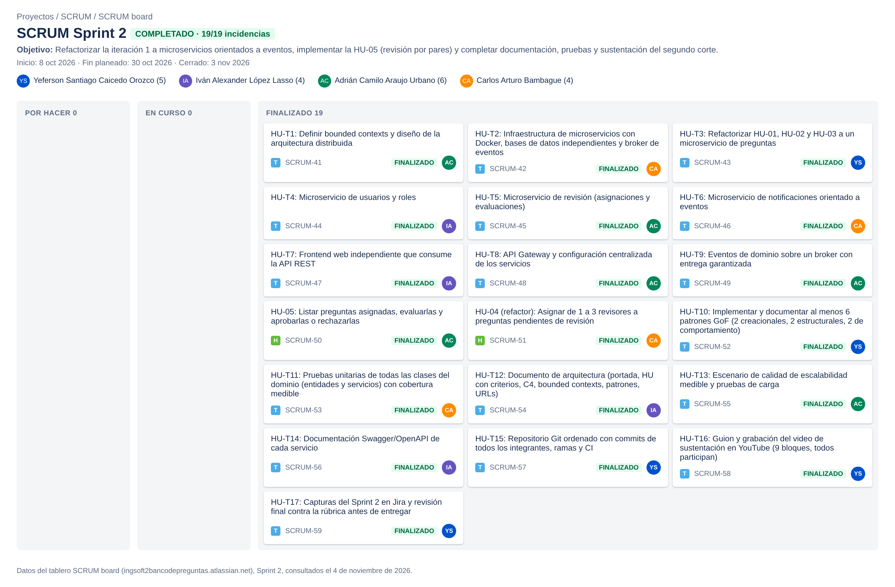
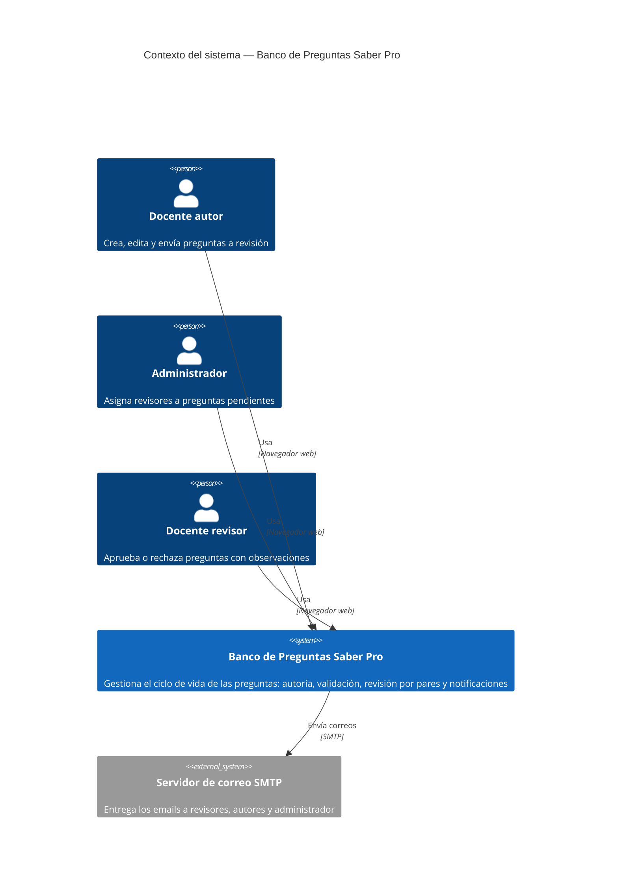
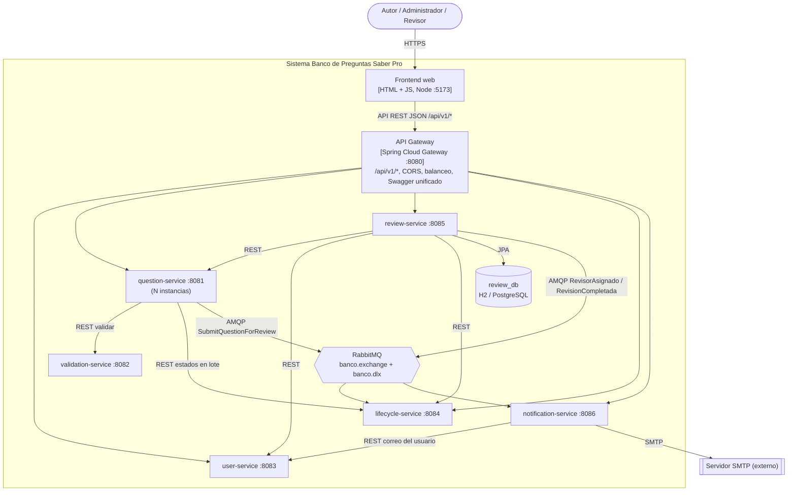
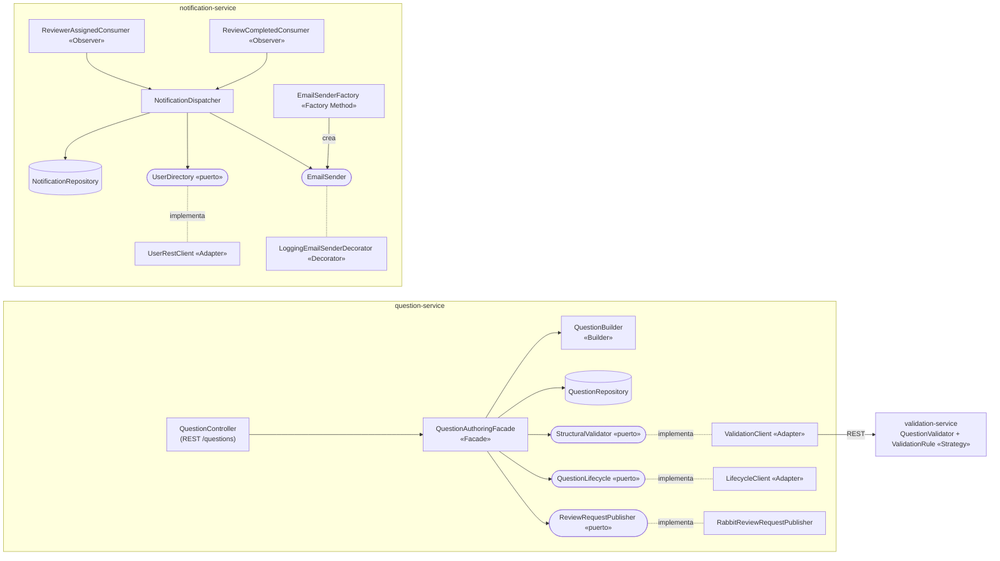
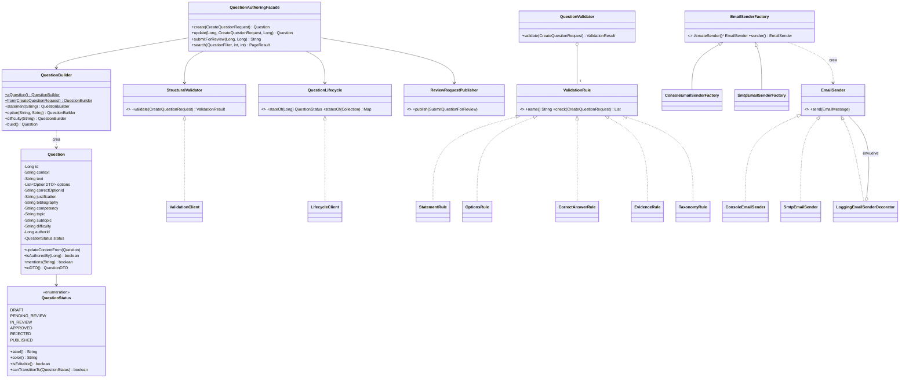
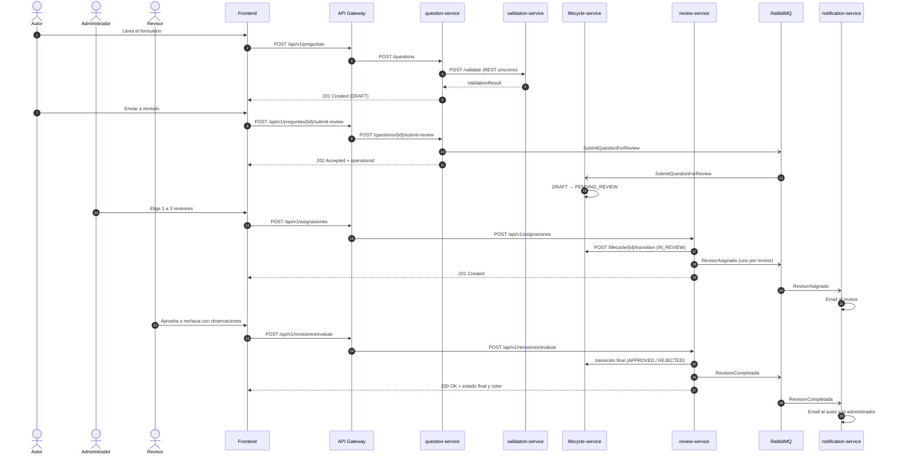

# Banco de Preguntas Saber Pro — Documento de Arquitectura de Software
## Segundo entregable (Corte 2): microservicios, arquitectura orientada a eventos y API REST

---

### Portada

- **Institución:** Universidad del Cauca
- **Facultad:** Facultad de Ingeniería Electrónica y Telecomunicaciones (FIET)
- **Programa:** Ingeniería de Sistemas
- **Asignatura:** Ingeniería de Software II (teoría y laboratorio)
- **Docentes:** Paola Andrea Bedoya, Pablo Magé, W. Libardo Pantoja, Julio Hurtado
- **Periodo académico:** 2026.2
- **Integrantes del equipo:**
  - Yeferson Santiago Caicedo Orozco
  - Ivan Alexander Lopez
  - Adrian Araujo Urbano
  - Carlos Bambague
- **Repositorio:** https://github.com/santyxswc/Banco_preguntas-ISoftII
- **Fecha de entrega:** noviembre de 2026

---

## 1. Introducción

Este documento describe la arquitectura de la segunda iteración del **Banco de Preguntas Saber Pro**. En el corte 1 el sistema era un monolito en capas con interfaz Swing (carpeta `banco-preguntas/`). En este corte se refactorizó a una **arquitectura de microservicios orientada a eventos** (carpeta `microservicios/`) para cumplir el atributo de calidad de **escalabilidad**:

- Cada contexto delimitado es un microservicio Spring Boot independiente, con su propio almacenamiento.
- Los servicios se comunican de forma **síncrona** por REST cuando necesitan una respuesta inmediata (validar, consultar un estado) y de forma **asíncrona** por **RabbitMQ** para todo lo que puede ocurrir después (enviar a revisión, notificar por correo).
- Un **API Gateway** (Spring Cloud Gateway) es el único punto de entrada y puede balancear varias instancias de un servicio.
- El **frontend web** (carpeta `frontend/`) es una aplicación separada que solo habla con el backend mediante la **API REST** del gateway, documentada con **Swagger / OpenAPI 3**.

El documento cubre las historias de usuario de la iteración, la planificación del Sprint 2, el escenario de calidad de escalabilidad, el modelo C4 con diagramas UML, el diagrama de contextos, los patrones GoF aplicados, la API REST y las pruebas.

---

## 2. Historias de usuario de la segunda iteración

Todas las rutas son las públicas del API Gateway (`http://localhost:8080`). Entre paréntesis está el microservicio que atiende la petición.

### HU-01 · Crear preguntas con validación estructural (autor)

**Como** autor de preguntas **necesito** crear preguntas de selección múltiple con única respuesta acordes al Diseño Centrado en Evidencia **para** alimentar el banco de preguntas Saber Pro.

```gherkin
Escenario: creación exitosa en Borrador
  Dado un autor autenticado
  Cuando envía POST /api/v1/preguntas (question-service) con contexto (>= 20 caracteres), pregunta directa (>= 15),
       4 opciones A-D sin repetir ni comodines, respuesta correcta, justificación (>= 20), bibliografía,
       competencia, tema, subtema y nivel de dificultad (BAJO, MEDIO o ALTO)
  Entonces question-service valida la pregunta llamando por REST a validation-service
  Y la guarda en estado DRAFT ("Borrador", color #969696)
  Y responde 201 Created con el id asignado

Escenario: rechazo por validación estructural
  Dado que falta algún elemento o una opción dice "Todas las anteriores"
  Cuando el autor intenta guardarla
  Entonces el sistema responde 400 Bad Request con la lista de todos los errores encontrados
  Y la pregunta no se guarda
```

### HU-02 · Enviar a revisión (autor)

**Como** autor **necesito** cambiar el estado de mis preguntas de "Borrador" a "Pendiente de revisión" **para** que el administrador les asigne al menos un revisor. *Los estados se visualizan con colores.*

```gherkin
Escenario: envío asíncrono a revisión
  Dado una pregunta del autor en DRAFT o REJECTED
  Cuando el autor envía POST /api/v1/preguntas/{id}/submit-review?requestedBy={autorId}
  Entonces question-service publica el comando SubmitQuestionForReview en RabbitMQ y responde 202 Accepted con un operationId
  Y lifecycle-service consume el comando y cambia el estado a PENDING_REVIEW ("Pendiente de revisión", #E6A014)
  Y GET /api/v1/preguntas/operations/{operationId} informa COMPLETED

Escenario: solo el autor puede enviarla
  Cuando otro usuario intenta enviarla a revisión
  Entonces el sistema responde 403 Forbidden

Escenario: transición no permitida
  Dado una pregunta que ya está en revisión
  Cuando se intenta enviar de nuevo
  Entonces lifecycle-service rechaza la transición y la operación queda FAILED con el motivo
```

### HU-03 · Listar, filtrar y editar mis preguntas (autor)

**Como** autor **necesito** listar las preguntas que he creado **para** verlas y editarlas más adelante. *Con paginación y filtros.*

```gherkin
Escenario: listado paginado con filtros
  Cuando el autor consulta GET /api/v1/preguntas?authorId=2&status=&competency=&topic=&difficulty=&keyword=&page=0&size=5
  Entonces recibe una página {content, page, size, totalElements, totalPages}
  Y cada pregunta trae status, statusLabel y statusColor, consultados en una sola llamada a lifecycle-service

Escenario: edición permitida
  Dado una pregunta propia en DRAFT o REJECTED
  Cuando el autor envía PUT /api/v1/preguntas/{id}?requestedBy=2 con el contenido corregido
  Entonces se vuelve a validar y se guarda (200 OK)

Escenario: edición no permitida
  Dado una pregunta en PENDING_REVIEW, IN_REVIEW, APPROVED o PUBLISHED
  Cuando el autor intenta editarla
  Entonces el sistema responde 409 Conflict ("solo se puede editar en Borrador o Rechazada")
```

### HU-04 · Asignar entre 1 y 3 revisores (administrador)

**Como** administrador **necesito** asignar revisores (entre 1 y 3) a las preguntas en "Pendiente de revisión" **para** que sean revisadas por otros docentes. *Una vez asignados, el sistema envía un email.*

```gherkin
Escenario: asignación con notificación por correo
  Dado una pregunta en PENDING_REVIEW
  Cuando el administrador envía POST /api/v1/asignaciones {questionId, reviewerIds:[4,5], assignedBy:1} (review-service)
  Entonces review-service guarda las asignaciones en review_db y pide a lifecycle-service pasar la pregunta a IN_REVIEW (#1E78D2)
  Y publica un evento RevisorAsignado por cada revisor en RabbitMQ y responde 201 Created
  Y notification-service consume cada evento, busca el correo del revisor en user-service y le envía el email

Escenario: reglas de la asignación
  Cuando se envían 0 o más de 3 revisores, un revisor repetido, un usuario sin rol REVISOR o el propio autor
  Entonces el sistema responde 400 Bad Request y no se envía ningún correo
```

### HU-05 · Evaluar las preguntas asignadas (revisor) — nueva en el corte 2

**Como** revisor **necesito** listar las preguntas que me han sido asignadas **para** leerlas, dejar la evaluación y cambiar el estado a Aprobada/Rechazada. *El revisor puede dejar observaciones para el autor; el sistema notifica a los implicados.*

```gherkin
Escenario: preguntas asignadas
  Cuando el revisor consulta GET /api/v1/revisiones/asignadas?revisorId=4&page=0&size=5
  Entonces recibe, paginadas, solo las preguntas que tiene asignadas y que aún no ha evaluado

Escenario: evaluación con observaciones
  Cuando el revisor envía POST /api/v1/revisiones/evaluar {questionId, reviewerId, result:"APPROVED"|"REJECTED", comments}
  Entonces se registra la revisión y se publica RevisionCompletada
  Y notification-service envía correo al autor y al administrador con el dictamen y las observaciones
  Y cuando todos los revisores evaluaron, la pregunta pasa a APPROVED (#28A745) si todos aprobaron, o a REJECTED (#DC3545) si alguno rechazó

Escenario: rechazo sin observaciones
  Cuando el revisor rechaza sin escribir observaciones
  Entonces el sistema responde 400 Bad Request

Escenario: el autor lee las observaciones
  Cuando el autor consulta GET /api/v1/revisiones/pregunta/{id}
  Entonces ve la decisión y las observaciones de cada revisor, y puede editar la pregunta rechazada y reenviarla
```

---

## 3. Planificación del Sprint 2

El tablero del Sprint 2 se gestionó en **Jira** (proyecto SCRUM; los commits referencian las tareas, por ejemplo `[SCRUM-110]`, `[SCRUM-111]`).

> **Pantallazo del tablero:** insertar aquí la captura del tablero del Sprint 2 de Jira (guardarla como `arquitectura/diagramas/sprint2-jira.png`).
>
> 

| Historia técnica | Contenido | Estado |
|---|---|---|
| HU-T1 | Contextos delimitados y contratos entre servicios | Hecho |
| HU-T3 / HU-T4 | question-service y user-service | Hecho |
| HU-T5 | review-service con BD propia (JPA), asignación 1–3 revisores y evaluación | Hecho |
| HU-T6 | notification-service con correo (simulado o SMTP) | Hecho |
| HU-T7 | Frontend web separado que consume la API REST | Hecho |
| HU-T8 | API Gateway con rutas `/api/v1` y Swagger unificado | Hecho |
| HU-T9 | Eventos con colas durables, DLQ y consumidores idempotentes | Hecho |
| HU-T13 | Escenario de escalabilidad y prueba de carga k6 | Script listo; falta registrar la medición |
| HU-T14 | Documentación OpenAPI de los endpoints | Hecho |

---

## 4. Escenario de calidad: escalabilidad

| Elemento | Especificación |
|---|---|
| **Atributo** | Escalabilidad (ISO/IEC 25010, capacidad) |
| **Fuente del estímulo** | Docentes autores y revisores durante la convocatoria Saber Pro |
| **Estímulo** | 500 usuarios concurrentes, cada uno con una petición por segundo: 90 % crean preguntas (`POST /api/v1/preguntas`) y 10 % consultan sus preguntas asignadas (`GET /api/v1/revisiones/asignadas`) |
| **Artefacto** | API Gateway, question-service (con validation-service) y review-service |
| **Entorno** | Operación normal; primero con 1 instancia de question-service y luego con 2 instancias detrás del gateway (perfil `escalado`) |
| **Respuesta** | El gateway reparte la carga entre las instancias. Las operaciones lentas (cambio de estado, correos) se hacen por RabbitMQ y no retienen la petición REST |
| **Medición de calidad** | Latencia p95 y tasa de errores medidas con k6 durante 2 minutos de carga sostenida |
| **Resultado esperado** | p95 < 500 ms y errores < 1 % con 500 usuarios; al pasar de 1 a 2 instancias la p95 se mantiene o baja **sin cambiar código, solo configuración** |

Decisiones de arquitectura que sostienen el escenario:

1. **Servicios sin estado de sesión** detrás de un gateway con balanceo (`lb://question-service`), así que escalar es agregar instancias.
2. **Mensajería asíncrona**: `202 Accepted` para enviar a revisión y eventos para notificar; el usuario no espera al servidor de correo.
3. **Consulta de estados en lote** (`GET /lifecycle?ids=`): listar N preguntas cuesta una sola llamada a lifecycle-service y no N.
4. **Entrega garantizada**: colas durables, reintentos con espera exponencial, DLQ y consumidores idempotentes; no se pierden eventos si un consumidor se cae.

La prueba está en `microservicios/pruebas-carga/` y el procedimiento en [`arquitectura/04-escenario-escalabilidad.md`](arquitectura/04-escenario-escalabilidad.md).

---

## 5. Arquitectura y diseño de software (modelo C4 + UML)

### 5.1 C4 nivel 1 — Contexto del sistema



### 5.2 C4 nivel 2 — Contenedores (frontend y backend separados por la API REST)




| Contenedor | Tecnología | Responsabilidad |
|---|---|---|
| Frontend web | HTML5, CSS, JavaScript sin framework; servidor estático Node | Pantallas de autor, administrador y revisor. Solo conoce la URL del gateway (`frontend/public/config.js`) |
| API Gateway | Spring Cloud Gateway 2023.0 | Único punto de entrada, reescritura de rutas, CORS, balanceo (`perfil escalado`) y Swagger UI unificado |
| question-service | Spring Boot 3.3 | Autoría: crear, editar, listar y enviar a revisión |
| validation-service | Spring Boot 3.3 | Reglas estructurales DCE (sin estado) |
| lifecycle-service | Spring Boot 3.3 | Autoridad única del estado y de las transiciones |
| review-service | Spring Boot 3.3 + Spring Data JPA | Asignaciones y evaluaciones (HU-04, HU-05) |
| notification-service | Spring Boot 3.3 + Spring Mail | Consume eventos y envía correos |
| user-service | Spring Boot 3.3 | Usuarios, roles y login |
| RabbitMQ | RabbitMQ 3.13 | Comandos y eventos de dominio con DLQ |

### 5.3 C4 nivel 3 — Componentes de question-service y notification-service



En **review-service** (organizado en dominio, aplicación, infraestructura y presentación) la decisión final se delega en `VerdictPolicy` (Strategy, implementada por `UnanimousApprovalPolicy`) y la persistencia en `JpaReviewRepositoryAdapter` (Adapter entre el puerto `ReviewRepository` y Spring Data JPA).

### 5.4 UML — Diagrama de clases (contexto de Autoría y patrones)



### 5.5 UML — Diagrama de secuencia del flujo completo (HU-01 a HU-05)



---

## 6. Diagrama de contextos delimitados (bounded contexts)


| Contexto | Microservicio | Almacenamiento | Se integra con |
|---|---|---|---|
| Identidad y acceso | user-service | user_db (en memoria) | — |
| Autoría de preguntas | question-service | question_db (en memoria) | Validación (REST), Ciclo de vida (REST + comando AMQP) |
| Validación estructural | validation-service | sin estado | — |
| Ciclo de vida | lifecycle-service | lifecycle_db (en memoria) | recibe comandos por RabbitMQ |
| Revisión por pares | review-service | **review_db (JPA: H2 / PostgreSQL)** | Autoría, Identidad y Ciclo de vida (REST); publica eventos |
| Notificaciones | notification-service | notification_db (en memoria) | consume eventos; Identidad (REST) |
| Simulacros y Analítica | — | — | identificados en la Figura 1, no implementados en este corte |

Regla común: ningún servicio lee la base de datos de otro. El detalle y las diferencias con la Figura 1 del enunciado están en [`arquitectura/01-bounded-contexts.md`](arquitectura/01-bounded-contexts.md); los contratos de eventos y endpoints en [`arquitectura/02-contratos.md`](arquitectura/02-contratos.md).

---

## 7. Patrones de diseño GoF implementados en los microservicios

Se cumplen los 6 patrones exigidos (2 creacionales, 2 estructurales y 2 de comportamiento) **dentro de la arquitectura de microservicios**, más uno adicional de comportamiento.

| # | Patrón | Tipo | Dónde | Cómo y para qué se aplicó |
|---|---|---|---|---|
| 1 | **Builder** | Creacional | `question-service` · `domain/QuestionBuilder` | Una pregunta DCE tiene once elementos. El builder la arma paso a paso desde la solicitud REST (`QuestionBuilder.from(request)`) o desde los datos de demostración, normaliza los textos y garantiza autor y enunciado antes de crearla. |
| 2 | **Factory Method** | Creacional | `notification-service` · `email/EmailSenderFactory` | El creador abstracto define `sender()` y delega en el método fábrica `createSender()`. `ConsoleEmailSenderFactory` crea el correo simulado y `SmtpEmailSenderFactory` el SMTP real. Se cambia con la propiedad `notifications.email.mode`, sin tocar el código que notifica. |
| 3 | **Facade** | Estructural | `question-service` · `application/QuestionAuthoringFacade` | Crear, editar, listar o enviar a revisión exige coordinar validation-service, lifecycle-service, el repositorio y RabbitMQ. El controlador REST solo conoce la fachada, que oculta ese orden y las reglas de autoría. |
| 4 | **Decorator** | Estructural | `notification-service` · `email/LoggingEmailSenderDecorator` | Envuelve cualquier `EmailSender` y agrega trazabilidad (canal, destinatario, duración, fallos) sin modificar las clases que envían. La fábrica entrega siempre el emisor decorado. |
| 5 | **Adapter** | Estructural | `ValidationClient`, `LifecycleClient` (question-service); `UserRestClient` (notification-service); `JpaReviewRepositoryAdapter`, `QuestionRestClient` (review-service) | Adaptan APIs REST de otros servicios y Spring Data JPA a las interfaces (puertos) que espera cada dominio, para que el dominio no dependa de HTTP ni de JPA. |
| 6 | **Strategy** | Comportamiento | `validation-service` · `ValidationRule` (`StatementRule`, `OptionsRule`, `CorrectAnswerRule`, `EvidenceRule`, `TaxonomyRule`); `review-service` · `VerdictPolicy` / `UnanimousApprovalPolicy` | Cada regla estructural es una estrategia; `QuestionValidator` las recibe inyectadas y las ejecuta todas. Agregar una regla es crear una clase (abierto/cerrado). En review-service la política de veredicto decide APPROVED/REJECTED y puede cambiarse por otra (por ejemplo, mayoría). |
| 7 | **Observer** | Comportamiento | RabbitMQ: `ReviewerAssignedConsumer`, `ReviewCompletedConsumer` (notification-service), `QuestionSubmitConsumer` (lifecycle-service) | review-service publica eventos sin conocer a sus suscriptores; cada consumidor es un observador suscrito a una cola y reacciona enviando correos o cambiando el estado. Es la base de la arquitectura orientada a eventos. |

El monolito del corte 1 (`banco-preguntas/`) conserva sus propios patrones (Builder, Factory Method, Singleton, Facade, Decorator, Strategy, Observer y State), que fueron la base de esta refactorización.

---

## 8. API REST documentada con Swagger

- **Swagger UI unificado (gateway):** http://localhost:8080/swagger-ui.html, con un selector arriba a la derecha para cada microservicio.
- Swagger individual: `http://localhost:{8081..8086}/swagger-ui.html`.

| Módulo | Método | Ruta pública | HU |
|---|---|---|---|
| Autenticación | POST | `/api/v1/auth/login` | Soporte |
| Preguntas | POST | `/api/v1/preguntas` | HU-01 |
| Preguntas | PUT | `/api/v1/preguntas/{id}?requestedBy=` | HU-03 |
| Preguntas | GET | `/api/v1/preguntas?authorId&status&competency&topic&difficulty&keyword&page&size` | HU-03 |
| Preguntas | GET | `/api/v1/preguntas/{id}` | HU-03 |
| Preguntas | GET | `/api/v1/preguntas/catalog` (estados con color) | HU-02 |
| Preguntas | POST | `/api/v1/preguntas/{id}/submit-review?requestedBy=` | HU-02 |
| Preguntas | GET | `/api/v1/preguntas/operations/{operationId}` | HU-02 |
| Usuarios | GET | `/api/v1/usuarios/role/REVISOR` | HU-04 |
| Asignaciones | POST / GET | `/api/v1/asignaciones` | HU-04 |
| Revisiones | GET | `/api/v1/revisiones/asignadas?revisorId&page&size` | HU-05 |
| Revisiones | POST | `/api/v1/revisiones/evaluar` | HU-05 |
| Revisiones | GET | `/api/v1/revisiones/pregunta/{questionId}` | HU-05 |
| Ciclo de vida | GET | `/api/v1/ciclo-vida/{id}` y `/api/v1/ciclo-vida?ids=` | HU-02 |
| Notificaciones | GET | `/api/v1/notificaciones/recipient/{id}` | HU-04, HU-05 |

---

## 9. Pruebas unitarias automatizadas

Se ejecutan con `mvn test` (JUnit 5, Java 21) y en GitHub Actions en cada push (`.github/workflows/pruebas.yml`: monolito, microservicios y verificación del frontend).

| Módulo | Clases de prueba | Qué cubren |
|---|---|---|
| question-service | `QuestionBuilderTest`, `QuestionAuthoringFacadeTest` | Entidad, Builder, filtros, Facade: crear, validar, editar (403/409), enviar (403/404), paginar y filtrar por estado, tolerancia a lifecycle caído |
| validation-service | `QuestionValidatorTest`, `ValidationControllerTest` | Cada estrategia de validación y extensión con una estrategia nueva |
| lifecycle-service | `LifecycleControllerTest`, `QuestionSubmitConsumerTest` | Transiciones válidas e inválidas, consulta en lote, consumo del comando |
| review-service | `ReviewDomainTest`, `ReviewServiceTest`, `RevisionControllerTest` | Reglas de asignación 1–3, autor no revisa, rechazo con observación, veredicto unánime, códigos HTTP |
| notification-service | `EmailNotificationTest`, `NotificationIdempotencyTest`, `NotificationServiceConsumerTest` | Factory Method, Decorator, correo SENT/FAILED, idempotencia de eventos |
| user-service | `AuthControllerTest` | Login correcto e incorrecto |
| api-gateway | `GatewayRoutesTest` | Rutas `/api/v1`, rutas de documentación y configuración por variables de entorno |
| banco-preguntas (corte 1) | 23 clases | Dominio, patrones GoF, JDBC/H2, JPA, DDD y REST del monolito |

Resultado de la última ejecución: **microservicios 78 pruebas** y **monolito 140 pruebas**, todas exitosas.

---

## 10. Guía de la sustentación en video

Tiempos según el protocolo (no acelerar el video ni pasarse del tiempo: −1 punto). **Todos los integrantes deben participar.**

| Tiempo | Punto del protocolo | Qué mostrar | Responsable |
|---|---|---|---|
| 0:00–1:00 | 1. Historias de usuario | Sección 2 (HU-01 a HU-05, la HU-05 es la nueva) | |
| 1:00–2:00 | 2. Escenario de escalabilidad | Sección 4 y el script k6 | |
| 2:00–4:00 | 3. Arquitectura C4 y UML | C4 nivel 1, 2 (frontend y backend separados por la API REST) y 3; diagrama de clases y de secuencia | |
| 4:00–6:00 | 4. Seis patrones GoF | Sección 7, abriendo cada clase en el IDE | |
| 6:00–7:00 | 5. Bounded contexts | Sección 6 | |
| 7:00–8:00 | 6. Pruebas unitarias | `mvn test` en `microservicios/` y la ejecución de GitHub Actions | |
| 8:00–9:00 | 7. Git y Scrum | Commits de cada integrante en GitHub y tablero del Sprint 2 en Jira | |
| 9:00–10:00 | 8. Swagger | http://localhost:8080/swagger-ui.html cambiando de servicio | |
| 10:00–15:00 | 9. Software funcional | En http://localhost:5173: autor crea (mostrar un error de validación), envía a revisión → admin asigna 2 revisores → correos en la consola de notification-service → revisor 1 aprueba y revisor 2 rechaza con observación → el autor ve "Rechazada" en rojo, lee las observaciones, edita y reenvía. Mostrar en el código la fachada, el gateway y un consumidor de RabbitMQ | Yeferson Santiago Caicedo Orozco y Adrian Araujo Urbano |

Cómo levantar todo para la demostración: `cd microservicios` y `.\start-all.ps1` (RabbitMQ, 7 servicios y el frontend).

---

## 11. Enlaces de entrega

- **Repositorio Git:** https://github.com/santyxswc/Banco_preguntas-ISoftII
- **Video de YouTube:** *(pendiente: agregar el enlace)*
- **Frontend local:** http://localhost:5173
- **Swagger unificado:** http://localhost:8080/swagger-ui.html
