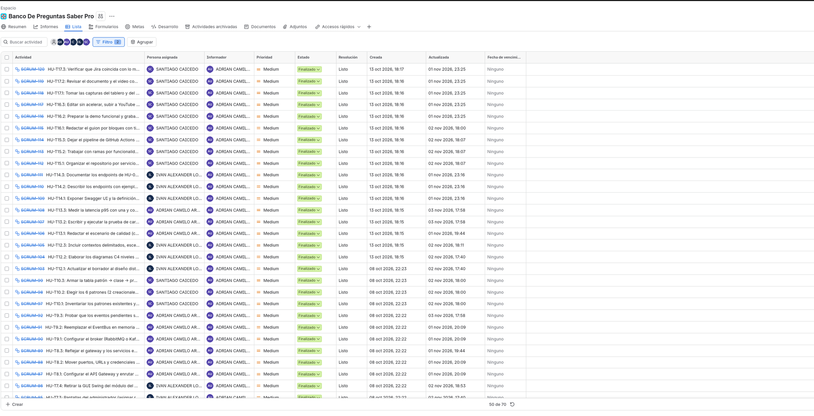
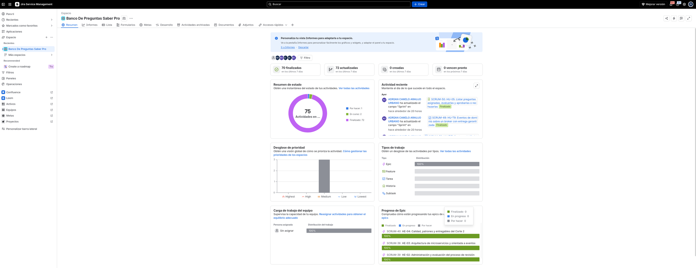
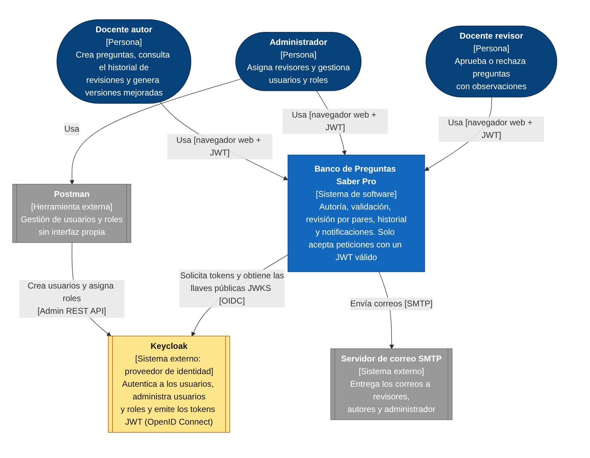
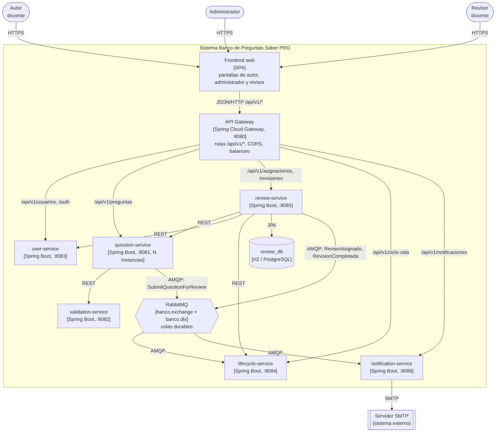
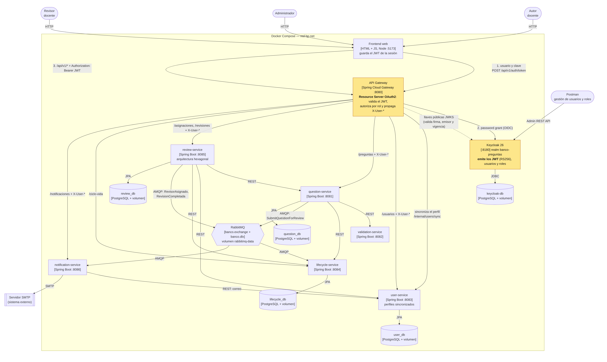
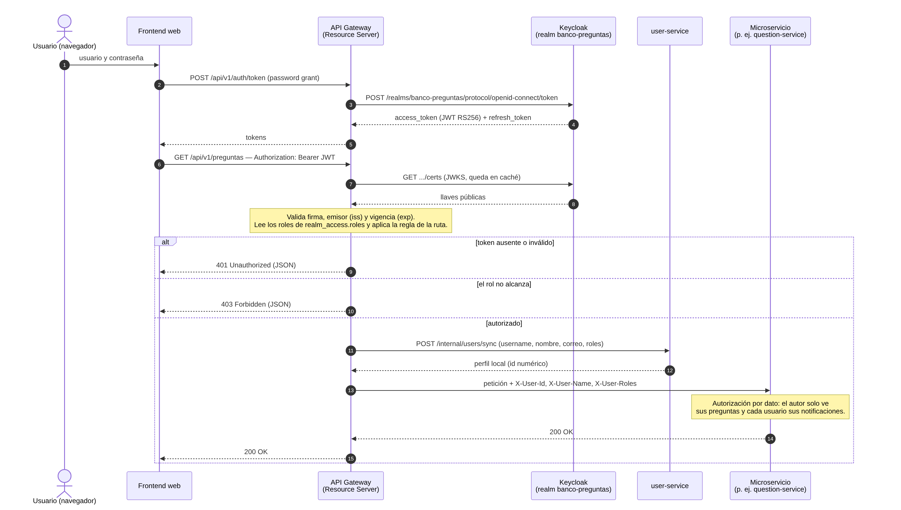
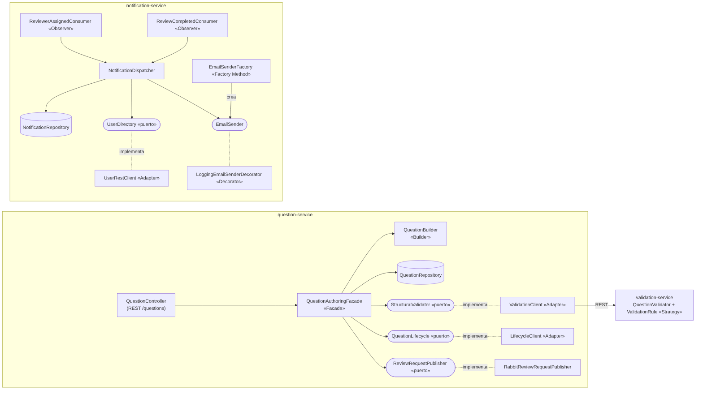
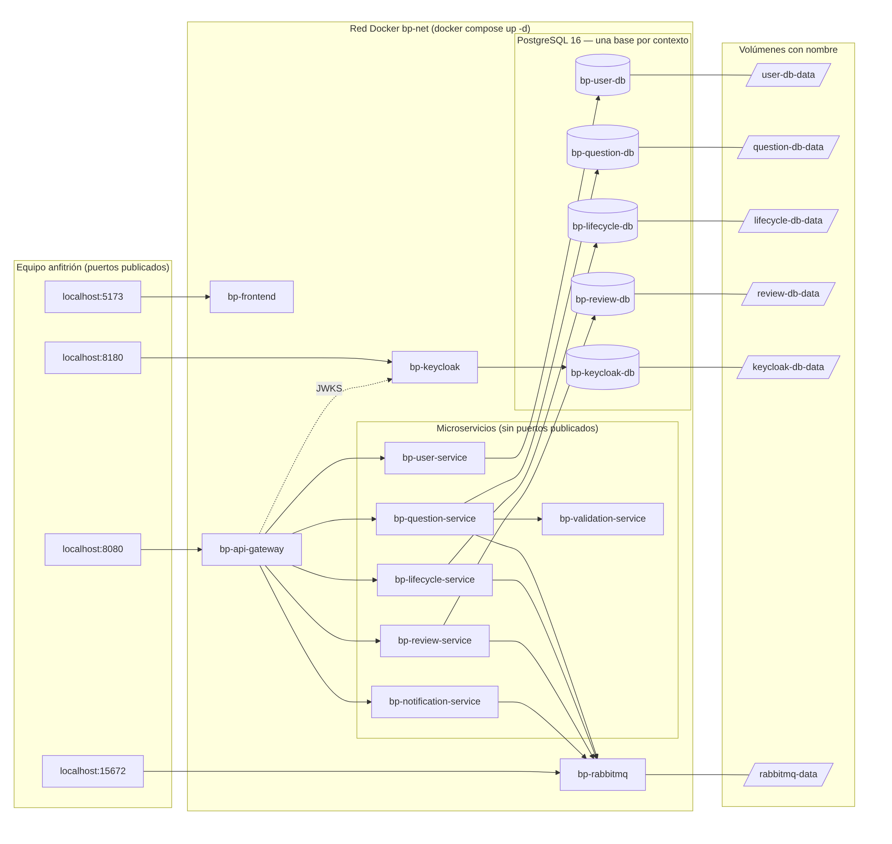

<div align="center">

# Documento de Arquitectura de Software — Banco de Preguntas Saber Pro

**Ingeniería de Software II (teoría y laboratorio)**

Tercer entregable del proyecto de curso (Corte 3): arquitectura limpia (hexagonal) en el microservicio de revisión, autenticación y autorización con JWT/Keycloak, despliegue con Docker Compose y consolidación del documento de arquitectura y del repositorio.

**Presentado por:**<br>
Yeferson Santiago Caicedo Orozco<br>
Iván Alexander López Lasso<br>
Adrián Camilo Araujo Urbano<br>
Carlos Arturo Bambague

**Profesores:**<br>
Paola Andrea Bedoya Toro<br>
Libardo Pantoja

Universidad del Cauca<br>
Facultad de Ingeniería Electrónica y Telecomunicaciones<br>
Programa de Ingeniería de Sistemas

Popayán, noviembre de 2026

</div>

> Documento final del Corte 3. Parte de la arquitectura descrita en [`DOCUMENTO_ARQUITECTURA_CORTE2.md`](DOCUMENTO_ARQUITECTURA_CORTE2.md) y añade lo construido en la tercera iteración. Las cifras y las salidas de consola son de la ejecución del 15 de noviembre de 2026. Lo que aún debe completar el equipo está en el [Anexo A](#anexo-a--pendientes-del-equipo).

---

## Contenido

- [Introducción](#introducción)
- [Capítulo 1 — Requisitos y planificación](#capítulo-1--requisitos-y-planificación)
  - [1. Historias de usuario (tres iteraciones)](#1-historias-de-usuario-tres-iteraciones)
  - [2. Planificación de los sprints](#2-planificación-de-los-sprints)
- [Capítulo 2 — Atributos de calidad](#capítulo-2--atributos-de-calidad)
  - [3. Escenario de calidad: escalabilidad](#3-escenario-de-calidad-escalabilidad)
  - [4. Escenario de calidad: modificabilidad](#4-escenario-de-calidad-modificabilidad)
- [Capítulo 3 — Arquitectura y diseño de software](#capítulo-3--arquitectura-y-diseño-de-software)
  - [5. Modelo C4 de las iteraciones 2 y 3](#5-modelo-c4-de-las-iteraciones-2-y-3)
  - [6. Diagrama de contextos delimitados](#6-diagrama-de-contextos-delimitados-bounded-contexts)
  - [7. Arquitectura limpia hexagonal en review-service (RNF #2)](#7-arquitectura-limpia-hexagonal-en-review-service-rnf-2)
  - [8. Patrones de diseño implementados](#8-patrones-de-diseño-implementados)
  - [9. API REST documentada con Swagger](#9-api-rest-documentada-con-swagger)
  - [10. Pruebas unitarias del dominio](#10-pruebas-unitarias-del-dominio)
- [Capítulo 4 — Requisitos no funcionales del Corte 3](#capítulo-4--requisitos-no-funcionales-del-corte-3)
  - [11. RNF #1 — Autenticación y autorización con JWT/Keycloak](#11-rnf-1--autenticación-y-autorización-con-jwtkeycloak)
  - [12. RNF #2 — Arquitectura limpia en un microservicio con lógica de dominio](#12-rnf-2--arquitectura-limpia-en-un-microservicio-con-lógica-de-dominio)
  - [13. RNF #3 — Despliegue con Docker Compose y volúmenes](#13-rnf-3--despliegue-con-docker-compose-y-volúmenes)
  - [14. RNF #4 — Documento de arquitectura y README](#14-rnf-4--documento-de-arquitectura-y-readme)
- [Capítulo 5 — Entrega](#capítulo-5--entrega)
- [Referencias](#referencias)
- [Anexo A — Pendientes del equipo](#anexo-a--pendientes-del-equipo)

---

## Introducción

Este documento describe la arquitectura del **Banco de Preguntas Saber Pro** en su tercera iteración. En el Corte 1 el sistema era un monolito en capas con interfaz Swing (carpeta `banco-preguntas/`); en el Corte 2 se refactorizó a una **arquitectura de microservicios orientada a eventos** (carpeta `microservicios/`), con cada contexto delimitado como un servicio Spring Boot independiente, comunicación síncrona por REST, asíncrona por **RabbitMQ**, un **API Gateway** como único punto de entrada y un **frontend web** separado que consume la **API REST** documentada con Swagger/OpenAPI 3.

El Corte 3 profundiza la calidad interna de la arquitectura con cuatro requisitos no funcionales:

1. **Autenticación y autorización con JWT y Keycloak** (gestión de usuarios y roles por Postman, sin interfaz propia). **Implementada** en el API Gateway.
2. **Arquitectura limpia (DDD y/o hexagonal) en un microservicio con lógica de dominio.** Aplicada a `review-service`. **Implementada.**
3. **Dockerización del sistema con Docker Compose**, con un volumen por base de datos. **Implementada**: 15 contenedores con un solo comando.
4. **Documento final de arquitectura (este documento) y README del repositorio.**

Además se implementó el requisito funcional nuevo del corte, la **HU-06**: el autor consulta el historial de revisiones y genera una versión mejorada de la pregunta, con notificación a los implicados.

El documento se organiza en cinco capítulos: requisitos y planificación (capítulo 1), atributos de calidad (capítulo 2), arquitectura y diseño (capítulo 3), requisitos no funcionales del corte (capítulo 4) y enlaces de entrega (capítulo 5).

---

## Capítulo 1 — Requisitos y planificación

## 1. Historias de usuario (tres iteraciones)

Las rutas son las públicas del API Gateway (`http://localhost:8080`); entre paréntesis va el microservicio que atiende la petición. Las historias HU-01 a HU-05 provienen de la segunda iteración y se conservan; la HU-06 es nueva del Corte 3.

### 1.1. HU-01 · Crear preguntas con validación estructural (autor)

**Como** autor de preguntas **necesito** crear preguntas de selección múltiple con única respuesta acordes al Diseño Centrado en Evidencia **para** alimentar el banco de preguntas Saber Pro.

```gherkin
Escenario: creación exitosa en Borrador
  Dado un autor autenticado
  Cuando envía POST /api/v1/preguntas (question-service) con contexto, pregunta directa,
       4 opciones A-D sin repetir ni comodines, respuesta correcta, justificación, bibliografía,
       competencia, tema, subtema y nivel de dificultad (BAJO, MEDIO o ALTO)
  Entonces question-service valida la pregunta llamando por REST a validation-service
  Y la guarda en estado DRAFT ("Borrador")
  Y responde 201 Created con el id asignado

Escenario: rechazo por validación estructural
  Dado que falta algún elemento o una opción dice "Todas las anteriores"
  Cuando el autor intenta guardarla
  Entonces el sistema responde 400 Bad Request con la lista de todos los errores encontrados
  Y la pregunta no se guarda
```

### 1.2. HU-02 · Enviar a revisión (autor)

**Como** autor **necesito** cambiar el estado de mis preguntas de "Borrador" a "Pendiente de revisión" **para** que el administrador les asigne al menos un revisor. *Los estados se visualizan con colores.*

```gherkin
Escenario: envío asíncrono a revisión
  Dado una pregunta del autor en DRAFT o REJECTED
  Cuando el autor envía POST /api/v1/preguntas/{id}/submit-review?requestedBy={autorId}
  Entonces question-service publica el comando SubmitQuestionForReview en RabbitMQ y responde 202 Accepted con un operationId
  Y lifecycle-service consume el comando y cambia el estado a PENDING_REVIEW ("Pendiente de revisión")
  Y GET /api/v1/preguntas/operations/{operationId} informa COMPLETED

Escenario: solo el autor puede enviarla
  Cuando otro usuario intenta enviarla a revisión
  Entonces el sistema responde 403 Forbidden
```

### 1.3. HU-03 · Listar, filtrar y editar mis preguntas (autor)

**Como** autor **necesito** listar las preguntas que he creado **para** verlas y editarlas más adelante. *Con paginación y filtros.*

```gherkin
Escenario: listado paginado con filtros
  Cuando el autor consulta GET /api/v1/preguntas?authorId=2&status=&competency=&topic=&difficulty=&keyword=&page=0&size=5
  Entonces recibe una página {content, page, size, totalElements, totalPages}
  Y cada pregunta trae status, statusLabel y statusColor

Escenario: edición no permitida
  Dado una pregunta en PENDING_REVIEW, IN_REVIEW o APPROVED
  Cuando el autor intenta editarla
  Entonces el sistema responde 409 Conflict ("solo se puede editar en Borrador o Rechazada")
```

### 1.4. HU-04 · Asignar entre 1 y 3 revisores (administrador)

**Como** administrador **necesito** asignar revisores (entre 1 y 3) a las preguntas en "Pendiente de revisión" **para** que sean revisadas por otros docentes. *Una vez asignados, el sistema envía un email.*

```gherkin
Escenario: asignación con notificación por correo
  Dado una pregunta en PENDING_REVIEW
  Cuando el administrador envía POST /api/v1/asignaciones {questionId, reviewerIds:[4,5], assignedBy:1} (review-service)
  Entonces review-service guarda las asignaciones en review_db y pide a lifecycle-service pasar la pregunta a IN_REVIEW
  Y publica un evento ReviewerAssigned por cada revisor en RabbitMQ y responde 201 Created
  Y notification-service consume cada evento y envía el correo al revisor

Escenario: reglas de la asignación
  Cuando se envían 0 o más de 3 revisores, un revisor repetido, un usuario sin rol REVISOR o el propio autor
  Entonces el sistema responde 400 Bad Request y no se envía ningún correo
```

### 1.5. HU-05 · Evaluar las preguntas asignadas (revisor)

**Como** revisor **necesito** listar las preguntas que me han sido asignadas **para** leerlas, dejar la evaluación y cambiar el estado a Aprobada/Rechazada. *El revisor puede dejar observaciones para el autor; el sistema notifica a los implicados.*

```gherkin
Escenario: evaluación con observaciones
  Cuando el revisor envía POST /api/v1/revisiones/evaluar {questionId, reviewerId, result:"APPROVED"|"REJECTED", comments}
  Entonces se registra la revisión y se publica ReviewCompleted
  Y cuando todos los revisores evaluaron, la pregunta pasa a APPROVED si todos aprobaron, o a REJECTED si alguno rechazó

Escenario: rechazo sin observaciones
  Cuando el revisor rechaza sin escribir observaciones
  Entonces el sistema responde 400 Bad Request
```

### 1.6. HU-06 · Ver el historial de revisiones y generar una versión mejorada (autor) — nueva en el corte 3

**Como** autor **necesito** consultar el historial de revisiones de mis preguntas y generar una versión mejorada a partir de las observaciones **para** corregirlas y volver a someterlas a revisión. *El sistema notifica a los implicados.*

```gherkin
Escenario: consulta del historial de revisiones
  Dado una pregunta del autor con al menos una ronda de revisión
  Cuando el autor consulta GET /api/v1/revisiones/pregunta/{questionId}/historial
  Entonces ve cada ronda con su resultado (En curso, Aprobada o Rechazada), los revisores,
    la decisión y las observaciones de cada uno
  Y si la última ronda fue rechazada ve la lista de observaciones por atender

Escenario: el historial es privado
  Cuando otro autor o un revisor que no participó consulta el historial
  Entonces el sistema responde 403 Forbidden

Escenario: nueva versión mejorada
  Dado una pregunta en estado REJECTED con observaciones
  Cuando el autor la edita (PUT /api/v1/preguntas/{id})
  Entonces la pregunta pasa a la versión siguiente (version + 1) y vuelve al estado DRAFT

Escenario: no se puede reenviar sin corregir
  Dado una pregunta en estado REJECTED que no ha sido editada
  Cuando el autor intenta enviarla a revisión
  Entonces el sistema responde 409 Conflict y pide crear la versión mejorada

Escenario: nueva ronda con notificación a los implicados
  Dado una versión mejorada en DRAFT
  Cuando el autor la envía a revisión y el administrador asigna revisores
  Entonces se abre la ronda siguiente (round + 1)
  Y se notifica al autor, al administrador y a los revisores indicando la versión y la ronda
```

**Cómo se implementó.** En `review-service` el dominio agrupa asignaciones y evaluaciones en `ReviewRound` y `ReviewHistory` (objetos de valor), que deciden el resultado de cada ronda y si se permite una versión mejorada. En `question-service` la entidad `Question` lleva el número de `version`; `QuestionAuthoringFacade.update` abre la versión siguiente cuando la pregunta está rechazada y `submitForReview` rechaza el reenvío sin cambios. En el frontend el autor tiene el botón **Historial** (rondas y observaciones) y **Crear versión mejorada**.

## 2. Planificación de los sprints

El proyecto se gestiona en **Jira** (proyecto SCRUM). El trabajo se organizó en tres iteraciones/sprints:

| Iteración | Alcance | Estado de la evidencia |
|---|---|---|
| Sprint 1 | Monolito en capas (Corte 1) y su línea base de historias HU-01 a HU-04 | Captura por agregar (ver Anexo A) |
| Sprint 2 | Refactorización a microservicios orientados a eventos, HU-04 y HU-05, documentación y pruebas | Capturas disponibles (Ilustraciones 1 y 2) |
| Sprint 3 | HU-06 y los cuatro requisitos no funcionales del Corte 3 | Tabla 2 (trabajo realizado y Pull Requests); captura de Jira por agregar (ver Anexo A) |

*Tabla 1. Historias del Sprint 2 en Jira. Elaboración propia (fuente: Corte 2).*

| Clave | Historia | Responsable | Estado |
|---|---|---|---|
| SCRUM-41 | HU-T1: Bounded contexts y diseño de la arquitectura distribuida | Adrián Camilo Araujo Urbano | Finalizado |
| SCRUM-42 | HU-T2: Infraestructura con Docker, bases de datos independientes y broker de eventos | Carlos Arturo Bambague | Finalizado |
| SCRUM-43 | HU-T3: Refactorizar HU-01, HU-02 y HU-03 a un microservicio de preguntas | Yeferson Santiago Caicedo Orozco | Finalizado |
| SCRUM-44 | HU-T4: Microservicio de usuarios y roles | Iván Alexander López Lasso | Finalizado |
| SCRUM-45 | HU-T5: Microservicio de revisión (asignaciones y evaluaciones) | Adrián Camilo Araujo Urbano | Finalizado |
| SCRUM-46 | HU-T6: Microservicio de notificaciones orientado a eventos | Carlos Arturo Bambague | Finalizado |
| SCRUM-47 | HU-T7: Frontend web independiente que consume la API REST | Iván Alexander López Lasso | Finalizado |
| SCRUM-48 | HU-T8: API Gateway y configuración centralizada | Adrián Camilo Araujo Urbano | Finalizado |
| SCRUM-49 | HU-T9: Eventos de dominio con entrega garantizada | Adrián Camilo Araujo Urbano | Finalizado |
| SCRUM-50 | HU-05: Listar preguntas asignadas, evaluarlas y aprobarlas o rechazarlas | Adrián Camilo Araujo Urbano | Finalizado |
| SCRUM-51 | HU-04 (refactor): Asignar de 1 a 3 revisores | Carlos Arturo Bambague | Finalizado |
| SCRUM-52 | HU-T10: Al menos 6 patrones GoF | Yeferson Santiago Caicedo Orozco | Finalizado |
| SCRUM-53 | HU-T11: Pruebas unitarias de las clases del dominio | Carlos Arturo Bambague | Finalizado |
| SCRUM-54 | HU-T12: Documento de arquitectura | Iván Alexander López Lasso | Finalizado |
| SCRUM-55 | HU-T13: Escenario de escalabilidad y pruebas de carga | Adrián Camilo Araujo Urbano | Finalizado |
| SCRUM-56 | HU-T14: Documentación Swagger/OpenAPI | Iván Alexander López Lasso | Finalizado |
| SCRUM-57 | HU-T15: Repositorio Git con commits de todos, ramas y CI | Yeferson Santiago Caicedo Orozco | Finalizado |
| SCRUM-58 | HU-T16: Guion y grabación del video de sustentación | Yeferson Santiago Caicedo Orozco | Finalizado |
| SCRUM-59 | HU-T17: Capturas del Sprint 2 y revisión final contra la rúbrica | Yeferson Santiago Caicedo Orozco | Finalizado |

### 2.1. Evidencia del Sprint 2 (Jira)



*Ilustración 1. Actividades del Sprint 2 en Jira (vista Lista).*



*Ilustración 2. Resumen del espacio en Jira: estado de las actividades y progreso de las épicas.*

### 2.2. Trabajo del Sprint 3

*Tabla 2. Historias del Sprint 3 y Pull Request con el que entró cada una a `main`. Elaboración propia.*

| Historia | Alcance | Pull Request |
|---|---|---|
| RNF #2 · Arquitectura hexagonal en review-service | Capas dominio, aplicación, infraestructura y presentación; puertos y adaptadores; prueba de arquitectura | [#14](https://github.com/santyxswc/Banco_preguntas-ISoftII/pull/14) |
| HU-06 · Historial de revisiones y versión mejorada | Rondas en el dominio, endpoint de historial, versión de la pregunta, notificaciones y pantallas del autor | [#15](https://github.com/santyxswc/Banco_preguntas-ISoftII/pull/15) |
| RNF #1 · JWT con Keycloak | Realm, gateway como Resource Server, propagación de identidad, autorización por rol y por dato, colección de Postman | [#16](https://github.com/santyxswc/Banco_preguntas-ISoftII/pull/16) |
| RNF #3 · Docker Compose | Dockerfile multi-etapa, 15 contenedores, PostgreSQL por contexto con volúmenes, persistencia del ciclo de vida | [#17](https://github.com/santyxswc/Banco_preguntas-ISoftII/pull/17) |
| RNF #4 · Documento y README | Este documento, diagramas C4 de la iteración 3 y README del repositorio | Este Pull Request |

> Las capturas del tablero de Jira de los Sprints 1 y 3 las debe tomar el equipo desde https://ingsoft2bancodepreguntas.atlassian.net y guardarlas como `arquitectura/diagramas/sprint1-jira-*.png` y `sprint3-jira-*.png` (Anexo A).

---

## Capítulo 2 — Atributos de calidad

## 3. Escenario de calidad: escalabilidad

**Contexto.** Durante la convocatoria Saber Pro muchos docentes crean y revisan preguntas al mismo tiempo. La arquitectura debe crecer agregando instancias de los servicios más cargados, sin cambiar el código. La Tabla 3 especifica el escenario.

*Tabla 3. Escenario de calidad de escalabilidad. Elaboración propia.*

| Elemento | Especificación |
|---|---|
| **Atributo** | Escalabilidad (ISO/IEC 25010, capacidad) |
| **Fuente del estímulo** | Docentes autores y revisores durante la convocatoria Saber Pro |
| **Estímulo** | 500 usuarios concurrentes, cada uno con una petición por segundo: 90 % crean preguntas y 10 % consultan sus preguntas asignadas |
| **Artefacto** | API Gateway, question-service (con validation-service) y review-service |
| **Entorno** | Operación normal; primero con 1 instancia de question-service y luego con 2 instancias detrás del gateway (perfil `escalado`) |
| **Respuesta** | El gateway reparte la carga entre las instancias. Las operaciones lentas (cambio de estado, correos) se hacen por RabbitMQ y no retienen la petición REST |
| **Medición de calidad** | Latencia p95 y tasa de errores medidas con k6 durante 2 minutos de carga sostenida |
| **Resultado esperado** | p95 < 500 ms y errores < 1 % con 500 usuarios; al pasar de 1 a 2 instancias la p95 se mantiene o baja sin cambiar código, solo configuración |

Resultado de la medición (4 de noviembre de 2026, k6 0.54.0, perfil `escalado`):

*Tabla 4. Resultados de la prueba de carga con k6. Elaboración propia (fuente: Corte 2).*

| Métrica | 1 instancia | 2 instancias |
|---|---|---|
| Peticiones totales | 71 287 | 71 278 |
| Peticiones por segundo | 429,9 | 429,8 |
| Tasa de errores | 0,0 % | 0,0 % |
| Latencia p95 | 3,9 ms | 3,8 ms |
| Latencia p99 | 5,8 ms | 5,9 ms |
| Cumple p95 < 500 ms y errores < 1 % | Sí | Sí |

El detalle y las limitaciones están en [`arquitectura/04-escenario-escalabilidad.md`](arquitectura/04-escenario-escalabilidad.md).

## 4. Escenario de calidad: modificabilidad

**Contexto.** El sistema debe admitir cambios frecuentes en las reglas de negocio sin reescribir la arquitectura: nuevas reglas de validación estructural, otra política de veredicto de revisión o un cambio del proveedor de identidad. La arquitectura debe aislar el núcleo de dominio y usar puntos de extensión (patrón Strategy) para que estos cambios se localicen.

*Tabla 5. Escenario de calidad de modificabilidad. Elaboración propia.*

| Elemento | Especificación |
|---|---|
| **Atributo** | Modificabilidad (ISO/IEC 25010, mantenibilidad) |
| **Fuente del estímulo** | Equipo de desarrollo |
| **Estímulo** | (a) agregar una regla de validación estructural nueva; (b) cambiar la política de veredicto de "unánime" a "mayoría"; (c) cambiar el proveedor de identidad |
| **Artefacto** | `validation-service` (`ValidationRule`), `review-service` (`VerdictPolicy`), capa de seguridad del `api-gateway` |
| **Entorno** | Desarrollo, con la suite de pruebas disponible |
| **Respuesta** | El cambio se realiza implementando una clase nueva que cumple la interfaz (puerto/estrategia), sin modificar las clases existentes |
| **Medición de calidad** | Número de clases existentes modificadas y de clases nuevas; la suite de pruebas y el test de arquitectura siguen pasando |
| **Resultado esperado** | (a) y (b): **1 clase nueva, 0 clases existentes modificadas** (principio abierto/cerrado). (c): el cambio se confina a la configuración y a los adaptadores de seguridad |

Evidencia de diseño (real, verificable en el código):

- `validation-service`: cada regla DCE es una implementación de `ValidationRule` (`StatementRule`, `OptionsRule`, `CorrectAnswerRule`, `EvidenceRule`, `TaxonomyRule`) que `QuestionValidator` recibe inyectadas. Añadir una regla es crear una clase.
- `review-service`: la decisión final se delega en `VerdictPolicy` (implementada por `UnanimousApprovalPolicy`). Cambiar a "mayoría" es crear otra implementación y configurarla, sin tocar el caso de uso.
- La prueba [`ArquitecturaHexagonalTest`](microservicios/review-service/src/test/java/co/unicauca/iso2/taller09/reviewservice/ArquitecturaHexagonalTest.java) protege estos puntos de extensión: falla si el dominio vuelve a depender de frameworks o de capas externas.

**Medición del caso (c), cambio del proveedor de identidad.** En este corte el cambio ocurrió de verdad: se pasó del token propio del Corte 2 (HMAC emitido por `user-service`) a JWT de Keycloak. La medición sale del commit `63e62e5` (Pull Request #16, 15 de noviembre de 2026):

*Tabla 6. Clases de producción tocadas por el cambio de proveedor de identidad. Elaboración propia (fuente: `git diff --name-status`).*

| Módulo | Nuevas | Eliminadas | Modificadas | Comentario |
|---|---|---|---|---|
| api-gateway | 5 | 1 | 1 | Toda la validación del token vive en el paquete `security` |
| user-service | 2 | 3 | 5 | Sale el login propio y la contraseña; entra la sincronización del perfil |
| shared-contracts | 1 | 4 | 0 | Sale el códec del token propio |
| question-service | 0 | 0 | 1 | Solo el controlador (autorización por dato) |
| notification-service | 0 | 0 | 1 | Solo el controlador (autorización por dato) |
| review-service, lifecycle-service, validation-service | 0 | 0 | 0 | **Sin cambios** |

Resultado: el dominio y los casos de uso de los seis microservicios de negocio no cambiaron; el cambio quedó en el gateway, en el servicio de identidad y en dos controladores. Las 160 pruebas siguen en verde.

Para los casos (a) y (b) la evidencia es de diseño: agregar una regla o una política es crear una clase que implementa `ValidationRule` o `VerdictPolicy`; no se midió con un cambio real en este corte.

---

## Capítulo 3 — Arquitectura y diseño de software

## 5. Modelo C4 de las iteraciones 2 y 3

Se presentan los diagramas de las dos iteraciones distribuidas. La diferencia principal es la seguridad: en la iteración 2 el sistema emitía su propio token; en la iteración 3 **Keycloak** autentica a los usuarios y emite los **JWT**, y el gateway los valida.

### 5.1. C4 nivel 1 — Contexto del sistema


*Ilustración 3. C4 nivel 1: contexto del sistema (iteración 2).*



*Ilustración 4. C4 nivel 1: contexto del sistema (iteración 3). Keycloak aparece como sistema externo de identidad y Postman como la herramienta con la que se gestionan usuarios y roles.*

### 5.2. C4 nivel 2 — Contenedores



*Ilustración 5. C4 nivel 2: contenedores (iteración 2).*



*Ilustración 6. C4 nivel 2: contenedores (iteración 3). En amarillo, los dos contenedores que resuelven la seguridad: Keycloak emite el JWT y el API Gateway lo valida, autoriza por rol y propaga la identidad. Cada base de datos tiene su volumen.*



*Ilustración 7. Flujo de autenticación y autorización con JWT (iteración 3).*

*Tabla 7. Contenedores del sistema en la iteración 3. Elaboración propia.*

| Contenedor | Tecnología | Responsabilidad |
|---|---|---|
| Frontend web | HTML5, CSS, JavaScript sin framework; servidor estático Node | Pantallas de autor, administrador y revisor. Solo conoce la URL del gateway y guarda el JWT de la sesión |
| API Gateway | Spring Cloud Gateway 2023.0 + Spring Security (OAuth2 Resource Server) | Único punto de entrada: **valida el JWT**, autoriza por rol, propaga la identidad, enruta, CORS y Swagger unificado |
| **Keycloak** | Keycloak 26.8 + PostgreSQL | **Proveedor de identidad**: autentica, administra usuarios y roles y emite los JWT (RS256) |
| question-service | Spring Boot 3.3 + Spring Data JPA + Flyway | Autoría: crear, editar, listar, versionar y enviar a revisión |
| validation-service | Spring Boot 3.3 | Reglas estructurales DCE (sin estado) |
| lifecycle-service | Spring Boot 3.3 + Spring Data JPA + Flyway | Autoridad única del estado y de las transiciones |
| review-service | Spring Boot 3.3 + Spring Data JPA | Asignaciones, evaluaciones e historial por rondas (HU-04, HU-05, HU-06). **Arquitectura hexagonal** |
| notification-service | Spring Boot 3.3 + Spring Mail | Consume eventos y envía correos |
| user-service | Spring Boot 3.3 + Spring Data JPA + Flyway | Perfiles y roles sincronizados con Keycloak; revisores elegibles |
| RabbitMQ | RabbitMQ 3.13 | Comandos y eventos de dominio con DLQ |
| PostgreSQL (×5) | PostgreSQL 16 | `user_db`, `question_db`, `lifecycle_db`, `review_db` y la base de Keycloak, cada una con su volumen |

### 5.3. C4 nivel 3 — Componentes de review-service

En **review-service** (organizado en dominio, aplicación, infraestructura y presentación) la decisión final se delega en `VerdictPolicy` (Strategy, implementada por `UnanimousApprovalPolicy`) y la persistencia en `JpaReviewRepositoryAdapter` (Adapter entre el puerto `ReviewRepository` y Spring Data JPA). El detalle está en la [sección 7](#7-arquitectura-limpia-hexagonal-en-review-service-rnf-2).



*Ilustración 8. C4 nivel 3: componentes de review-service (iteraciones 2 y 3; la organización en capas se detalla en la Ilustración 10).*

## 6. Diagrama de contextos delimitados (bounded contexts)


*Ilustración 9. Diagrama de contextos delimitados.*

*Tabla 8. Contextos delimitados y almacenamiento. Elaboración propia.*

| Contexto | Microservicio | Almacenamiento | Se integra con |
|---|---|---|---|
| Identidad y acceso | user-service + Keycloak | user_db (perfiles) y base de Keycloak (credenciales y roles) | Keycloak emite el JWT que el gateway valida |
| Autoría de preguntas | question-service | question_db (JPA + Flyway: H2 / PostgreSQL) | Validación (REST), Ciclo de vida (REST + comando AMQP) |
| Validación estructural | validation-service | Sin estado | — |
| Ciclo de vida | lifecycle-service | lifecycle_db (JPA + Flyway: H2 / PostgreSQL) | Recibe comandos por RabbitMQ |
| Revisión por pares | review-service | review_db (JPA: H2 / PostgreSQL) | Autoría, Identidad y Ciclo de vida (REST); publica eventos |
| Notificaciones | notification-service | notification_db (en memoria) | Consume eventos; Identidad (REST) |
| Simulacros y Analítica | — | — | Identificados en el enunciado, no implementados |

Regla común: ningún servicio lee la base de datos de otro. Detalle en [`arquitectura/01-bounded-contexts.md`](arquitectura/01-bounded-contexts.md) y contratos en [`arquitectura/02-contratos.md`](arquitectura/02-contratos.md).

## 7. Arquitectura limpia hexagonal en review-service (RNF #2)

> Sección completa en [`arquitectura/07-arquitectura-hexagonal.md`](arquitectura/07-arquitectura-hexagonal.md). Aquí se resume.

Se aplica arquitectura limpia hexagonal a **`review-service`** porque es el microservicio con reglas de negocio propias: asignación de 1 a 3 revisores, restricciones de autor/revisor, veredicto de la revisión por pares y ciclo de rondas. Las reglas viven en el **núcleo del dominio**, aislado de frameworks.


*Ilustración 10. Arquitectura hexagonal de review-service. Elaboración propia.*

**Regla de dependencia:** siempre hacia adentro (`infrastructure` → `application` → `domain`; `presentation` → `application`). El dominio no conoce Spring, JPA, Jackson ni RabbitMQ, y no importa las capas externas.

*Tabla 9. Puertos y adaptadores de review-service. Elaboración propia.*

| Puerto (dominio) | Propósito | Adaptador (infraestructura) | Tecnología / destino |
|---|---|---|---|
| `ReviewRepository` | Persistir asignaciones y revisiones, paginar las asignadas | `JpaReviewRepositoryAdapter` | Spring Data JPA · H2 / PostgreSQL |
| `QuestionCatalog` | Leer los datos de la pregunta | `QuestionRestClient` | REST → `question-service` |
| `ReviewerDirectory` | Leer perfil y roles del revisor | `UserRestClient` | REST → `user-service` |
| `QuestionLifecycle` | Consultar el estado y ejecutar transiciones | `LifecycleRestClient` | REST → `lifecycle-service` |
| `ReviewEventPublisher` | Publicar `ReviewerAssigned` y `ReviewCompleted` | `RabbitReviewEventPublisher` | RabbitMQ |

*Tabla 10. Lógica de dominio encapsulada en review-service. Elaboración propia.*

| Elemento | Tipo | Regla / invariante que protege |
|---|---|---|
| `Review` | Entidad | La decisión es obligatoria y un rechazo exige al menos una observación |
| `ReviewAssignment` | Entidad | La ronda debe ser ≥ 1 y una asignación solo se completa una vez |
| `ReviewerSelection` | Objeto de Valor | Entre 1 y 3 revisores, sin repetidos; descarta identidades nulas |
| `ReviewerProfile` | Objeto de Valor | Solo los roles REVISOR o DOCENTE pueden revisar |
| `UnanimousApprovalPolicy` | Política (Strategy) | La pregunta se aprueba solo si todos los revisores aprueban |
| `PageResult` | Objeto de Valor | Cálculo del total de páginas de la paginación |
| `ReviewRound` | Objeto de Valor (HU-06) | Resultado de una ronda: en curso mientras falten evaluaciones; luego lo decide la política de veredicto |
| `ReviewHistory` | Objeto de Valor (HU-06) | Solo se permite una versión mejorada si la última ronda terminó rechazada; reúne las observaciones por atender |

La pureza del núcleo y la dirección de las dependencias se comprueban con `ArquitecturaHexagonalTest`, que falla si (1) el dominio importa Spring/JPA/Hibernate/Lombok/Jackson, (2) el dominio importa `application`/`infrastructure`/`presentation`, o (3) la aplicación importa `infrastructure`/`presentation`.

## 8. Patrones de diseño implementados

Además de los seis patrones GoF exigidos (2 creacionales, 2 estructurales, 2 de comportamiento), se documenta el patrón estructural **Adapter** como base de la arquitectura de puertos y adaptadores.

*Tabla 11. Patrones de diseño implementados. Elaboración propia.*

| # | Patrón | Tipo | Dónde | Cómo y para qué se aplicó |
|---|---|---|---|---|
| 1 | **Builder** | Creacional | `question-service` · `domain/QuestionBuilder` | Arma paso a paso una pregunta DCE desde la solicitud REST, normalizando textos y garantizando autor y enunciado. |
| 2 | **Factory Method** | Creacional | `notification-service` · `email/EmailSenderFactory` | El creador abstracto define `sender()` y delega en `createSender()`. Se cambia entre correo simulado y SMTP con la propiedad `notifications.email.mode`. |
| 3 | **Facade** | Estructural | `question-service` · `application/QuestionAuthoringFacade` | Oculta la coordinación de validation-service, lifecycle-service, el repositorio y RabbitMQ detrás de una interfaz simple para el controlador. |
| 4 | **Decorator** | Estructural | `notification-service` · `email/LoggingEmailSenderDecorator` | Añade trazabilidad a cualquier `EmailSender` sin modificar las clases que envían. |
| 5 | **Adapter** | Estructural | `JpaReviewRepositoryAdapter`, `QuestionRestClient`, `UserRestClient`, `LifecycleRestClient` (review-service); `JpaLifecycleRepository` (lifecycle-service); `UserServiceIdentityResolver` y `KeycloakJwtAuthenticationConverter` (api-gateway) | Adaptan Spring Data JPA, las API REST de otros servicios y el JWT de Keycloak a las interfaces que espera el resto del código, de modo que el dominio no dependa de HTTP, de JPA ni del proveedor de identidad. |
| 6 | **Strategy** | Comportamiento | `validation-service` · `ValidationRule`; `review-service` · `VerdictPolicy` | Cada regla estructural y cada política de veredicto es una estrategia sustituible (abierto/cerrado). |
| 7 | **Observer** | Comportamiento | RabbitMQ: consumidores de eventos en `notification-service` y `lifecycle-service` | Los productores publican eventos sin conocer a sus suscriptores; cada consumidor reacciona (correos, cambio de estado). |

El monolito del Corte 1 (`banco-preguntas/`) conserva sus propios patrones (Builder, Factory Method, Singleton, Facade, Decorator, Strategy, Observer y State).

## 9. API REST documentada con Swagger

- **Swagger UI unificado (gateway):** http://localhost:8080/swagger-ui.html
- Swagger individual: `http://localhost:{8081..8086}/swagger-ui.html` (con Maven o con `docker-compose.debug.yml`).

Todas las rutas, salvo las de autenticación, exigen `Authorization: Bearer <JWT>`. La identidad sale del token: ya no se envía en parámetros.

*Tabla 12. Endpoints públicos de la API REST. Elaboración propia.*

| Módulo | Método | Ruta pública | HU |
|---|---|---|---|
| Autenticación | POST | `/api/v1/auth/token` (token y renovación) y `/api/v1/auth/logout` | RNF #1 |
| Usuarios | GET | `/api/v1/usuarios/me` | RNF #1 |
| Preguntas | POST | `/api/v1/preguntas` | HU-01 |
| Preguntas | PUT | `/api/v1/preguntas/{id}` | HU-03, HU-06 (versión mejorada) |
| Preguntas | GET | `/api/v1/preguntas?status&competency&topic&difficulty&keyword&page&size` | HU-03 |
| Preguntas | POST | `/api/v1/preguntas/{id}/submit-review` | HU-02, HU-06 |
| Preguntas | GET | `/api/v1/preguntas/operations/{operationId}` | HU-02 |
| Usuarios | GET | `/api/v1/usuarios/reviewers/eligible?authorId=` | HU-04 |
| Asignaciones | POST / GET | `/api/v1/asignaciones` | HU-04 |
| Revisiones | GET | `/api/v1/revisiones/asignadas?page&size` | HU-05 |
| Revisiones | POST | `/api/v1/revisiones/evaluar` | HU-05 |
| Revisiones | GET | `/api/v1/revisiones/pregunta/{questionId}/historial` | **HU-06** |
| Ciclo de vida | GET | `/api/v1/ciclo-vida/{id}` y `/api/v1/ciclo-vida?ids=` | HU-02 |
| Notificaciones | GET | `/api/v1/notificaciones/recipient/{id}` | HU-04, HU-05, HU-06 |

## 10. Pruebas unitarias del dominio

Se ejecutan con `mvn test` (JUnit 5, Java 21) y en GitHub Actions en cada push y en cada Pull Request. La rúbrica del Corte 3 otorga peso propio a las **pruebas unitarias de las clases del dominio**.

*Tabla 13. Pruebas unitarias del dominio y de la arquitectura. Elaboración propia.*

| Módulo | Clases de prueba | Qué cubren |
|---|---|---|
| review-service (dominio) | `ReviewDomainTest`, `ReviewHistoryTest` | Invariantes de `Review`, `ReviewAssignment`, `ReviewerSelection`, `ReviewerProfile`, `UnanimousApprovalPolicy`, `PageResult`, `ReviewRound` y `ReviewHistory` |
| review-service (arquitectura) | `ArquitecturaHexagonalTest` | Pureza del dominio y dirección de las dependencias |
| review-service (aplicación) | `ReviewServiceTest` | Casos de uso de asignación, evaluación e historial con dobles de prueba |
| review-service (adaptadores) | `JpaReviewRepositoryAdapterTest`, `RevisionControllerTest` | Persistencia y entrada REST |
| question-service | `QuestionBuilderTest`, `QuestionAuthoringFacadeTest`, `JpaQuestionRepositoryTest`, `RequestIdentityTest` | `Question` (incluida la versión mejorada), Builder, Facade, persistencia y autorización por dato |
| validation-service | `QuestionValidatorTest`, `ValidationControllerTest` | Cada regla estructural DCE |
| lifecycle-service | `QuestionSubmittedEventTest`, `QuestionSubmitConsumerTest`, `LifecycleControllerTest`, `JpaLifecycleRepositoryTest` | Transiciones de `QuestionState`, `OperationResult` y su persistencia |
| user-service | `UserDomainTest`, `UserControllerTest`, `JpaUserRepositoryTest` | `User` sin contraseña, sincronización con Keycloak y roles |
| notification-service | `EmailNotificationTest`, `NotificationIdempotencyTest`, `NotificationServiceConsumerTest`, `QuestionSubmittedConsumerTest`, `NotificationControllerTest` | Factory Method, Decorator, idempotencia y avisos de la HU-06 |
| api-gateway | `GatewaySecurityTest`, `KeycloakIdentityTest`, `IdentityPropagationFilterTest`, `GatewayRoutesTest` | Reglas 401/403, lectura del JWT, propagación de identidad y rutas |

Cifras de la suite (15 de noviembre de 2026, `mvn -f microservicios/pom.xml test`): **160 pruebas, 0 fallos, 0 errores**. En el Corte 2 eran 114.

*Tabla 14. Pruebas por módulo (ejecución del 15 de noviembre de 2026). Elaboración propia.*

| Módulo | Pruebas | Módulo | Pruebas |
|---|---|---|---|
| user-service | 14 | notification-service | 17 |
| question-service | 28 | api-gateway | 19 |
| validation-service | 11 | shared-contracts | 0 (sus clases se prueban desde los servicios) |
| lifecycle-service | 11 | **Total** | **160** |
| review-service | 60 | | |

El flujo de GitHub Actions ([`pruebas.yml`](.github/workflows/pruebas.yml)) tiene cinco trabajos: monolito, dominio DDD, microservicios, frontend y **Docker Compose** (valida el `docker-compose.yml` y construye las imágenes). Los Pull Requests #15, #16 y #17 entraron a `main` con todos los trabajos en verde: https://github.com/santyxswc/Banco_preguntas-ISoftII/actions/workflows/pruebas.yml

---

## Capítulo 4 — Requisitos no funcionales del Corte 3

## 11. RNF #1 — Autenticación y autorización con JWT/Keycloak

**Requisito.** Implementar autenticación y autorización con **JWT** usando **Keycloak**; la gestión de usuarios y roles se hará por **Postman** (sin interfaz propia).

**Estado: implementado.** Detalle completo en [`arquitectura/08-seguridad-keycloak-jwt.md`](arquitectura/08-seguridad-keycloak-jwt.md).

- **Keycloak 26** corre en Docker Compose con su propia base de datos y volumen. Al arrancar importa el realm `banco-preguntas`: roles `ADMINISTRADOR`, `AUTOR`, `REVISOR`, `DOCENTE` y `ESTUDIANTE`, el cliente `banco-preguntas-frontend` y los usuarios de prueba.
- **El API Gateway es el Resource Server OAuth2.** Valida la firma (JWKS), el emisor y la vigencia de cada JWT y aplica las reglas por rol antes de enrutar. Sin token responde 401; sin el rol necesario, 403.
- **Propagación de identidad.** El gateway sincroniza el perfil con `user-service` y agrega `X-User-Id`, `X-User-Name` y `X-User-Roles`. Las cabeceras que envíe el cliente se descartan.
- **Ningún microservicio guarda contraseñas.** `user-service` eliminó la columna de la contraseña (migración `V3`) y su login propio.
- **Autorización por dato.** El autor solo lista sus preguntas, cada usuario solo lee sus notificaciones y el historial de una pregunta solo lo ven su autor, los revisores que participaron y el administrador.

*Tabla 15. Reglas de autorización por rol en el gateway. Elaboración propia.*

| Ruta | Método | Rol exigido |
|---|---|---|
| `/api/v1/auth/**`, Swagger | — | Público |
| `/api/v1/preguntas`, `/api/v1/preguntas/{id}`, `/submit-review` | POST, PUT | AUTOR |
| `/api/v1/asignaciones/**` | Todos | ADMINISTRADOR |
| `/api/v1/usuarios/**` (salvo `/me`) | Todos | ADMINISTRADOR |
| `/api/v1/revisiones/asignadas`, `/api/v1/revisiones/evaluar` | GET, POST | REVISOR |
| Las demás rutas | Todos | Cualquier usuario autenticado |

**Gestión de usuarios y roles por Postman.** La colección [`banco-preguntas-corte3.postman_collection.json`](microservicios/banco-preguntas-corte3.postman_collection.json) usa la API de administración de Keycloak: obtener el token del administrador, crear un usuario, asignarle un rol, cambiarle la contraseña y quitarle el rol. También trae los casos 401 y 403 y el flujo HU-01 a HU-06.

*Tabla 16. Resultados de las peticiones de seguridad (15 de noviembre de 2026, contra los contenedores). Elaboración propia.*

| Caso | Respuesta |
|---|---|
| `POST /admin/realms/banco-preguntas/users` (crear `revisor3`) | 201 Created |
| `POST .../users/{id}/role-mappings/realm` (asignar REVISOR) | 204 No Content |
| `revisor3` inicia sesión y consulta `/api/v1/usuarios/me` | 200, perfil creado con el rol REVISOR |
| Petición sin token o con el token alterado | 401 |
| Un revisor crea una pregunta · un autor asigna revisores · un estudiante lista usuarios | 403 |
| Un autor lee las notificaciones de otro usuario | 403 |
| Credenciales incorrectas | 400 `invalid_grant` |

> Las capturas de pantalla de Postman las toma el equipo al ejecutar la colección (Anexo A).

## 12. RNF #2 — Arquitectura limpia en un microservicio con lógica de dominio

**Requisito.** Implementar arquitectura limpia (DDD y/o hexagonal) en un microservicio que lo amerite.

**Estado: implementado** en `review-service` (ver [sección 7](#7-arquitectura-limpia-hexagonal-en-review-service-rnf-2) y [`arquitectura/07-arquitectura-hexagonal.md`](arquitectura/07-arquitectura-hexagonal.md)).

## 13. RNF #3 — Despliegue con Docker Compose y volúmenes

**Requisito.** Dockerizar el sistema y orquestarlo con Docker Compose, usando **volúmenes** para la persistencia.

**Estado: implementado.** Detalle completo en [`arquitectura/09-docker-compose.md`](arquitectura/09-docker-compose.md).

`docker compose up -d --build` en `microservicios/` levanta **15 contenedores**: el frontend, el API Gateway, seis microservicios, RabbitMQ, Keycloak y cinco bases de datos PostgreSQL.



*Ilustración 11. Despliegue con Docker Compose: puertos publicados, red interna y volúmenes.*

- **Un Dockerfile multi-etapa** ([`microservicios/Dockerfile`](microservicios/Dockerfile)) construye los siete servicios: compila con Maven y JDK 21 y ejecuta con JRE 21 Alpine y un usuario sin privilegios.
- **Una base de datos por contexto**, cada una con su **volumen con nombre**.
- Solo se publican el frontend (5173), el gateway (8080), Keycloak (8180) y RabbitMQ (5672 y 15672). Los microservicios y las bases de datos solo son alcanzables dentro de la red `bp-net`.
- Healthchecks y `depends_on` ordenan el arranque.

*Tabla 17. Volúmenes de Docker Compose. Elaboración propia.*

| Volumen | Contenedor | Qué guarda |
|---|---|---|
| `banco-preguntas_user-db-data` | `bp-user-db` | Perfiles y roles |
| `banco-preguntas_question-db-data` | `bp-question-db` | Preguntas, opciones y versiones |
| `banco-preguntas_lifecycle-db-data` | `bp-lifecycle-db` | Estado de cada pregunta y operaciones asíncronas |
| `banco-preguntas_review-db-data` | `bp-review-db` | Asignaciones, rondas y evaluaciones |
| `banco-preguntas_keycloak-db-data` | `bp-keycloak-db` | Realm, usuarios, credenciales y roles |
| `banco-preguntas_rabbitmq-data` | `bp-rabbitmq` | Colas durables y mensajes pendientes |

**Evidencia** (salida real del 15 de noviembre de 2026; en el equipo de prueba el puerto 8080 estaba ocupado, por eso el gateway se publicó en el 8088 con `GATEWAY_PORT=8088`):

```text
$ GATEWAY_PORT=8088 docker compose ps   # 8080 estaba ocupado en el equipo de prueba
NAME                      IMAGE                                         STATUS                    PORTS
bp-api-gateway            banco-preguntas/api-gateway:corte3            Up 12 seconds (healthy)   0.0.0.0:8088->8080/tcp
bp-frontend               banco-preguntas/frontend:corte3               Up 12 seconds             0.0.0.0:5173->5173/tcp
bp-keycloak               quay.io/keycloak/keycloak:26.8.1              Up 33 seconds (healthy)   8443/tcp, 9000/tcp, 0.0.0.0:8180->8080/tcp
bp-keycloak-db            postgres:16-alpine                            Up 39 seconds (healthy)   5432/tcp
bp-lifecycle-db           postgres:16-alpine                            Up 39 seconds (healthy)   5432/tcp
bp-lifecycle-service      banco-preguntas/lifecycle-service:corte3      Up 26 seconds (healthy)   
bp-notification-service   banco-preguntas/notification-service:corte3   Up 27 seconds (healthy)   
bp-question-db            postgres:16-alpine                            Up 38 seconds (healthy)   5432/tcp
bp-question-service       banco-preguntas/question-service:corte3       Up 26 seconds (healthy)   
bp-rabbitmq               rabbitmq:3.13-management                      Up 38 seconds (healthy)   4369/tcp, 5671/tcp, 0.0.0.0:5672->5672/tcp, 15671/tcp, 15691-15692/tcp, 25672/tcp, 0.0.0.0:15672->15672/tcp
bp-review-db              postgres:16-alpine                            Up 38 seconds (healthy)   5432/tcp
bp-review-service         banco-preguntas/review-service:corte3         Up 26 seconds (healthy)   
bp-user-db                postgres:16-alpine                            Up 38 seconds (healthy)   5432/tcp
bp-user-service           banco-preguntas/user-service:corte3           Up 32 seconds (healthy)   
bp-validation-service     banco-preguntas/validation-service:corte3     Up 38 seconds (healthy)   

$ docker volume ls
DRIVER    VOLUME NAME
local     banco-preguntas_keycloak-db-data
local     banco-preguntas_lifecycle-db-data
local     banco-preguntas_question-db-data
local     banco-preguntas_rabbitmq-data
local     banco-preguntas_review-db-data
local     banco-preguntas_user-db-data
```

**Persistencia.** Después de recorrer el flujo completo (la pregunta 4 se crea, se rechaza, pasa a la versión 2 y se aprueba en la segunda ronda) se ejecutó `docker compose down` y `docker compose up -d`. Los contenedores son nuevos y los datos siguen en los volúmenes:

```text
$ docker compose down && docker compose up -d   # los contenedores se eliminan y se crean de nuevo
$ curl -H "Authorization: Bearer $TOKEN" http://localhost:8088/api/v1/ciclo-vida/4
{"id":1,"questionId":4,"state":"APPROVED","changedAt":"2026-11-15T23:02:47.884505","changedBy":"Revisor 5","message":"Resultado de la revisión por pares: APPROVED"}
$ curl -H "Authorization: Bearer $TOKEN" http://localhost:8088/api/v1/revisiones/pregunta/4/historial
{"questionId": 4, "totalRounds": 2, "improvedVersionAllowed": false} [(1, 'REJECTED'), (2, 'APPROVED')]
$ docker exec bp-question-db psql -U question_db -c "select id, version, author_id from question order by id"
 id | version | author_id 
----+---------+-----------
  1 |       1 |         2
  2 |       1 |         2
  3 |       1 |         3
  4 |       2 |         2
(4 rows)

$ docker exec bp-lifecycle-db psql -U lifecycle_db -c "select question_id, state, changed_by from question_state"
 question_id |  state   | changed_by 
-------------+----------+------------
           2 | DRAFT    | SYSTEM
           1 | DRAFT    | SYSTEM
           4 | APPROVED | Revisor 5
(3 rows)

```

Limitación conocida: `notification-service` guarda el historial de avisos en memoria, así que esa lista se vacía al reiniciar su contenedor (los correos sí se envían).

## 14. RNF #4 — Documento de arquitectura y README

**Requisito.** Entregar el documento final de arquitectura (PDF) y actualizar el README del repositorio.

**Estado: implementado.** Este documento se entrega en PDF ([`DOCUMENTO_ARQUITECTURA_CORTE3.pdf`](DOCUMENTO_ARQUITECTURA_CORTE3.pdf)); la fuente es `DOCUMENTO_ARQUITECTURA_CORTE3.md`. El [`README.md`](README.md) del repositorio es la carta de presentación del proyecto: qué problema resuelve, cómo levantarlo con un comando, usuarios de prueba, arquitectura por corte y enlaces a los entregables. El detalle por tema está en [`arquitectura/`](arquitectura/README.md).

---

## Capítulo 5 — Entrega

## 15. Enlaces

- **Repositorio Git:** https://github.com/santyxswc/Banco_preguntas-ISoftII (rama `main`)
- **Tablero Scrum (Jira):** https://ingsoft2bancodepreguntas.atlassian.net (proyecto SCRUM)
- **Video de sustentación del Corte 3 (YouTube):** por agregar cuando el equipo lo grabe (Anexo A). Video del Corte 2: https://youtu.be/B-chmKrIsbY
- **Swagger unificado:** http://localhost:8080/swagger-ui.html
- **Frontend local:** http://localhost:5173
- **Keycloak local:** http://localhost:8180
- **Colección de Postman:** [`microservicios/banco-preguntas-corte3.postman_collection.json`](microservicios/banco-preguntas-corte3.postman_collection.json)

---

## Referencias

- Bass, L., Clements, P. y Kazman, R. (2021). *Software Architecture in Practice* (4.ª ed.). Addison-Wesley.
- Brown, S. (2018). *The C4 model for visualising software architecture*. https://c4model.com
- Cockburn, A. (2005). *Hexagonal Architecture (Ports and Adapters)*.
- Evans, E. (2003). *Domain-Driven Design: Tackling Complexity in the Heart of Software*. Addison-Wesley.
- Gamma, E., Helm, R., Johnson, R. y Vlissides, J. (1994). *Design Patterns: Elements of Reusable Object-Oriented Software*. Addison-Wesley.
- International Organization for Standardization. (2023). *ISO/IEC 25010:2023 — Product quality model*. ISO.
- Keycloak. (2026). *Server Administration Guide* y *Admin REST API*. https://www.keycloak.org/documentation
- Martin, R. C. (2017). *Clean Architecture: A Craftsman's Guide to Software Structure and Design*. Prentice Hall.
- Newman, S. (2021). *Building Microservices* (2.ª ed.). O'Reilly Media.
- Universidad del Cauca. (2026). *Entregables Proyecto de Curso — Tercer Corte 2026.2. Ingeniería de Software II*.

---

## Anexo A — Pendientes del equipo

Todo lo que se podía construir y verificar en el código está hecho. Queda lo que requiere a las personas del equipo:

| # | Pendiente | Asociado a |
|---|---|---|
| 1 | Capturas del tablero de Jira de los Sprints 1 y 3 (y registrar en Jira las historias del Sprint 3 de la Tabla 2) | Documento |
| 2 | Capturas de pantalla de Postman al ejecutar la colección del corte 3 (crear usuario, asignar rol, obtener token) | RNF #1 |
| 3 | Grabar el video de sustentación del Corte 3 y agregar el enlace en la sección 15 y en el README | Entrega |
| 4 | Volver a exportar el PDF después de agregar las capturas | RNF #4 |
