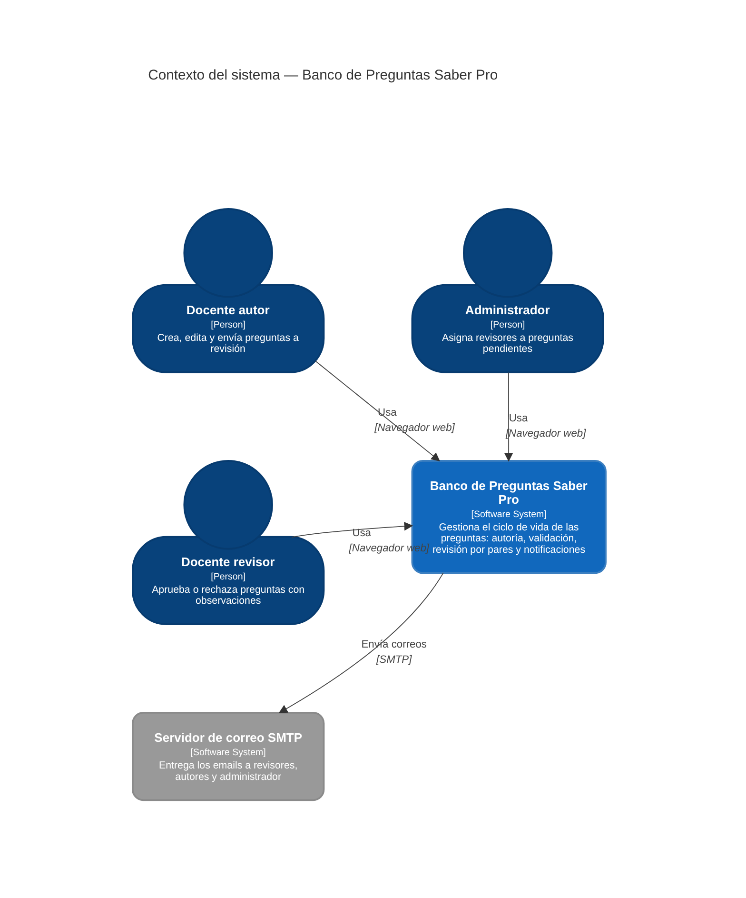
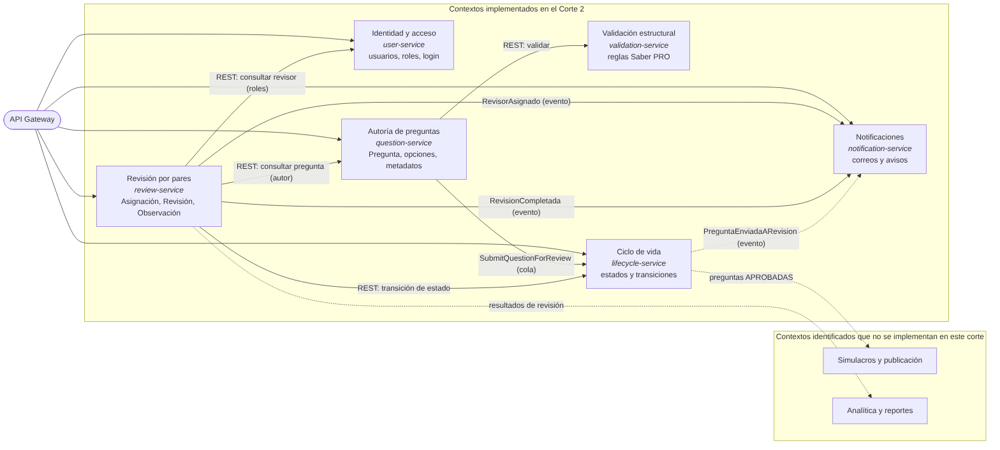
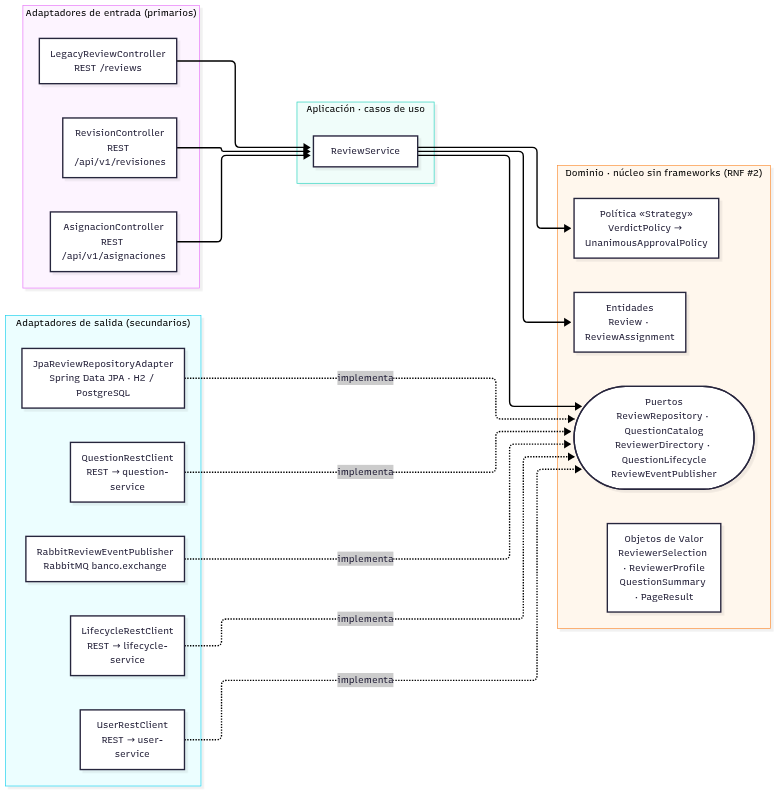

<div align="center">

# Documento de Arquitectura de Software — Banco de Preguntas Saber Pro

**Ingeniería de Software II (teoría y laboratorio)**

Tercer entregable del proyecto de curso (Corte 3): arquitectura limpia (hexagonal) en el microservicio de revisión, autenticación y autorización con JWT/Keycloak, despliegue con Docker Compose y consolidación del documento de arquitectura y del repositorio.

**Presentado por:**<br>
Yeferson Santiago Caicedo Orozco<br>
Iván Alexander López Lasso<br>
Adrián Camilo Araujo Urbano<br>
Carlos Arturo Bambague

**Profesores:**<br>
Paola Andrea Bedoya Toro<br>
Libardo Pantoja

Universidad del Cauca<br>
Facultad de Ingeniería Electrónica y Telecomunicaciones<br>
Programa de Ingeniería de Sistemas

Popayán, noviembre de 2026

</div>

> Este documento es un **borrador de trabajo** del Corte 3. Reutiliza la arquitectura descrita en [`DOCUMENTO_ARQUITECTURA_CORTE2.md`](DOCUMENTO_ARQUITECTURA_CORTE2.md) y añade los entregables del tercer corte. Las partes que dependen de evidencia aún no capturada o de funcionalidad aún no implementada están marcadas como **[PENDIENTE]** y se listan en el [Anexo A](#anexo-a--pendientes-y-evidencia-por-completar).

---

## Contenido

- [Introducción](#introducción)
- [Capítulo 1 — Requisitos y planificación](#capítulo-1--requisitos-y-planificación)
  - [1. Historias de usuario (tres iteraciones)](#1-historias-de-usuario-tres-iteraciones)
  - [2. Planificación de los sprints](#2-planificación-de-los-sprints)
- [Capítulo 2 — Atributos de calidad](#capítulo-2--atributos-de-calidad)
  - [3. Escenario de calidad: escalabilidad](#3-escenario-de-calidad-escalabilidad)
  - [4. Escenario de calidad: modificabilidad](#4-escenario-de-calidad-modificabilidad)
- [Capítulo 3 — Arquitectura y diseño de software](#capítulo-3--arquitectura-y-diseño-de-software)
  - [5. Modelo C4 de las iteraciones 2 y 3](#5-modelo-c4-de-las-iteraciones-2-y-3)
  - [6. Diagrama de contextos delimitados](#6-diagrama-de-contextos-delimitados-bounded-contexts)
  - [7. Arquitectura limpia hexagonal en review-service (RNF #2)](#7-arquitectura-limpia-hexagonal-en-review-service-rnf-2)
  - [8. Patrones de diseño implementados](#8-patrones-de-diseño-implementados)
  - [9. API REST documentada con Swagger](#9-api-rest-documentada-con-swagger)
  - [10. Pruebas unitarias del dominio](#10-pruebas-unitarias-del-dominio)
- [Capítulo 4 — Requisitos no funcionales del Corte 3](#capítulo-4--requisitos-no-funcionales-del-corte-3)
  - [11. RNF #1 — Autenticación y autorización con JWT/Keycloak](#11-rnf-1--autenticación-y-autorización-con-jwtkeycloak)
  - [12. RNF #2 — Arquitectura limpia en un microservicio con lógica de dominio](#12-rnf-2--arquitectura-limpia-en-un-microservicio-con-lógica-de-dominio)
  - [13. RNF #3 — Despliegue con Docker Compose y volúmenes](#13-rnf-3--despliegue-con-docker-compose-y-volúmenes)
  - [14. RNF #4 — Documento de arquitectura y README](#14-rnf-4--documento-de-arquitectura-y-readme)
- [Capítulo 5 — Entrega](#capítulo-5--entrega)
- [Referencias](#referencias)
- [Anexo A — Pendientes y evidencia por completar](#anexo-a--pendientes-y-evidencia-por-completar)

---

## Introducción

Este documento describe la arquitectura del **Banco de Preguntas Saber Pro** en su tercera iteración. En el Corte 1 el sistema era un monolito en capas con interfaz Swing (carpeta `banco-preguntas/`); en el Corte 2 se refactorizó a una **arquitectura de microservicios orientada a eventos** (carpeta `microservicios/`), con cada contexto delimitado como un servicio Spring Boot independiente, comunicación síncrona por REST, asíncrona por **RabbitMQ**, un **API Gateway** como único punto de entrada y un **frontend web** separado que consume la **API REST** documentada con Swagger/OpenAPI 3.

El Corte 3 profundiza la calidad interna de la arquitectura con cuatro requisitos no funcionales:

1. **Autenticación y autorización con JWT y Keycloak** (gestión de usuarios y roles sin interfaz propia). **[PENDIENTE de implementación]**
2. **Arquitectura limpia (DDD y/o hexagonal) en un microservicio con lógica de dominio.** Aplicada a `review-service`. **Implementada.**
3. **Dockerización del sistema con Docker Compose**, incluyendo volúmenes para la persistencia. **Parcial.**
4. **Documento final de arquitectura (este documento) y README del repositorio.**

El documento se organiza en cinco capítulos: requisitos y planificación (capítulo 1), atributos de calidad (capítulo 2), arquitectura y diseño (capítulo 3), requisitos no funcionales del corte (capítulo 4) y enlaces de entrega (capítulo 5).

---

## Capítulo 1 — Requisitos y planificación

## 1. Historias de usuario (tres iteraciones)

Las rutas son las públicas del API Gateway (`http://localhost:8080`); entre paréntesis va el microservicio que atiende la petición. Las historias HU-01 a HU-05 provienen de la segunda iteración y se conservan; la HU-06 es nueva del Corte 3.

### 1.1. HU-01 · Crear preguntas con validación estructural (autor)

**Como** autor de preguntas **necesito** crear preguntas de selección múltiple con única respuesta acordes al Diseño Centrado en Evidencia **para** alimentar el banco de preguntas Saber Pro.

```gherkin
Escenario: creación exitosa en Borrador
  Dado un autor autenticado
  Cuando envía POST /api/v1/preguntas (question-service) con contexto, pregunta directa,
       4 opciones A-D sin repetir ni comodines, respuesta correcta, justificación, bibliografía,
       competencia, tema, subtema y nivel de dificultad (BAJO, MEDIO o ALTO)
  Entonces question-service valida la pregunta llamando por REST a validation-service
  Y la guarda en estado DRAFT ("Borrador")
  Y responde 201 Created con el id asignado

Escenario: rechazo por validación estructural
  Dado que falta algún elemento o una opción dice "Todas las anteriores"
  Cuando el autor intenta guardarla
  Entonces el sistema responde 400 Bad Request con la lista de todos los errores encontrados
  Y la pregunta no se guarda
```

### 1.2. HU-02 · Enviar a revisión (autor)

**Como** autor **necesito** cambiar el estado de mis preguntas de "Borrador" a "Pendiente de revisión" **para** que el administrador les asigne al menos un revisor. *Los estados se visualizan con colores.*

```gherkin
Escenario: envío asíncrono a revisión
  Dado una pregunta del autor en DRAFT o REJECTED
  Cuando el autor envía POST /api/v1/preguntas/{id}/submit-review?requestedBy={autorId}
  Entonces question-service publica el comando SubmitQuestionForReview en RabbitMQ y responde 202 Accepted con un operationId
  Y lifecycle-service consume el comando y cambia el estado a PENDING_REVIEW ("Pendiente de revisión")
  Y GET /api/v1/preguntas/operations/{operationId} informa COMPLETED

Escenario: solo el autor puede enviarla
  Cuando otro usuario intenta enviarla a revisión
  Entonces el sistema responde 403 Forbidden
```

### 1.3. HU-03 · Listar, filtrar y editar mis preguntas (autor)

**Como** autor **necesito** listar las preguntas que he creado **para** verlas y editarlas más adelante. *Con paginación y filtros.*

```gherkin
Escenario: listado paginado con filtros
  Cuando el autor consulta GET /api/v1/preguntas?authorId=2&status=&competency=&topic=&difficulty=&keyword=&page=0&size=5
  Entonces recibe una página {content, page, size, totalElements, totalPages}
  Y cada pregunta trae status, statusLabel y statusColor

Escenario: edición no permitida
  Dado una pregunta en PENDING_REVIEW, IN_REVIEW o APPROVED
  Cuando el autor intenta editarla
  Entonces el sistema responde 409 Conflict ("solo se puede editar en Borrador o Rechazada")
```

### 1.4. HU-04 · Asignar entre 1 y 3 revisores (administrador)

**Como** administrador **necesito** asignar revisores (entre 1 y 3) a las preguntas en "Pendiente de revisión" **para** que sean revisadas por otros docentes. *Una vez asignados, el sistema envía un email.*

```gherkin
Escenario: asignación con notificación por correo
  Dado una pregunta en PENDING_REVIEW
  Cuando el administrador envía POST /api/v1/asignaciones {questionId, reviewerIds:[4,5], assignedBy:1} (review-service)
  Entonces review-service guarda las asignaciones en review_db y pide a lifecycle-service pasar la pregunta a IN_REVIEW
  Y publica un evento ReviewerAssigned por cada revisor en RabbitMQ y responde 201 Created
  Y notification-service consume cada evento y envía el correo al revisor

Escenario: reglas de la asignación
  Cuando se envían 0 o más de 3 revisores, un revisor repetido, un usuario sin rol REVISOR o el propio autor
  Entonces el sistema responde 400 Bad Request y no se envía ningún correo
```

### 1.5. HU-05 · Evaluar las preguntas asignadas (revisor)

**Como** revisor **necesito** listar las preguntas que me han sido asignadas **para** leerlas, dejar la evaluación y cambiar el estado a Aprobada/Rechazada. *El revisor puede dejar observaciones para el autor; el sistema notifica a los implicados.*

```gherkin
Escenario: evaluación con observaciones
  Cuando el revisor envía POST /api/v1/revisiones/evaluar {questionId, reviewerId, result:"APPROVED"|"REJECTED", comments}
  Entonces se registra la revisión y se publica ReviewCompleted
  Y cuando todos los revisores evaluaron, la pregunta pasa a APPROVED si todos aprobaron, o a REJECTED si alguno rechazó

Escenario: rechazo sin observaciones
  Cuando el revisor rechaza sin escribir observaciones
  Entonces el sistema responde 400 Bad Request
```

### 1.6. HU-06 · Ver el historial de revisiones y generar una versión mejorada (autor) — nueva en el corte 3

**Como** autor **necesito** consultar el historial de revisiones de mis preguntas y generar una versión mejorada a partir de las observaciones **para** corregirlas y volver a someterlas a revisión. *El sistema notifica a los implicados.*

```gherkin
Escenario: consulta del historial de revisiones
  Dado una pregunta con al menos una ronda de revisión
  Cuando el autor consulta GET /api/v1/revisiones/pregunta/{questionId}
  Entonces ve, por ronda, la decisión y las observaciones de cada revisor

Escenario: nueva versión mejorada
  Dado una pregunta en estado REJECTED con observaciones
  Cuando el autor edita la pregunta (PUT /api/v1/preguntas/{id}) y la reenvía a revisión
  Entonces se abre una nueva ronda de revisión (round + 1)
  Y se notifica por correo al autor y a los revisores implicados
```

> **[PENDIENTE]** Verificar el alineamiento exacto de la HU-06 con el código actual (existe el concepto de ronda — `round` — y el endpoint de observaciones; falta confirmar el "generar versión mejorada" como funcionalidad de primera clase) y completar los casos de aceptación definitivos.

## 2. Planificación de los sprints

El proyecto se gestiona en **Jira** (proyecto SCRUM). El trabajo se organizó en tres iteraciones/sprints:

| Iteración | Alcance | Estado de la evidencia |
|---|---|---|
| Sprint 1 | Monolito en capas (Corte 1) y su línea base de historias HU-01 a HU-03 | **[PENDIENTE]** captura de Jira |
| Sprint 2 | Refactorización a microservicios orientados a eventos, HU-04 y HU-05, documentación y pruebas | Capturas disponibles (Ilustraciones 1 y 2) |
| Sprint 3 | HU-06 y los cuatro requisitos no funcionales del Corte 3 | **[PENDIENTE]** captura de Jira |

*Tabla 1. Historias del Sprint 2 en Jira. Elaboración propia (fuente: Corte 2).*

| Clave | Historia | Responsable | Estado |
|---|---|---|---|
| SCRUM-41 | HU-T1: Bounded contexts y diseño de la arquitectura distribuida | Adrián Camilo Araujo Urbano | Finalizado |
| SCRUM-42 | HU-T2: Infraestructura con Docker, bases de datos independientes y broker de eventos | Carlos Arturo Bambague | Finalizado |
| SCRUM-43 | HU-T3: Refactorizar HU-01, HU-02 y HU-03 a un microservicio de preguntas | Yeferson Santiago Caicedo Orozco | Finalizado |
| SCRUM-44 | HU-T4: Microservicio de usuarios y roles | Iván Alexander López Lasso | Finalizado |
| SCRUM-45 | HU-T5: Microservicio de revisión (asignaciones y evaluaciones) | Adrián Camilo Araujo Urbano | Finalizado |
| SCRUM-46 | HU-T6: Microservicio de notificaciones orientado a eventos | Carlos Arturo Bambague | Finalizado |
| SCRUM-47 | HU-T7: Frontend web independiente que consume la API REST | Iván Alexander López Lasso | Finalizado |
| SCRUM-48 | HU-T8: API Gateway y configuración centralizada | Adrián Camilo Araujo Urbano | Finalizado |
| SCRUM-49 | HU-T9: Eventos de dominio con entrega garantizada | Adrián Camilo Araujo Urbano | Finalizado |
| SCRUM-50 | HU-05: Listar preguntas asignadas, evaluarlas y aprobarlas o rechazarlas | Adrián Camilo Araujo Urbano | Finalizado |
| SCRUM-51 | HU-04 (refactor): Asignar de 1 a 3 revisores | Carlos Arturo Bambague | Finalizado |
| SCRUM-52 | HU-T10: Al menos 6 patrones GoF | Yeferson Santiago Caicedo Orozco | Finalizado |
| SCRUM-53 | HU-T11: Pruebas unitarias de las clases del dominio | Carlos Arturo Bambague | Finalizado |
| SCRUM-54 | HU-T12: Documento de arquitectura | Iván Alexander López Lasso | Finalizado |
| SCRUM-55 | HU-T13: Escenario de escalabilidad y pruebas de carga | Adrián Camilo Araujo Urbano | Finalizado |
| SCRUM-56 | HU-T14: Documentación Swagger/OpenAPI | Iván Alexander López Lasso | Finalizado |
| SCRUM-57 | HU-T15: Repositorio Git con commits de todos, ramas y CI | Yeferson Santiago Caicedo Orozco | Finalizado |
| SCRUM-58 | HU-T16: Guion y grabación del video de sustentación | Yeferson Santiago Caicedo Orozco | Finalizado |
| SCRUM-59 | HU-T17: Capturas del Sprint 2 y revisión final contra la rúbrica | Yeferson Santiago Caicedo Orozco | Finalizado |

### 2.1. Evidencia del Sprint 2 (Jira)


*Ilustración 1. Actividades del Sprint 2 en Jira (vista Lista).*


*Ilustración 2. Resumen del espacio en Jira: estado de las actividades y progreso de las épicas.*

> **[PENDIENTE]** Añadir las capturas de Jira de los Sprints 1 y 3 (guardar como `arquitectura/diagramas/sprint1-jira-*.png` y `sprint3-jira-*.png`) y la tabla de historias del Sprint 3.

---

## Capítulo 2 — Atributos de calidad

## 3. Escenario de calidad: escalabilidad

**Contexto.** Durante la convocatoria Saber Pro muchos docentes crean y revisan preguntas al mismo tiempo. La arquitectura debe crecer agregando instancias de los servicios más cargados, sin cambiar el código. La Tabla 2 especifica el escenario.

*Tabla 2. Escenario de calidad de escalabilidad. Elaboración propia.*

| Elemento | Especificación |
|---|---|
| **Atributo** | Escalabilidad (ISO/IEC 25010, capacidad) |
| **Fuente del estímulo** | Docentes autores y revisores durante la convocatoria Saber Pro |
| **Estímulo** | 500 usuarios concurrentes, cada uno con una petición por segundo: 90 % crean preguntas y 10 % consultan sus preguntas asignadas |
| **Artefacto** | API Gateway, question-service (con validation-service) y review-service |
| **Entorno** | Operación normal; primero con 1 instancia de question-service y luego con 2 instancias detrás del gateway (perfil `escalado`) |
| **Respuesta** | El gateway reparte la carga entre las instancias. Las operaciones lentas (cambio de estado, correos) se hacen por RabbitMQ y no retienen la petición REST |
| **Medición de calidad** | Latencia p95 y tasa de errores medidas con k6 durante 2 minutos de carga sostenida |
| **Resultado esperado** | p95 < 500 ms y errores < 1 % con 500 usuarios; al pasar de 1 a 2 instancias la p95 se mantiene o baja sin cambiar código, solo configuración |

Resultado de la medición (4 de noviembre de 2026, k6 0.54.0, perfil `escalado`):

*Tabla 3. Resultados de la prueba de carga con k6. Elaboración propia (fuente: Corte 2).*

| Métrica | 1 instancia | 2 instancias |
|---|---|---|
| Peticiones totales | 71 287 | 71 278 |
| Peticiones por segundo | 429,9 | 429,8 |
| Tasa de errores | 0,0 % | 0,0 % |
| Latencia p95 | 3,9 ms | 3,8 ms |
| Latencia p99 | 5,8 ms | 5,9 ms |
| Cumple p95 < 500 ms y errores < 1 % | Sí | Sí |

El detalle y las limitaciones están en [`arquitectura/04-escenario-escalabilidad.md`](arquitectura/04-escenario-escalabilidad.md).

## 4. Escenario de calidad: modificabilidad

**Contexto.** El sistema debe admitir cambios frecuentes en las reglas de negocio sin reescribir la arquitectura: nuevas reglas de validación estructural, otra política de veredicto de revisión o un cambio del proveedor de identidad. La arquitectura debe aislar el núcleo de dominio y usar puntos de extensión (patrón Strategy) para que estos cambios se localicen.

*Tabla 4. Escenario de calidad de modificabilidad. Elaboración propia.*

| Elemento | Especificación |
|---|---|
| **Atributo** | Modificabilidad (ISO/IEC 25010, mantenibilidad) |
| **Fuente del estímulo** | Equipo de desarrollo |
| **Estímulo** | (a) agregar una regla de validación estructural nueva; (b) cambiar la política de veredicto de "unánime" a "mayoría"; (c) cambiar el proveedor de identidad |
| **Artefacto** | `validation-service` (`ValidationRule`), `review-service` (`VerdictPolicy`), capa de seguridad del `api-gateway` |
| **Entorno** | Desarrollo, con la suite de pruebas disponible |
| **Respuesta** | El cambio se realiza implementando una clase nueva que cumple la interfaz (puerto/estrategia), sin modificar las clases existentes |
| **Medición de calidad** | Número de clases existentes modificadas y de clases nuevas; la suite de pruebas y el test de arquitectura siguen pasando |
| **Resultado esperado** | (a) y (b): **1 clase nueva, 0 clases existentes modificadas** (principio abierto/cerrado). (c): el cambio se confina a la configuración y a los adaptadores de seguridad |

Evidencia de diseño (real, verificable en el código):

- `validation-service`: cada regla DCE es una implementación de `ValidationRule` (`StatementRule`, `OptionsRule`, `CorrectAnswerRule`, `EvidenceRule`, `TaxonomyRule`) que `QuestionValidator` recibe inyectadas. Añadir una regla es crear una clase.
- `review-service`: la decisión final se delega en `VerdictPolicy` (implementada por `UnanimousApprovalPolicy`). Cambiar a "mayoría" es crear otra implementación y configurarla, sin tocar el caso de uso.
- La prueba [`ArquitecturaHexagonalTest`](microservicios/review-service/src/test/java/co/unicauca/iso2/taller09/reviewservice/ArquitecturaHexagonalTest.java) protege estos puntos de extensión: falla si el dominio vuelve a depender de frameworks o de capas externas.

> **[PENDIENTE]** Registrar la medición cuantitativa del escenario (fecha, número de líneas/clases antes y después de cada cambio) para la evidencia de la sustentación.

---

## Capítulo 3 — Arquitectura y diseño de software

## 5. Modelo C4 de las iteraciones 2 y 3

### 5.1. C4 nivel 1 — Contexto del sistema

Autores, administradores y revisores usan el sistema desde el navegador; el sistema se apoya en un servidor de correo externo y, en el Corte 3, en el servidor de identidad **Keycloak (JWT)**.



*Ilustración 3. C4 nivel 1: contexto del sistema (iteración 2).*

> **[PENDIENTE]** Regenerar el C4 de contexto de la iteración 3 incorporando **Keycloak** como sistema externo de identidad.

### 5.2. C4 nivel 2 — Contenedores


*Ilustración 4. C4 nivel 2: contenedores (iteración 2).*

*Tabla 5. Contenedores del sistema. Elaboración propia (fuente: Corte 2).*

| Contenedor | Tecnología | Responsabilidad |
|---|---|---|
| Frontend web | HTML5, CSS, JavaScript sin framework; servidor estático Node | Pantallas de autor, administrador y revisor. Solo conoce la URL del gateway |
| API Gateway | Spring Cloud Gateway 2023.0 | Único punto de entrada, reescritura de rutas, CORS, balanceo (perfil `escalado`), validación del token y propagación de identidad y Swagger UI unificado |
| question-service | Spring Boot 3.3 + Spring Data JPA + Flyway | Autoría: crear, editar, listar y enviar a revisión |
| validation-service | Spring Boot 3.3 | Reglas estructurales DCE (sin estado) |
| lifecycle-service | Spring Boot 3.3 | Autoridad única del estado y de las transiciones |
| review-service | Spring Boot 3.3 + Spring Data JPA | Asignaciones y evaluaciones (HU-04, HU-05, HU-06). **Arquitectura hexagonal** |
| notification-service | Spring Boot 3.3 + Spring Mail | Consume eventos y envía correos |
| user-service | Spring Boot 3.3 + Spring Data JPA + Flyway | Usuarios, roles, login y revisores elegibles |
| RabbitMQ | RabbitMQ 3.13 | Comandos y eventos de dominio con DLQ |

> **[PENDIENTE]** Añadir el contenedor **Keycloak** al C4 de contenedores de la iteración 3 y regenerar `c4-contenedores.mmd`/`.png`.

### 5.3. C4 nivel 3 — Componentes de review-service

En **review-service** (organizado en dominio, aplicación, infraestructura y presentación) la decisión final se delega en `VerdictPolicy` (Strategy, implementada por `UnanimousApprovalPolicy`) y la persistencia en `JpaReviewRepositoryAdapter` (Adapter entre el puerto `ReviewRepository` y Spring Data JPA). El detalle está en la [sección 7](#7-arquitectura-limpia-hexagonal-en-review-service-rnf-2).


*Ilustración 5. C4 nivel 3: componentes (iteración 2).*

## 6. Diagrama de contextos delimitados (bounded contexts)



*Ilustración 6. Diagrama de contextos delimitados.*

*Tabla 6. Contextos delimitados y almacenamiento. Elaboración propia (fuente: Corte 2).*

| Contexto | Microservicio | Almacenamiento | Se integra con |
|---|---|---|---|
| Identidad y acceso | user-service + Keycloak | user_db (JPA + Flyway: H2 / PostgreSQL) | Keycloak emite el token JWT que el gateway valida |
| Autoría de preguntas | question-service | question_db (JPA + Flyway: H2 / PostgreSQL) | Validación (REST), Ciclo de vida (REST + comando AMQP) |
| Validación estructural | validation-service | Sin estado | — |
| Ciclo de vida | lifecycle-service | lifecycle_db (en memoria) | Recibe comandos por RabbitMQ |
| Revisión por pares | review-service | review_db (JPA: H2 / PostgreSQL) | Autoría, Identidad y Ciclo de vida (REST); publica eventos |
| Notificaciones | notification-service | notification_db (en memoria) | Consume eventos; Identidad (REST) |
| Simulacros y Analítica | — | — | Identificados en el enunciado, no implementados |

Regla común: ningún servicio lee la base de datos de otro. Detalle en [`arquitectura/01-bounded-contexts.md`](arquitectura/01-bounded-contexts.md) y contratos en [`arquitectura/02-contratos.md`](arquitectura/02-contratos.md).

## 7. Arquitectura limpia hexagonal en review-service (RNF #2)

> Sección completa en [`arquitectura/07-arquitectura-hexagonal.md`](arquitectura/07-arquitectura-hexagonal.md). Aquí se resume.

Se aplica arquitectura limpia hexagonal a **`review-service`** porque es el microservicio con reglas de negocio propias: asignación de 1 a 3 revisores, restricciones de autor/revisor, veredicto de la revisión por pares y ciclo de rondas. Las reglas viven en el **núcleo del dominio**, aislado de frameworks.



*Ilustración 7. Arquitectura hexagonal de review-service. Elaboración propia.*

**Regla de dependencia:** siempre hacia adentro (`infrastructure` → `application` → `domain`; `presentation` → `application`). El dominio no conoce Spring, JPA, Jackson ni RabbitMQ, y no importa las capas externas.

*Tabla 7. Puertos y adaptadores de review-service. Elaboración propia.*

| Puerto (dominio) | Propósito | Adaptador (infraestructura) | Tecnología / destino |
|---|---|---|---|
| `ReviewRepository` | Persistir asignaciones y revisiones, paginar las asignadas | `JpaReviewRepositoryAdapter` | Spring Data JPA · H2 / PostgreSQL |
| `QuestionCatalog` | Leer los datos de la pregunta | `QuestionRestClient` | REST → `question-service` |
| `ReviewerDirectory` | Leer perfil y roles del revisor | `UserRestClient` | REST → `user-service` |
| `QuestionLifecycle` | Consultar el estado y ejecutar transiciones | `LifecycleRestClient` | REST → `lifecycle-service` |
| `ReviewEventPublisher` | Publicar `ReviewerAssigned` y `ReviewCompleted` | `RabbitReviewEventPublisher` | RabbitMQ |

*Tabla 8. Lógica de dominio encapsulada en review-service. Elaboración propia.*

| Elemento | Tipo | Regla / invariante que protege |
|---|---|---|
| `Review` | Entidad | La decisión es obligatoria y un rechazo exige al menos una observación |
| `ReviewAssignment` | Entidad | La ronda debe ser ≥ 1 y una asignación solo se completa una vez |
| `ReviewerSelection` | Objeto de Valor | Entre 1 y 3 revisores, sin repetidos; descarta identidades nulas |
| `ReviewerProfile` | Objeto de Valor | Solo los roles REVISOR o DOCENTE pueden revisar |
| `UnanimousApprovalPolicy` | Política (Strategy) | La pregunta se aprueba solo si todos los revisores aprueban |
| `PageResult` | Objeto de Valor | Cálculo del total de páginas de la paginación |

La pureza del núcleo y la dirección de las dependencias se comprueban con `ArquitecturaHexagonalTest`, que falla si (1) el dominio importa Spring/JPA/Hibernate/Lombok/Jackson, (2) el dominio importa `application`/`infrastructure`/`presentation`, o (3) la aplicación importa `infrastructure`/`presentation`.

## 8. Patrones de diseño implementados

Además de los seis patrones GoF exigidos (2 creacionales, 2 estructurales, 2 de comportamiento), se documenta el patrón estructural **Adapter** como base de la arquitectura de puertos y adaptadores.

*Tabla 9. Patrones de diseño implementados. Elaboración propia.*

| # | Patrón | Tipo | Dónde | Cómo y para qué se aplicó |
|---|---|---|---|---|
| 1 | **Builder** | Creacional | `question-service` · `domain/QuestionBuilder` | Arma paso a paso una pregunta DCE desde la solicitud REST, normalizando textos y garantizando autor y enunciado. |
| 2 | **Factory Method** | Creacional | `notification-service` · `email/EmailSenderFactory` | El creador abstracto define `sender()` y delega en `createSender()`. Se cambia entre correo simulado y SMTP con la propiedad `notifications.email.mode`. |
| 3 | **Facade** | Estructural | `question-service` · `application/QuestionAuthoringFacade` | Oculta la coordinación de validation-service, lifecycle-service, el repositorio y RabbitMQ detrás de una interfaz simple para el controlador. |
| 4 | **Decorator** | Estructural | `notification-service` · `email/LoggingEmailSenderDecorator` | Añade trazabilidad a cualquier `EmailSender` sin modificar las clases que envían. |
| 5 | **Adapter** | Estructural | `JpaReviewRepositoryAdapter`, `QuestionRestClient`, `UserRestClient`, `LifecycleRestClient` (review-service) | Adaptan Spring Data JPA y las API REST de otros servicios a los puertos que espera el dominio, de modo que el dominio no dependa de HTTP ni de JPA. |
| 6 | **Strategy** | Comportamiento | `validation-service` · `ValidationRule`; `review-service` · `VerdictPolicy` | Cada regla estructural y cada política de veredicto es una estrategia sustituible (abierto/cerrado). |
| 7 | **Observer** | Comportamiento | RabbitMQ: consumidores de eventos en `notification-service` y `lifecycle-service` | Los productores publican eventos sin conocer a sus suscriptores; cada consumidor reacciona (correos, cambio de estado). |

El monolito del Corte 1 (`banco-preguntas/`) conserva sus propios patrones (Builder, Factory Method, Singleton, Facade, Decorator, Strategy, Observer y State).

## 9. API REST documentada con Swagger

- **Swagger UI unificado (gateway):** http://localhost:8080/swagger-ui.html
- Swagger individual: `http://localhost:{8081..8086}/swagger-ui.html`.

*Tabla 10. Endpoints públicos de la API REST. Elaboración propia.*

| Módulo | Método | Ruta pública | HU |
|---|---|---|---|
| Autenticación | POST | `/api/v1/auth/login` | Soporte (a migrar a Keycloak — RNF #1) |
| Preguntas | POST | `/api/v1/preguntas` | HU-01 |
| Preguntas | PUT | `/api/v1/preguntas/{id}?requestedBy=` | HU-03, HU-06 |
| Preguntas | GET | `/api/v1/preguntas?authorId&status&competency&topic&difficulty&keyword&page&size` | HU-03 |
| Preguntas | POST | `/api/v1/preguntas/{id}/submit-review?requestedBy=` | HU-02, HU-06 |
| Usuarios | GET | `/api/v1/usuarios/reviewers/eligible?authorId=` | HU-04 |
| Asignaciones | POST / GET | `/api/v1/asignaciones` | HU-04 |
| Revisiones | GET | `/api/v1/revisiones/asignadas?revisorId&page&size` | HU-05 |
| Revisiones | POST | `/api/v1/revisiones/evaluar` | HU-05 |
| Revisiones | GET | `/api/v1/revisiones/pregunta/{questionId}` | HU-05, HU-06 |
| Ciclo de vida | GET | `/api/v1/ciclo-vida/{id}` y `/api/v1/ciclo-vida?ids=` | HU-02 |
| Notificaciones | GET | `/api/v1/notificaciones/recipient/{id}` | HU-04, HU-05, HU-06 |

## 10. Pruebas unitarias del dominio

Se ejecutan con `mvn test` (JUnit 5, Java 21) y en GitHub Actions en cada push. La rúbrica del Corte 3 otorga peso propio a las **pruebas unitarias de las clases del dominio**; el núcleo del dominio de `review-service` se cubre con `ReviewDomainTest` (entidades, objetos de valor, política de veredicto, paginación) y la arquitectura se blinda con `ArquitecturaHexagonalTest`.

*Tabla 11. Pruebas unitarias del dominio y de la arquitectura. Elaboración propia.*

| Módulo | Clases de prueba | Qué cubren |
|---|---|---|
| review-service (dominio) | `ReviewDomainTest` | Invariantes de `Review`, `ReviewAssignment`, `ReviewerSelection`, `ReviewerProfile`, `UnanimousApprovalPolicy` y `PageResult` |
| review-service (arquitectura) | `ArquitecturaHexagonalTest` | Reglas de la arquitectura hexagonal (pureza del dominio y dirección de dependencias) |
| review-service (aplicación) | `ReviewServiceTest` | Casos de uso de asignación y evaluación con dobles de prueba |
| review-service (infraestructura) | `JpaReviewRepositoryAdapterTest`, `RevisionControllerTest` | Adaptador de persistencia y adaptador de entrada REST |
| Resto de módulos | `QuestionBuilderTest`, `QuestionValidatorTest`, `LifecycleControllerTest`, `EmailNotificationTest`, `AuthControllerTest`, `GatewayRoutesTest`, … | Dominio, patrones y persistencia de cada servicio |

Cifras reales de la suite (14 de noviembre de 2026, `mvn -f microservicios/pom.xml test`): **114 pruebas, 0 fallos**. En `review-service`: `ReviewDomainTest` 10, `ArquitecturaHexagonalTest` 3, `ReviewServiceTest` 20, `JpaReviewRepositoryAdapterTest` 4 y `RevisionControllerTest` 8 (45 en total).

*Tabla 12. Pruebas por módulo (ejecución del 14 de noviembre de 2026). Elaboración propia.*

| Módulo | Pruebas | Módulo | Pruebas |
|---|---|---|---|
| user-service | 14 | notification-service | 12 |
| question-service | 18 | api-gateway | 6 |
| validation-service | 11 | shared-contracts | 0 |
| lifecycle-service | 8 | **Total** | **114** |
| review-service | 45 | | |

> **[PENDIENTE]** Publicar el resumen de la ejecución en el CI (GitHub Actions) como evidencia.

---

## Capítulo 4 — Requisitos no funcionales del Corte 3

## 11. RNF #1 — Autenticación y autorización con JWT/Keycloak

**Requisito.** Implementar autenticación y autorización con **JWT** usando **Keycloak**; la gestión de usuarios y roles se hará por **Postman** (sin interfaz propia).

**Estado: [PENDIENTE de implementación].** En el repositorio actual no existen dependencias ni configuración de Keycloak, Spring Security ni validación de JWT (búsqueda sin resultados sobre `keycloak`, `jwt`, `spring-security`). La iteración 2 usa un esquema propio: `user-service` emite un token y el gateway propaga la identidad; ese esquema debe sustituirse por Keycloak + JWT.

Trabajo pendiente (para el equipo):

1. Levantar **Keycloak** (realm, cliente y roles: autor, administrador, revisor) — preferiblemente dentro del `docker-compose` (ver RNF #3).
2. Configurar `api-gateway` como **OAuth2 Resource Server** (validación del JWT con el `issuer-uri` / JWKS de Keycloak) y los microservicios como resource servers.
3. Migrar el login a Keycloak y propagar los roles por `scope`/`realm_access`.
4. Añadir la captura de Postman (creación de usuario, asignación de rol y obtención del token) como evidencia.
5. Regenerar los diagramas C4 de las iteraciones 2 y 3 marcando **Keycloak** y el flujo JWT.

## 12. RNF #2 — Arquitectura limpia en un microservicio con lógica de dominio

**Requisito.** Implementar arquitectura limpia (DDD y/o hexagonal) en un microservicio que lo amerite.

**Estado: implementado** en `review-service` (ver [sección 7](#7-arquitectura-limpia-hexagonal-en-review-service-rnf-2) y [`arquitectura/07-arquitectura-hexagonal.md`](arquitectura/07-arquitectura-hexagonal.md)).

## 13. RNF #3 — Despliegue con Docker Compose y volúmenes

**Requisito.** Dockerizar el sistema y orquestarlo con Docker Compose, usando **volúmenes** para la persistencia.

**Estado: parcial.**

*Tabla 12. Estado de la dockerización. Elaboración propia.*

| Archivo | Contenido actual | Volúmenes | Estado |
|---|---|---|---|
| `microservicios/docker-compose.yml` | `rabbitmq:3.13-management` (puertos 5672 y 15672, healthcheck) | No | Falta dockerizar los servicios y las bases de datos |
| `banco-preguntas/docker-compose.yml` | `postgres:16` del monolito (Corte 1) | Sí (`banco-preguntas-data:/var/lib/postgresql/data`) | Correcto (línea base) |

Trabajo pendiente (para el equipo):

1. Añadir a `microservicios/docker-compose.yml` un servicio por microservicio (con su `Dockerfile`) y **PostgreSQL** por contexto (`question_db`, `review_db`, `user_db`, …), cada uno con **volumen nombrado** para persistir los datos.
2. Añadir **Keycloak** y su volumen (RNF #1).
3. Capturar la evidencia: `docker compose up -d`, `docker compose ps`, `docker volume ls` y la persistencia de datos tras reiniciar.

> **[PENDIENTE]** Crear los `Dockerfile` de los microservicios, completar el `docker-compose.yml` con volúmenes y capturar la evidencia.

## 14. RNF #4 — Documento de arquitectura y README

**Requisito.** Entregar el documento final de arquitectura (PDF) y actualizar el README del repositorio.

**Estado: en curso.** Este documento (`DOCUMENTO_ARQUITECTURA_CORTE3.md`) es la fuente; debe exportarse a PDF y el [`README.md`](README.md) del repositorio debe enlazarlo, junto con [`arquitectura/README.md`](arquitectura/README.md).

---

## Capítulo 5 — Entrega

## 15. Enlaces

- **Repositorio Git:** https://github.com/santyxswc/Banco_preguntas-ISoftII (rama `main`)
- **Tablero Scrum (Jira):** [PENDIENTE] URL del tablero y del Sprint 3
- **Video de sustentación (YouTube):** [PENDIENTE] URL del video del Corte 3
- **Swagger unificado:** http://localhost:8080/swagger-ui.html
- **Frontend local:** http://localhost:5173

---

## Referencias

- Bass, L., Clements, P. y Kazman, R. (2021). *Software Architecture in Practice* (4.ª ed.). Addison-Wesley.
- Brown, S. (2018). *The C4 model for visualising software architecture*. https://c4model.com
- Cockburn, A. (2005). *Hexagonal Architecture (Ports and Adapters)*.
- Evans, E. (2003). *Domain-Driven Design: Tackling Complexity in the Heart of Software*. Addison-Wesley.
- Gamma, E., Helm, R., Johnson, R. y Vlissides, J. (1994). *Design Patterns: Elements of Reusable Object-Oriented Software*. Addison-Wesley.
- International Organization for Standardization. (2023). *ISO/IEC 25010:2023 — Product quality model*. ISO.
- Martin, R. C. (2017). *Clean Architecture: A Craftsman's Guide to Software Structure and Design*. Prentice Hall.
- Newman, S. (2021). *Building Microservices* (2.ª ed.). O'Reilly Media.
- Universidad del Cauca. (2026). *Entregables Proyecto de Curso — Tercer Corte 2026.2. Ingeniería de Software II*.

---

## Anexo A — Pendientes y evidencia por completar

Lista de verificación para cerrar el Corte 3. Los puntos marcados como **[PENDIENTE]** a lo largo del documento se resumen aquí.

| # | Pendiente | RNF/RF asociado | Responsable sugerido |
|---|---|---|---|
| 1 | Implementar Keycloak + JWT (realm, cliente, roles), resource server en el gateway y los servicios | RNF #1 | Iván / Adrián |
| 2 | Capturas de Postman: crear usuario, asignar rol y obtener token | RNF #1 | Iván |
| 3 | Regenerar C4 (contexto, contenedores, componentes) de las iteraciones 2 y 3 evidenciando Keycloak/JWT | Documento | Adrián |
| 4 | Completar `docker-compose.yml` (microservicios + PostgreSQL por contexto) con volúmenes y `Dockerfile` | RNF #3 | Carlos |
| 5 | Evidencia Docker Compose: `up -d`, `ps`, `volume ls` y persistencia tras reinicio | RNF #3 | Carlos |
| 6 | Capturas de Jira de los Sprints 1 y 3 + tabla de historias del Sprint 3 | Documento | Yeferson |
| 7 | Verificar y completar la HU-06 (historial de revisiones y versión mejorada) | RF #6 | Adrián |
| 8 | Medición cuantitativa del escenario de modificabilidad | Documento | Adrián |
| 9 | Ejecutar `mvn test` completo y publicar el total de pruebas y el CI | Rúbrica | Carlos |
| 10 | Exportar este documento a PDF y enlazarlo desde el README del repositorio | RNF #4 | Iván |
