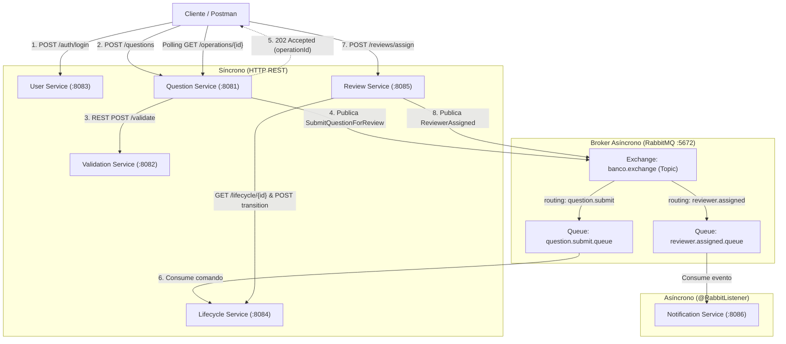

# Laboratorio de Ingeniería de Software II — Taller 09
## Comunicación Síncrona y Asíncrona de Microservicios

- **Institución:** Universidad del Cauca  
- **Facultad:** Facultad de Ingeniería Electrónica y Telecomunicaciones (FIET)  
- **Programa:** Ingeniería de Sistemas  
- **Docentes:** Paola Andrea Bedoya Toro, Libardo Pantoja  
- **Periodo Académico:** 2026.2  
- **Estudiante / Equipo:** Yeferson Santiago Caicedo Orozco, Iván Alexander López Lasso, Adrián Camilo Araujo Urbano, Carlos Arturo Bambague  

---

> **Nota (corte 2):** este documento describe el Taller 09 tal como se entregó. Después del taller el sistema creció: se agregaron el **API Gateway** (:8080), el **frontend web** (:5173), la evaluación de revisores (HU-05), el correo real y los patrones GoF en los microservicios. La pregunta ahora exige todos los campos DCE (contexto, justificación, bibliografía, competencia, tema, subtema y dificultad), y la colección de Postman ya está actualizada con ellos. La arquitectura vigente está en [`DOCUMENTO_ARQUITECTURA_CORTE2.md`](DOCUMENTO_ARQUITECTURA_CORTE2.md).

## 1. Introducción y Objetivo del Taller

El objetivo de este taller es diseñar, implementar y probar mecanismos de **comunicación síncrona (API REST con Spring Web)** y **comunicación asíncrona (mensajería orientada a eventos y comandos con RabbitMQ)** aplicados a la evolución del **Banco de Preguntas Saber Pro**, garantizando el desacoplamiento, la escalabilidad, la resiliencia y la consistencia de estados entre microservicios independientes.

---

## 2. Arquitectura de Microservicios y Delimitación de Contextos

La solución divide el dominio en **6 microservicios autónomos**, cada uno desplegado con su propio puerto y contexto delimitado (*Bounded Context*):

| Microservicio | Puerto | Responsabilidad Principal | Tecnologías / Mecanismos |
|---|---|---|---|
| **User Service** | `8083` | Autenticación síncrona y verificación de roles (Admin, Autor, Revisor). | Spring Web, REST (`POST /auth/login`, `GET /users`) |
| **Question Service** | `8081` | Administración del contenido de preguntas y orquestación de creación y envío a revisión. | Spring Web, RestTemplate (síncrono), Spring AMQP / `RabbitTemplate` (asíncrono) |
| **Validation Service** | `8082` | Validación estructural, de distractores y de respuesta correcta (DCE). | Spring Web, REST (`POST /validate`) |
| **Lifecycle Service** | `8084` | **Autoridad única sobre el estado y las transiciones**. Es el único servicio que altera el estado de las preguntas y gestiona el resultado de operaciones asíncronas. | Spring Web, `@RabbitListener` (consumidor de `question.submit`), REST (`/lifecycle/{id}`) |
| **Review Service** | `8085` | Asignación de docentes revisores y registro de dictámenes (aprobación / rechazo). | Spring Web, RestTemplate (síncrono con Lifecycle), `RabbitTemplate` (publica `reviewer.assigned`) |
| **Notification Service** | `8086` | Procesamiento y despacho desacoplado de notificaciones a revisores sin bloquear el flujo principal. | Spring Web, `@RabbitListener` (consumidor de `reviewer.assigned`) |



---

## 3. Detalle de Flujos de Comunicación

### 3.1 Flujo 1: Creación Síncrona y Validación (Puntos 1, 2 y 3)
1. **Autenticación (User Service - 8083):**
   - El cliente envía credenciales a `POST /auth/login`.
   - Si son válidas (`autor1` / `autor123`), retorna `200 OK` con datos y roles (`AUTOR`, `DOCENTE`). Si no, `401 Unauthorized`.
2. **Creación de Pregunta (Question Service - 8081):**
   - El docente envía `POST /questions` con el contexto, la pregunta, 4 opciones, la respuesta correcta, la justificación, la bibliografía, la competencia, el tema, el subtema y la dificultad.
3. **Validación Síncrona (Validation Service - 8082):**
   - `Question Service` realiza una llamada REST bloqueante a `POST /validate` en `Validation Service`.
   - Si la validación es exitosa, `Question Service` persiste la pregunta en estado `DRAFT` y responde `201 Created`.
   - Si falla (ej. distractor "Todas las anteriores" o menos de 4 opciones), responde `400 Bad Request` con los errores identificados.

### 3.2 Flujo 2: Envío Asíncrono a Revisión (Puntos 4, 5 y 6)
1. El docente solicita enviar la pregunta a revisión mediante `POST /questions/{id}/submit-review`.
2. `Question Service` genera un identificador único de operación (`operationId` tipo UUID).
3. `Question Service` publica el comando `SubmitQuestionForReview` en RabbitMQ (`routingKey = question.submit`).
4. `Question Service` responde inmediatamente al cliente con **`202 Accepted`** indicando que la solicitud fue admitida para procesamiento asíncrono.
5. `Lifecycle Service` (puerto 8084) consume el comando mediante `@RabbitListener`.
6. `Lifecycle Service` valida la transición `DRAFT -> PENDING_REVIEW`. Si es válida, actualiza el estado y marca la operación como `COMPLETED`. Si es inválida, marca la operación como `FAILED`.
7. El cliente puede realizar consultas periódicas (polling) a `GET /operations/{operationId}` para verificar el estado final.

### 3.3 Flujo 3: Asignación de Revisor y Notificación Asíncrona (Puntos 7 y 8)
1. El administrador solicita asignar un revisor a una pregunta mediante `POST /reviews/assign` en `Review Service` (puerto 8085).
2. `Review Service` consulta síncronamente a `Lifecycle Service` (`GET /lifecycle/{id}`) para verificar que la pregunta se encuentre en `PENDING_REVIEW`.
3. `Review Service` solicita la transición síncrona a `IN_REVIEW` a través de `POST /lifecycle/{id}/transition`.
4. Si `Lifecycle Service` confirma el cambio de estado, `Review Service` persiste la asignación y publica en RabbitMQ el evento `ReviewerAssigned` (`routingKey = reviewer.assigned`).
5. `Notification Service` (puerto 8086) consume el evento mediante `@RabbitListener` y simula el despacho de la notificación sin bloquear al cliente ni al `Review Service`.

---

## 4. Matriz de Pruebas y Casos de Error (Rúbrica de Evaluación)

Todos los casos requeridos en el taller están cubiertos tanto por pruebas automatizadas en JUnit 5 como por la colección de Postman:

| Caso de Prueba | Microservicio / Endpoint | Resultado Esperado | Evidencia / Código HTTP |
|---|---|---|---|
| **1. Login con credenciales válidas** | User Service: `POST /auth/login` | Autenticación exitosa, entrega roles | `200 OK` (`authenticated: true`) |
| **2. Login con credenciales incorrectas** | User Service: `POST /auth/login` | Acceso rechazado | `401 Unauthorized` |
| **3. Crear pregunta válida** | Question Service: `POST /questions` | Validación remota exitosa, pregunta en DRAFT | `201 Created` (`status: "DRAFT"`) |
| **4. Crear pregunta inválida** | Question Service: `POST /questions` | Rechazo por Validation Service | `400 Bad Request` (errores en lista) |
| **5. Enviar pregunta a revisión** | Question Service: `POST /questions/{id}/submit-review` | Publica comando y responde de inmediato | `202 Accepted` (`status: "PENDING"`) |
| **6. Confirmación de transición asíncrona** | Question Service / Lifecycle: `GET /operations/{id}` | Transición procesada en Lifecycle | `200 OK` (`status: "COMPLETED"`) |
| **7. Aprobar pregunta en DRAFT** | Lifecycle Service: `POST /lifecycle/{id}/transition` | Máquina de estados rechaza transición ilegal | `400 Bad Request` (`TRANSICION_NO_PERMITIDA`) |
| **8. Asignar revisor a pregunta elegible** | Review Service: `POST /reviews/assign` | Transiciona a IN_REVIEW y emite evento RabbitMQ | `201 Created` (`status: "ASSIGNED"`) |
| **9. Notificación asíncrona recibida** | Notification Service: `GET /notifications` | Evento consumido sin bloquear flujo principal | `200 OK` (`NotificationType: REVIEWER_ASSIGNED`) |
| **10. Rechazar pregunta en IN_REVIEW** | Review Service: `POST /reviews/evaluate` | Pregunta pasa a REJECTED con observaciones | `200 OK` (`status: "REJECTED"`) |
| **11. Corregir pregunta rechazada** | Lifecycle Service: `POST /lifecycle/{id}/transition` | Puede volver a PENDING_REVIEW para re-evaluar | `200 OK` (`state: "PENDING_REVIEW"`) |
| **12. Falla en transición asíncrona** | Lifecycle Service: `GET /operations/{id}` | Cliente consulta resultado y no se engaña con falso éxito | `200 OK` (`status: "FAILED"`) |

---

## 5. Instrucciones de Ejecución Paso a Paso

### 5.1 Requisitos Previos
- Docker Desktop activo.
- Java 21 JDK instalado.

### 5.2 Paso 1: Iniciar RabbitMQ
En la carpeta `microservicios`, ejecutar:
```powershell
docker compose up -d
```
> La consola de administración de RabbitMQ quedará disponible en:  
> **URL:** `http://localhost:15672`  
> **Usuario / Contraseña:** `guest` / `guest`

### 5.3 Paso 2: Compilar y Ejecutar Pruebas Automatizadas
```powershell
..\mvnw.cmd test    # desde la carpeta microservicios (el wrapper está en la raíz)
```
*Se ejecutarán las pruebas unitarias y de integración de cada microservicio, validando la interacción con RabbitMQ, la máquina de estados y las reglas de validación.*

### 5.4 Paso 3: Iniciar los Microservicios
Se puede utilizar el script automatizado (también inicia RabbitMQ, el API Gateway y el frontend web):
```powershell
.\microservicios\start-all.ps1
```
O bien ejecutar cada microservicio en una terminal independiente:
```powershell
# Terminal 1 - User Service (:8083)
cd microservicios/user-service; ..\..\mvnw.cmd spring-boot:run

# Terminal 2 - Validation Service (:8082)
cd microservicios/validation-service; ..\..\mvnw.cmd spring-boot:run

# Terminal 3 - Lifecycle Service (:8084)
cd microservicios/lifecycle-service; ..\..\mvnw.cmd spring-boot:run

# Terminal 4 - Question Service (:8081)
cd microservicios/question-service; ..\..\mvnw.cmd spring-boot:run

# Terminal 5 - Review Service (:8085)
cd microservicios/review-service; ..\..\mvnw.cmd spring-boot:run

# Terminal 6 - Notification Service (:8086)
cd microservicios/notification-service; ..\..\mvnw.cmd spring-boot:run

# Terminal 7 - API Gateway (:8080)
cd microservicios/api-gateway; ..\..\mvnw.cmd spring-boot:run
```

### 5.5 Paso 4: Ejecutar la Colección de Postman
1. Abrir Postman.
2. Hacer clic en **Import**.
3. Seleccionar el archivo `microservicios/lisw2_taller09_postman_collection.json`.
4. Ejecutar la colección secuencialmente o mediante el **Collection Runner** para observar todas las aserciones en verde.

### 5.6 Paso 5: Detener los Microservicios
```powershell
.\microservicios\stop-all.ps1
```

---

## 6. Justificación Técnica para Sustentación (Rúbrica de 100%)

1. **Desacoplamiento Temporal:** El docente que envía una pregunta a revisión no espera a que el servicio de ciclo de vida termine de procesar el registro ni a que la base de datos distribuida sincronice. La respuesta `202 Accepted` garantiza una experiencia de usuario fluida e inmediata.
2. **Resiliencia ante Caídas:** Si el `Notification Service` llega a estar inactivo temporalmente, los mensajes de asignación permanecen seguros en la cola durable `reviewer.assigned.queue` de RabbitMQ y se consumen automáticamente cuando el servicio se restablece.
3. **Consistencia de Datos:** El `Lifecycle Service` actúa como única autoridad sobre las transiciones de estado, impidiendo que el `Question Service` o el `Review Service` fuercen transiciones inválidas.
4. **Trazabilidad:** Gracias al identificador de correlación `operationId`, es posible rastrear el ciclo de vida completo de una solicitud asíncrona a través de múltiples microservicios.
