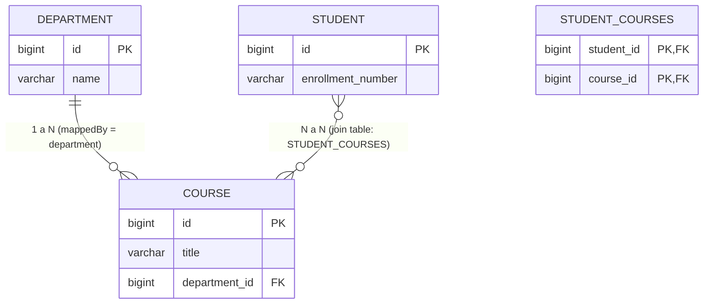
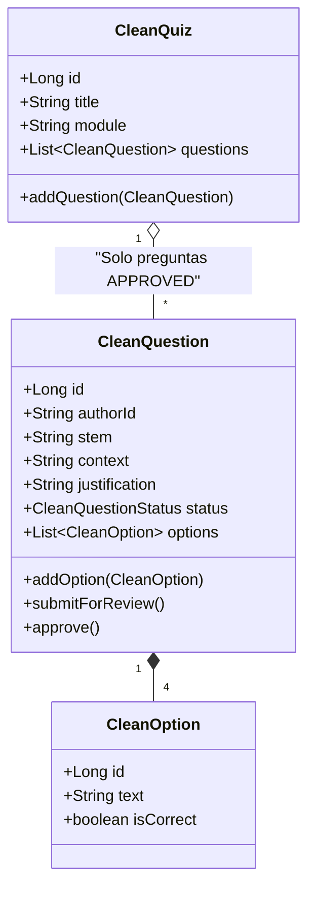
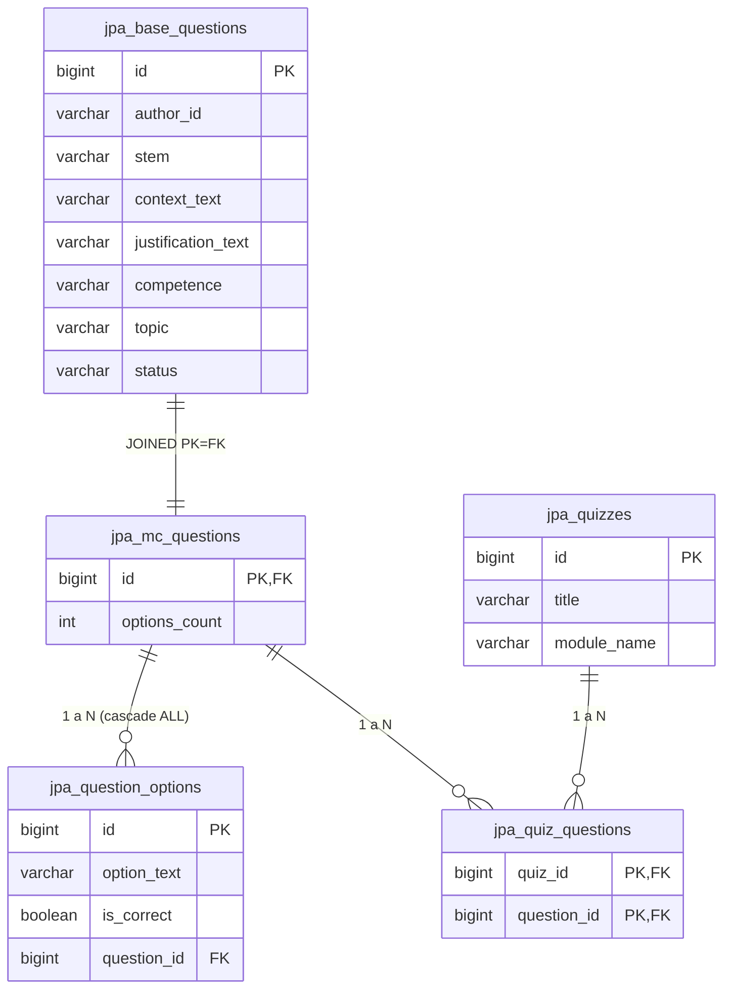

# Laboratorio de Ingeniería de Software II — Taller 10
## Persistencia Limpia con JPA: Aislamiento del Dominio y Arquitectura en Capas

- **Institución:** Universidad del Cauca  
- **Facultad:** Facultad de Ingeniería Electrónica y Telecomunicaciones (FIET)  
- **Programa:** Ingeniería de Sistemas  
- **Asignatura:** Laboratorio de Ingeniería de Software II  
- **Docente:** Ing. Paola Andrea Bedoya Toro  
- **Periodo Académico:** 2026.2  
- **Autores / Equipo:**  
  - Santiago Caicedo  
  - Ivan Alexander Lopez  
  - Adrian Araujo Urbano  
  - Carlos Bambague  

---

## 1. Introducción y Objetivos del Taller

El propósito de este laboratorio es diseñar, implementar y verificar un esquema de **persistencia limpia utilizando JPA (Java Persistence API / Jakarta Persistence) y Spring Data JPA**, garantizando que el **modelo de dominio no sea contaminado con anotaciones tecnológicas** (`@Entity`, `@Table`, `@Id`, etc.) ni acoplado al framework de persistencia.

Se estructura en dos etapas principales:
1. **Parte I:** Comprensión y análisis arquitectural del modelo de persistencia limpia desacoplada (relaciones `@OneToMany`, `@ManyToOne`, `@ManyToMany`, herencia `InheritanceType.JOINED` y justificación de diseño).
2. **Parte II:** Diseño e implementación práctica para el **Banco de Preguntas Saber Pro** con base de datos H2 en memoria, cumpliendo los 5 casos de uso de negocio y pruebas automatizadas.

---

## Parte I: Comprensión del Demo Existente

### Actividad 1.1. Reconocimiento de la Arquitectura en Capas

| Capa / Elemento | Archivo o Clase | Responsabilidad Principal |
|---|---|---|
| **Presentación** | `SchoolController` | Expone los endpoints HTTP REST, recibe las peticiones externas (DTOs), delega al servicio de aplicación y retorna códigos de estado HTTP estandarizados. |
| **Aplicación** | `SchoolService` | Orquesta los casos de uso del sistema, coordina transacciones de negocio e invoca los contratos de repositorio independientes de la tecnología. |
| **Dominio** | `Student`, `Course`, `Department` | Representan los conceptos esenciales del negocio escolar con sus invariantes y reglas semánticas. Son clases Java puras (POJOs), sin anotaciones de JPA (`@Entity`). |
| **Contrato de Repositorio** | `StudentRepository` | Define la interfaz abstracta que expresa las operaciones de consulta y persistencia en el lenguaje del negocio, sin detalles de infraestructura. |
| **Implementación Concreta** | `StudentRepositoryJpa` (Adapter) | Implementa la interfaz del dominio interactuando con Spring Data JPA y el EntityManager, ejecutando las consultas en la base de datos y usando el mapeador. |
| **Modelo JPA (Infraestructura)** | `StudentRecord`, `CourseRecord`, `DepartmentRecord` | Entidades tecnológicas anotadas con `@Entity`, `@Table`, `@Id`, `@JoinColumn` que modelan fielmente el esquema de base de datos relacional. |
| **Conversión de Modelos** | `DomainMapper` | Realiza la transformación bidireccional entre las clases de dominio puras (`Student`) y los registros JPA de infraestructura (`StudentRecord`), preservando el aislamiento. |

#### Preguntas de Reflexión Arquitectural:

1. **¿Qué ocurriría si se agregara `@Entity` directamente a la clase de dominio `Student`?**  
   Se violaría el principio de responsabilidad única (SRP) y la arquitectura limpia, acoplando las reglas de negocio a la especificación de Jakarta Persistence. Si el esquema relacional requiere cambios (e.g., columnas compuestas, nombres de tablas legadas, estrategias de caché de segundo nivel), la lógica de negocio se vería obligada a cambiar. Además, se forzaría la existencia de constructores vacíos y getters/setters mutables exigidos por JPA, comprometiendo la inmutabilidad y encapsulamiento del dominio.

2. **¿Por qué `SchoolService` depende de `StudentRepository` y no directamente de `SpringStudentDataRepository`?**  
   Por el **Principio de Inversión de Dependencias (DIP)** de SOLID. El servicio de aplicación pertenece a una capa superior al framework de acceso a datos. Al depender de la abstracción `StudentRepository`, el servicio puede ser probado unitariamente con repositorios en memoria (fakes/mocks) sin necesidad de levantar el contexto de Spring Data ni una base de datos real.

3. **¿Qué responsabilidades tiene `StudentRepositoryJpa` que no deberían estar en `Student`?**  
   Gestionar la conexión JDBC, iniciar y comprometer transacciones (`@Transactional`), traducir excepciones SQL a excepciones de acceso a datos, ejecutar consultas JPQL/SQL, gestionar el ciclo de vida del contexto de persistencia (`EntityManager`) y mapear resultados relacionales a objetos.

4. **¿Qué ventajas y costos introduce tener una clase `Student` y otra `StudentRecord`?**  
   - **Ventajas:** Desacoplamiento total; el esquema de base de datos puede optimizarse (desnormalizaciones, índices, tipos específicos de columnas) sin alterar el modelo del negocio; el dominio se mantiene testeable y puro.  
   - **Costos:** Mayor cantidad de clases (código boilerplate), sobrecarga en CPU/memoria debido a la transformación de objetos en el `DomainMapper` y necesidad de mantener la sincronización entre ambos modelos.

5. **¿Qué tendría que cambiar si se reemplazara H2 por PostgreSQL manteniendo el mismo contrato de repositorio?**  
   Únicamente la configuración de infraestructura: las dependencias del driver JDBC en el `pom.xml`, la URL de conexión, usuario, contraseña y el dialecto en las propiedades de la aplicación (`application.properties` o `DataSource`). **El código de dominio (`Student`), el servicio (`SchoolService`) y el contrato (`StudentRepository`) permanecen 100% inalterados.**

---

### Actividad 1.2. Comprensión de Relaciones en JPA



- **Lado propietario:** En la relación bidireccional `DepartmentRecord` ↔ `CourseRecord`, el **lado propietario es `CourseRecord`** porque es quien contiene la anotación `@JoinColumn(name = "department_id")` y la clave foránea física en la base de datos.
- **`mappedBy = "department"`:** Aparece en `DepartmentRecord` para indicarle a JPA que este extremo es el lado inverso. Informa que la relación ya fue mapeada por el atributo `department` de la clase `CourseRecord`, evitando que Hibernate cree una tabla intermedia innecesaria.
- **Función de `@JoinColumn`:** Especifica el nombre físico de la columna que almacena la clave foránea en la tabla relacional (`department_id`).
- **Tabla intermedia en Many-to-Many:** La anotación `@JoinTable(name = "student_courses")` define la tabla física que resuelve la relación muchos a muchos, vinculando `student_id` y `course_id`.
- **Diferencia entre colecciones:** La colección de cursos de un departamento representa una **composición organizativa 1 a N** (un curso pertenece a un único departamento). La colección de cursos de un estudiante representa una **asociación N a N** (un estudiante cursa múltiples asignaturas y cada asignatura tiene múltiples estudiantes matriculados).

---

### Actividad 1.3. Comprensión de la Herencia en JPA

1. **`@Inheritance(strategy = InheritanceType.JOINED)`:** Indica a JPA que cada clase de la jerarquía polimórfica tendrá su propia tabla relacional en la base de datos.
2. **Distribución de atributos:**
   - **Tabla Base (`jpa_base_questions` o `person`):** Almacena los atributos compartidos por todas las variantes (`id`, `authorId`, `stem`, `context`, `status`).
   - **Tablas Especializadas (`jpa_mc_questions`, `student`, `instructor`):** Contienen únicamente las columnas específicas del subtipo (e.g., `options_count`), compartiendo la misma clave primaria como clave foránea hacia la tabla base.
3. **Comparación de estrategias:**
   - **`JOINED` (Elegida):** Esquema relacional normalizado sin redundancias ni columnas nulas. Permite integridad referencial estricta pero requiere operaciones `JOIN` en consultas polimórficas.
   - **`SINGLE_TABLE`:** Todas las subclases se guardan en una única tabla con una columna discriminadora (`DTYPE`). Muy rápida en lecturas sin joins, pero genera columnas con valores `NULL` obligatorios para atributos específicos.
   - **`TABLE_PER_CLASS`:** Cada subclase tiene una tabla independiente con todos los atributos duplicados. No permite claves foráneas directas polimórficas eficientes.

---

## Parte II: Solución para el Banco de Preguntas Saber Pro

### 2.1 Arquitectura del Módulo Implementado

El módulo implementado en `co.unicauca.iso2.bancopreguntas.jpa` sigue una estricta separación en capas:

```
co.unicauca.iso2.bancopreguntas.jpa/
├── domain/                                # DOMINIO PURO (Sin jakarta.persistence)
│   ├── model/
│   │   ├── CleanQuestion.java             # Entidad pura de Pregunta
│   │   ├── CleanOption.java               # Entidad pura de Opción
│   │   ├── CleanQuiz.java                 # Entidad pura de Cuestionario
│   │   └── CleanQuestionStatus.java       # Enum de ciclo de vida
│   ├── repository/
│   │   ├── CleanQuestionRepository.java   # Contrato abstracto del repositorio de preguntas
│   │   └── CleanQuizRepository.java       # Contrato abstracto del repositorio de cuestionarios
│   └── service/
│       └── CleanQuizService.java          # Servicio orquestador de los 5 casos de uso
└── infrastructure/                        # INFRAESTRUCTURA JPA (Aislada)
    ├── record/
    │   ├── BaseQuestionRecord.java        # Entidad JPA Base (@Inheritance JOINED)
    │   ├── MultipleChoiceQuestionRecord.java # Entidad JPA de Selección Múltiple
    │   ├── OptionRecord.java              # Entidad JPA (@ManyToOne con pregunta)
    │   └── QuizRecord.java                # Entidad JPA (@ManyToMany con preguntas)
    ├── springdata/
    │   ├── SpringQuestionRecordRepository.java # JpaRepository de preguntas
    │   └── SpringQuizRecordRepository.java     # JpaRepository de cuestionarios
    ├── mapper/
    │   └── CleanDomainMapper.java         # Mapeador bidireccional Dominio <-> JPA
    └── adapter/
        ├── CleanQuestionRepositoryJpaAdapter.java # Adaptador JPA de preguntas
        └── CleanQuizRepositoryJpaAdapter.java     # Adaptador JPA de cuestionarios
```



---

### 2.2 Esquema Relacional Generado en H2



---

### 2.3 Implementación de los 5 Casos de Uso

En `CleanQuizService.java` se implementaron y verificaron:

1. **Crear una pregunta:** Registro de autor, enunciado, justificación, competencia y sus 4 opciones con cascada completa hacia `jpa_question_options`.
2. **Consultar preguntas:** Recuperación de preguntas por identificador reconstruyendo las entidades de dominio y sus opciones a través del `CleanDomainMapper`.
3. **Clasificar una pregunta:** Modificación de competencia y tema sin alterar el resto de atributos persistidos.
4. **Enviar una pregunta a revisión:** Validación de precondiciones de negocio (debe tener exactamente 4 opciones y 1 respuesta correcta) antes de transicionar a `PENDIENTE_REVISION`.
5. **Crear un cuestionario:** Asociación de preguntas evaluadas garantizando la **invariante de que solo preguntas en estado `APPROVED` pueden conformar un examen**.

---

### 2.4 Verificación Automatizada con H2 (`CleanJpaPersistenceH2Test`)

Las pruebas en `banco-preguntas/src/test/java/co/unicauca/iso2/bancopreguntas/jpa/CleanJpaPersistenceH2Test.java` verifican:

- Persistencia y consulta en memoria con H2.
- Integridad de claves foráneas y cascadas (`CascadeType.ALL`, `orphanRemoval = true`).
- Aislamiento: los contratos de repositorio (`CleanQuestionRepository`, `CleanQuizRepository`) se prueban sin exponer detalles JPA al servicio.
- Caso de error: se comprueba que el intento de crear un cuestionario con preguntas en estado `DRAFT` lanza `IllegalStateException` y no persiste la relación inválida.

Resultado de ejecución:
```
[INFO] Running co.unicauca.iso2.bancopreguntas.jpa.CleanJpaPersistenceH2Test
[INFO] Tests run: 5, Failures: 0, Errors: 0, Skipped: 0, Time elapsed: 2.944 s
[INFO] BUILD SUCCESS
```
