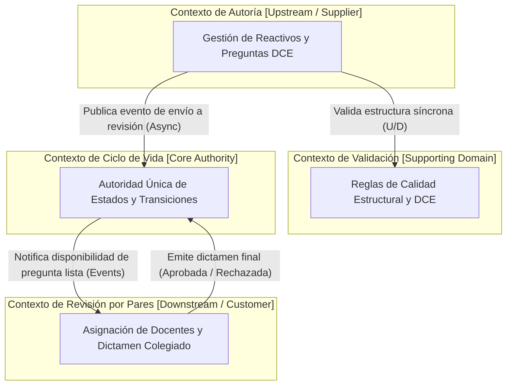

# Laboratorio de Ingeniería de Software II — Taller 11
## Domain-Driven Design (DDD): Modelado Estratégico y Táctico en el Banco de Preguntas Saber Pro

- **Institución:** Universidad del Cauca  
- **Facultad:** Facultad de Ingeniería Electrónica y Telecomunicaciones (FIET)  
- **Programa:** Ingeniería de Sistemas  
- **Asignatura:** Laboratorio de Ingeniería de Software II  
- **Docente:** Ing. Paola Andrea Bedoya Toro  
- **Periodo Académico:** 2026.2  
- **Autores / Equipo:**  
  - Yeferson Santiago Caicedo Orozco  
  - Iván Alexander López Lasso  
  - Adrián Camilo Araujo Urbano  

---

## 1. Objetivos del Taller

1. Comprender y aplicar los patrones de **diseño estratégico de DDD** (*Bounded Contexts*, Lenguaje Ubicuo y *Context Mapping*) sobre el sistema del Banco de Preguntas Saber Pro.
2. Implementar los patrones de **diseño táctico de DDD** (*Aggregates*, *Aggregate Root*, *Entities*, *Value Objects*, *Domain Exceptions* e Invariantes de Negocio) en **Java puro (Java 17+)**.
3. Aislar completamente la lógica del negocio garantizando que el núcleo del dominio **no contenga ninguna dependencia técnica hacia frameworks externos (sin Spring, sin JPA, sin anotaciones tecnológicas)**.

---

## 2. Parte I: Modelado Estratégico (Bounded Contexts y Lenguaje Ubicuo)

En el diseño estratégico de DDD, el problema se descompone en **Contextos Delimitados (*Bounded Contexts*)**, donde cada modelo conceptual es aplicable dentro de una frontera explícita compartiendo un **Lenguaje Ubicuo**:

| Bounded Context | Responsabilidad Principal | Conceptos del Lenguaje Ubicuo |
|---|---|---|
| **Contexto de Autoría** | Gestión de reactivos bajo el Diseño Centrado en Evidencia (DCE), redacción de enunciados, distractores, claves y justificaciones pedagógicas. | `Pregunta`, `Enunciado`, `Clave`, `Justificacion`, `Autor`, `OpcionRespuesta`, `Distractor`. |
| **Contexto de Validación** | Verificación determinista de reglas de calidad estructural, sintáctica y pedagógica sobre los reactivos. | `ReglaEstructural`, `FiltroExpresion`, `ValidezOpciones`, `CriterioDCE`, `ResultadoValidacion`. |
| **Contexto de Ciclo de Vida** | Control estricto y autoridad única sobre las transiciones de estado de las preguntas a lo largo de su flujo de madurez. | `EstadoPregunta`, `Transicion`, `Borrador`, `PendienteRevision`, `EnRevision`, `Aprobada`, `Rechazada`. |
| **Contexto de Revisión por Pares** | Asignación de docentes evaluadores, consolidación de dictámenes colegiados y registro de observaciones de mejora. | `Revisor`, `Asignacion`, `Evaluacion`, `Dictamen`, `ObservacionPedagogica`, `Veredicto`. |

### Mapa de Contextos (*Context Map*)



- **Relación Autoría → Validación:** Relación *Customer-Supplier* donde el contexto de autoría consume el contrato de validación estructural antes de admitir cambios.
- **Relación Autoría → Ciclo de Vida:** El ciclo de vida actúa como *Published Language* y autoridad central; una pregunta no cambia de estado por decisión unilateral del autor sino mediante transiciones formalmente verificadas.
- **Relación Revisión por Pares → Ciclo de Vida:** La revisión por pares genera dictámenes que alimentan el cambio de estado definitivo (`APROBADA` o `RECHAZADA`).

---

## 3. Parte II: Modelado Táctico (Bloques de Construcción)

El código del dominio puro vive en el módulo Maven independiente [`saberpro-domain/`](saberpro-domain/), cuyo `pom.xml` no hereda de Spring Boot ni declara JPA (solo JUnit 5 en alcance `test`). Se estructuró bajo el paquete `co.edu.unicauca.saberpro.domain`:

```
co.edu.unicauca.saberpro.domain/
├── model/                                # CLASES DE DOMINIO PURAS (Java 17+)
│   ├── Pregunta.java                     # AGGREGATE ROOT (Raíz de Agregado)
│   ├── Enunciado.java                    # VALUE OBJECT (Inmutable)
│   ├── Justificacion.java                # VALUE OBJECT (Inmutable, >= 15 chars)
│   ├── OpcionRespuesta.java              # VALUE OBJECT (Inmutable)
│   ├── Revisor.java                      # ENTITY (identidad: ID de docente)
│   ├── Revision.java                     # ENTITY (identidad: ID de evaluación)
│   ├── Dictamen.java                     # ENUM (APROBADA, RECHAZADA)
│   └── EstadoPregunta.java               # ENUM (BORRADOR, PENDIENTE_REVISION...)
├── exception/                            # EXCEPCIONES DE NEGOCIO
│   ├── DomainException.java              # Excepción raíz del dominio
│   └── ReglaNegocioException.java        # Violación de invariantes
└── repository/                           # CONTRATOS DE REPOSITORIO PUROS
    ├── PreguntaRepository.java           # Interfaz pura del dominio
    └── PreguntaMemoryRepository.java     # Doble de prueba en memoria
```

### 3.1 Objetos de Valor (Value Objects)
- **`Justificacion`:** Inmutable. Garantiza que toda justificación contenga al menos 15 caracteres significativos y que no use palabras prohibidas (`obvio`, `obviamente`, `evidentemente`, `claramente`, `porque sí`, `todas las anteriores`, `ninguna de las anteriores`), sin importar mayúsculas ni tildes. Fragmento base del taller:
  ```java
  public final class Justificacion {
      private final String texto;
      public Justificacion(String texto) {
          if (texto == null || texto.trim().length() < 15) {
              throw new ReglaNegocioException("La justificación debe contener al menos 15 caracteres.");
          }
          this.texto = texto.trim();
      }
      public String getTexto() { return texto; }
  }
  ```
- **`Enunciado`:** Inmutable. Valida la no-nulidad y un tamaño pedagógico mínimo (>= 10 caracteres). Igualdad determinada por su valor (`equals` y `hashCode`).
- **`OpcionRespuesta`:** Inmutable. Encapsula el texto de la opción y la bandera booleana `esCorrecta` (distractor o clave).

### 3.1.1 Entidades (Entities)
- **`Revisor`:** Entidad identificada por el **ID de docente**. Dos revisores son el mismo aunque cambie su nombre (`equals`/`hashCode` solo usan el ID); por eso es entidad y no objeto de valor.
- **`Revision`:** Entidad identificada por el **ID de evaluación**. Protege tres reglas del contexto de Revisión por Pares: el autor de la pregunta no puede ser su revisor, el `Dictamen` (`APROBADA`/`RECHAZADA`) se emite una sola vez y un rechazo exige una observación pedagógica.

### 3.2 Raíz de Agregado (`Pregunta`) e Invariantes de Negocio
La clase `Pregunta` actúa como guardián de consistencia del agregado, garantizando las siguientes **invariantes inviolables**:

1. **Modificación restringida:** Solo se pueden agregar o modificar opciones cuando la pregunta está en estado `BORRADOR`.
2. **Máximo de 4 opciones:** Si se intenta agregar una quinta opción, se lanza de inmediato `ReglaNegocioException("Una pregunta no puede tener más de 4 opciones.")`.
3. **Regla de envío a revisión (`validarInvariantesParaEnvio`):**
   - El enunciado debe estar presente y ser válido.
   - La justificación debe estar presente y ser válida.
   - Debe tener **exactamente 4 opciones de respuesta**.
   - Debe existir **exactamente 1 opción marcada como correcta**.
4. **Encapsulamiento estricto:** El método `getOpciones()` expone `Collections.unmodifiableList(opciones)`, imposibilitando mutaciones externas sin pasar por los métodos del agregado.
5. **Transiciones seguras de ciclo de vida:**
   - `enviarARevision()`: Requiere estado `BORRADOR` y el cumplimiento de las invariantes. Pasa a `PENDIENTE_REVISION`.
   - `iniciarRevision()`: Requiere estado `PENDIENTE_REVISION`. Pasa a `EN_REVISION`.
   - `aprobar()`: Requiere estado `EN_REVISION`. Pasa a `APROBADA`.
   - `rechazar(motivo)`: Requiere estado `EN_REVISION` y un motivo explícito. Pasa a `RECHAZADA`.

---

## 4. Pruebas Unitarias de Invariantes (JUnit 5)

En `saberpro-domain/src/test/java/co/edu/unicauca/saberpro/domain/` se implementaron 22 pruebas unitarias sin dependencias externas (se ejecutan con `cd saberpro-domain && mvn test`). Una de ellas, `DominioPuroTest`, recorre las fuentes del dominio y falla si alguna importa Spring, JPA, Hibernate o Lombok:

```java
@Test
@DisplayName("Invariante: no debe permitir enviar a revisión sin tener 4 opciones")
void noDebePermitirEnviarARevisionSinCuatroOpciones() {
    Pregunta pregunta = new Pregunta();
    pregunta.agregarOpcion("Opción A", true);
    assertThrows(ReglaNegocioException.class, pregunta::enviarARevision);
}

@Test
@DisplayName("Invariante: no debe permitir más de 4 opciones")
void noDebePermitirMasDeCuatroOpciones() {
    pregunta.agregarOpcion("Opción A", true);
    pregunta.agregarOpcion("Opción B", false);
    pregunta.agregarOpcion("Opción C", false);
    pregunta.agregarOpcion("Opción D", false);

    assertThrows(ReglaNegocioException.class, () ->
            pregunta.agregarOpcion("Opción E", false));
}

@Test
@DisplayName("Invariante: no debe permitir enviar a revisión sin exactamente 1 opción correcta")
void noDebePermitirEnviarARevisionSinOpcionCorrecta() {
    pregunta.agregarOpcion("Opción A", false);
    pregunta.agregarOpcion("Opción B", false);
    pregunta.agregarOpcion("Opción C", false);
    pregunta.agregarOpcion("Opción D", false);

    assertThrows(ReglaNegocioException.class, pregunta::enviarARevision);
}
```

### Resultados de Ejecución de Pruebas:
```
[INFO] Running co.edu.unicauca.saberpro.domain.DominioPuroTest
[INFO] Tests run: 1, Failures: 0, Errors: 0, Skipped: 0
[INFO] Running co.edu.unicauca.saberpro.domain.model.ValueObjectsTest
[INFO] Tests run: 6, Failures: 0, Errors: 0, Skipped: 0
[INFO] Running co.edu.unicauca.saberpro.domain.model.PreguntaAggregateTest
[INFO] Tests run: 9, Failures: 0, Errors: 0, Skipped: 0
[INFO] Running co.edu.unicauca.saberpro.domain.model.EntidadesRevisionTest
[INFO] Tests run: 3, Failures: 0, Errors: 0, Skipped: 0
[INFO] Running co.edu.unicauca.saberpro.domain.repository.PreguntaMemoryRepositoryTest
[INFO] Tests run: 3, Failures: 0, Errors: 0, Skipped: 0
[INFO] BUILD SUCCESS
```

---

## 5. Resumen de Entregables del Taller 11

- ✅ **Módulo de Dominio Puro:** Módulo `saberpro-domain` (paquete `co.edu.unicauca.saberpro.domain`) en Java 17+ sin dependencias de Spring ni JPA, verificado por `DominioPuroTest` y por un job propio en GitHub Actions.
- ✅ **Raíz de Agregado con Invariantes:** Clase `Pregunta` con validación estricta de 4 opciones, clave única y transiciones de estado.
- ✅ **Objetos de Valor Inmutables:** `Justificacion` (>=15 caracteres y sin palabras prohibidas), `Enunciado` y `OpcionRespuesta`.
- ✅ **Entidades con identidad:** `Revisor` (ID de docente) y `Revision` (ID de evaluación) con sus reglas de dictamen.
- ✅ **Contrato de Repositorio:** Interfaz `PreguntaRepository` e implementación `PreguntaMemoryRepository`.
- ✅ **Pruebas Automatizadas JUnit 5:** 22 pruebas unitarias ejecutadas exitosamente.
