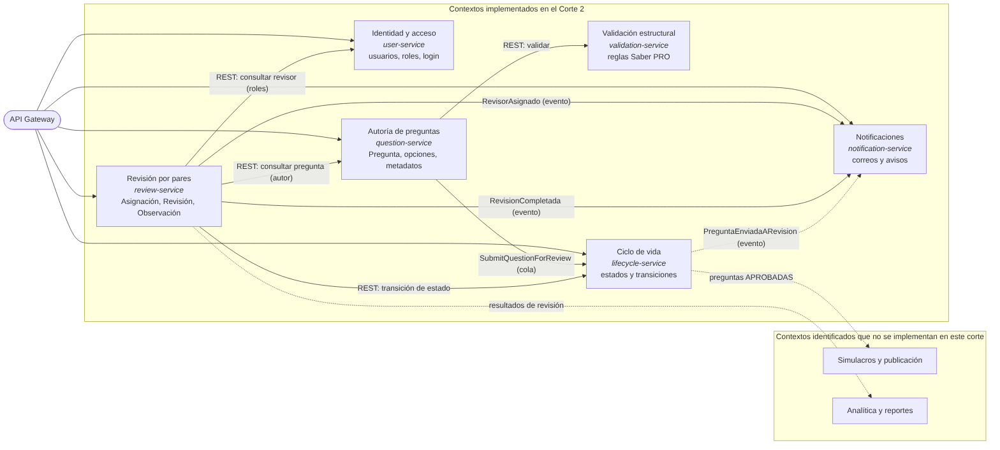
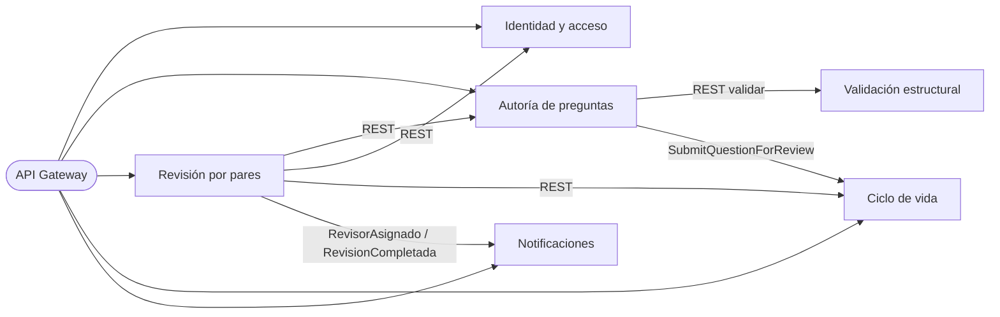

# Contextos delimitados del Banco de Preguntas Saber PRO

Historia técnica **HU-T1** (SCRUM-41). Parte de la Figura 1 del enunciado, pero la ajusta a cómo el grupo dividió el sistema en la iteración 2.

## 1. Diagrama de contextos

La fuente editable del diagrama está en [`diagramas/contextos.mmd`](diagramas/contextos.mmd) (Mermaid). Las flechas continuas son integraciones que ya existen en el código; las punteadas son relaciones previstas para contextos que no se implementan en este corte.

## 2. Diferencias con la Figura 1

| Decisión | Motivo |
|---|---|
| La validación estructural es un contexto propio (`validation-service`) y no parte de la autoría. | Las reglas Saber PRO (4 opciones, una clave, longitudes, expresiones prohibidas) cambian con independencia del formulario de autoría y pueden reutilizarse al importar preguntas externas. |
| El ciclo de vida es un contexto propio (`lifecycle-service`). | Es la autoridad única del estado de la pregunta. Autoría y revisión le piden transiciones en lugar de cambiar el estado cada una por su lado, así se evita que dos servicios dejen la pregunta en estados distintos. |
| Asignación y evaluación quedan juntas en **Revisión por pares**. | Comparten las mismas invariantes: 1 a 3 revisores, el autor no revisa su pregunta, solo evalúa quien tiene la asignación y la decisión final depende de todas las evaluaciones. |
| Simulacros y Analítica se identifican pero **no se implementan** en el corte 2. | No los piden las HU-01 a HU-05. Se dejan en el mapa para mostrar hacia dónde crece el sistema. |

## 3. Contexto → microservicio → base de datos

| Contexto | Microservicio | Puerto | Responsabilidad | Base de datos propia | Estado en el repositorio |
|---|---|---|---|---|---|
| Identidad y acceso | `user-service` | 8083 | Usuarios, roles (AUTOR, ADMINISTRADOR, REVISOR, DOCENTE, ESTUDIANTE) y login | `user_db` | Implementada: Spring Data JPA + Flyway (H2 por defecto, PostgreSQL con `USER_DB_URL`) |
| Autoría de preguntas | `question-service` | 8081 | Crear y editar preguntas, listar con paginación y filtros, solicitar envío a revisión | `question_db` | **Implementada con JPA y migraciones Flyway** (H2 en archivo por defecto, PostgreSQL con `QUESTION_DB_URL`) |
| Validación estructural | `validation-service` | 8082 | Reglas estructurales de la pregunta (Strategy) | Sin estado | No necesita BD |
| Ciclo de vida | `lifecycle-service` | 8084 | Estado de cada pregunta y transiciones permitidas | `lifecycle_db` | En memoria |
| **Revisión por pares** | `review-service` | 8085 | Asignaciones, evaluaciones y observaciones (HU-04 y HU-05) | `review_db` | **Implementada con JPA** (H2 en archivo por defecto, PostgreSQL con `REVIEW_DB_URL`) |
| Notificaciones | `notification-service` | 8086 | Consumir eventos y enviar correo a revisores, autores y administrador | `notification_db` | En memoria; la BD propia llega con HU-T6 |
| — | `api-gateway` | 8080 | Punto de entrada único del frontend | Sin estado | Implementado (HU-T8) |

Regla común: ningún servicio lee la base de datos de otro. Lo que necesita de otro contexto lo pide por REST (consulta síncrona) o lo recibe como evento por RabbitMQ.

## 4. Lenguaje ubicuo por contexto

| Contexto | Términos | Invariantes principales |
|---|---|---|
| Autoría | Pregunta, Contexto, Enunciado, Opción, Clave, Justificación, Competencia, Tema, Subtema, Nivel | Una pregunta se edita solo en BORRADOR o RECHAZADA |
| Ciclo de vida | Estado, Transición | DRAFT → PENDING_REVIEW → IN_REVIEW → APPROVED / REJECTED → PUBLISHED; REJECTED vuelve a DRAFT o PENDING_REVIEW |
| Revisión por pares | Asignación, Revisor, Revisión, Decisión, Observación, Veredicto | 1 a 3 revisores distintos; el autor no revisa su pregunta; rechazar exige observación; la pregunta se aprueba solo si todos aprueban |
| Notificaciones | Notificación, Destinatario, Tipo | Cada evento se notifica una sola vez aunque llegue repetido |

Los contratos (eventos y endpoints) de cada contexto están en [02-contratos.md](02-contratos.md).
