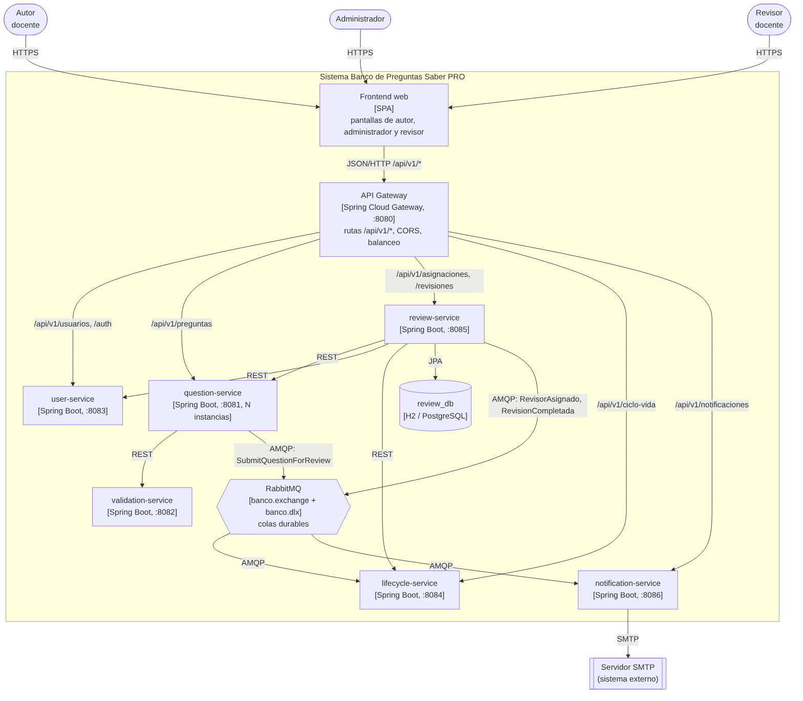

# Modelo C4 — nivel 2 (contenedores)

Historia técnica **HU-T8.3** (SCRUM-89). El frontend y el backend están separados y se comunican solo por la API REST que expone el API Gateway.

Fuente editable: [`diagramas/c4-contenedores.mmd`](diagramas/c4-contenedores.mmd).

## Contenedores

| Contenedor | Tecnología | Responsabilidad | Se comunica con |
|---|---|---|---|
| Frontend web | SPA (HU-T7) | Pantallas de autor, administrador y revisor | API Gateway por JSON/HTTP |
| **API Gateway** | Spring Cloud Gateway 2023.0, puerto 8080 | Único punto de entrada. Enruta `/api/v1/*` al servicio correcto, aplica CORS y balancea entre instancias de question-service (perfil `escalado`) | Todos los servicios por HTTP |
| user-service | Spring Boot 3.3, puerto 8083 | Usuarios, roles y login | — |
| question-service | Spring Boot 3.3, puerto 8081, varias instancias | Autoría de preguntas | validation-service (REST), RabbitMQ |
| validation-service | Spring Boot 3.3, puerto 8082 | Validación estructural | — |
| lifecycle-service | Spring Boot 3.3, puerto 8084 | Estados y transiciones | RabbitMQ |
| review-service | Spring Boot 3.3 + Spring Data JPA, puerto 8085 | Asignaciones y evaluaciones | question, user y lifecycle (REST), review_db, RabbitMQ |
| notification-service | Spring Boot 3.3, puerto 8086 | Notificaciones por eventos | RabbitMQ, SMTP |
| RabbitMQ | RabbitMQ 3.13 | `banco.exchange` para eventos y `banco.dlx` para mensajes fallidos | — |
| review_db | H2 en archivo (desarrollo) / PostgreSQL (`REVIEW_DB_URL`) | Tablas `asignacion` y `revision` | — |

## Rutas del API Gateway

| Ruta pública | Servicio destino | Reescritura |
|---|---|---|
| `/api/v1/preguntas/**` | question-service (`QUESTION_SERVICE_ROUTE`) | `/questions/**` |
| `/api/v1/usuarios/**` | user-service (`USER_SERVICE_URL`) | `/users/**` |
| `/api/v1/auth/**` | user-service | `/auth/**` |
| `/api/v1/asignaciones/**` | review-service (`REVIEW_SERVICE_URL`) | sin cambio |
| `/api/v1/revisiones/**` | review-service | sin cambio |
| `/api/v1/ciclo-vida/**` | lifecycle-service (`LIFECYCLE_SERVICE_URL`) | `/lifecycle/**` |
| `/api/v1/validaciones` | validation-service (`VALIDATION_SERVICE_URL`) | `/validate` |
| `/api/v1/notificaciones/**` | notification-service (`NOTIFICATION_SERVICE_URL`) | `/notifications/**` |

`GET http://localhost:8080/actuator/gateway/routes` muestra las rutas cargadas.

Con el perfil `escalado` (`SPRING_PROFILES_ACTIVE=escalado`), `/api/v1/preguntas/**` usa `lb://question-service` y reparte las peticiones entre `QUESTION_SERVICE_URL` y `QUESTION_SERVICE_URL_2`. Es el modo que usa la prueba de carga del escenario de escalabilidad.
