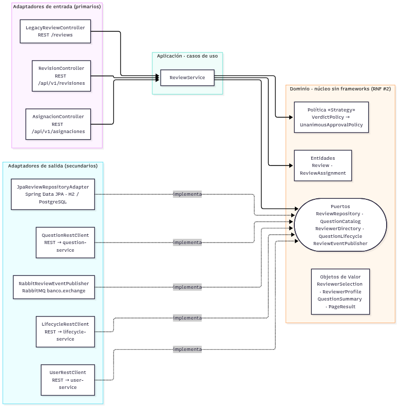

# Arquitectura limpia hexagonal en `review-service` — RNF #2

Requisito no funcional **RNF #2 (Tercer Corte 2026.2)**: *"Arquitectura limpia (DDD y/o hexagonal) en un microservicio con lógica de dominio."*

Se aplica a **`review-service`** porque es el microservicio con reglas de negocio propias: asignación de 1 a 3 revisores, restricciones de autor/revisor, veredicto de la revisión por pares y ciclo de rondas. Las reglas **no viven en los controladores ni en los repositorios**, sino en el núcleo del dominio, aislado de frameworks.

## Diagrama hexagonal



Fuente editable: [`diagramas/hexagonal-review-service.mmd`](diagramas/hexagonal-review-service.mmd).

## Capas y regla de dependencias

| Capa | Paquete | Depende de | Contenido |
|---|---|---|---|
| Presentación | `presentation` | Aplicación | `RevisionController`, `AsignacionController`, `LegacyReviewController`, DTOs y `ApiExceptionHandler` |
| Aplicación | `application` | Dominio | `ReviewService` (casos de uso), `EvaluationOutcome`, `AssignedQuestionView` |
| Dominio | `domain` | — (solo Java + `shared-contracts`) | Modelo, puertos, políticas y excepciones |
| Infraestructura | `infrastructure` | Dominio y aplicación | Adaptadores JPA/REST/RabbitMQ y `ReviewServiceConfig` |

**Regla de dependencia:** siempre hacia adentro (`infrastructure` → `application` → `domain`; `presentation` → `application`). El dominio no conoce Spring, JPA, Jackson ni RabbitMQ, y no importa `application`, `infrastructure` ni `presentation`. Esta regla está **blindada con una prueba automatizada** (ver la última sección).

## Puertos y adaptadores

Los puertos son las interfaces del dominio que la capa de aplicación consume; los adaptadores son las implementaciones de infraestructura que los satisfacen. La inyección se declara en [`ReviewServiceConfig`](../microservicios/review-service/src/main/java/co/unicauca/iso2/taller09/reviewservice/infrastructure/config/ReviewServiceConfig.java).

| Puerto (dominio) | Propósito | Adaptador (infraestructura) | Tecnología / destino |
|---|---|---|---|
| `ReviewRepository` | Persistir asignaciones y revisiones, paginar las asignadas | `JpaReviewRepositoryAdapter` (+ `AssignmentEntity`, `ReviewEntity`) | Spring Data JPA · H2 (desarrollo) / PostgreSQL |
| `QuestionCatalog` | Leer los datos de la pregunta (`QuestionSummary`) | `QuestionRestClient` | REST → `question-service` (`services.question.url`) |
| `ReviewerDirectory` | Leer perfil y roles del revisor (`ReviewerProfile`) | `UserRestClient` | REST → `user-service` (`services.user.url`) |
| `QuestionLifecycle` | Consultar el estado y ejecutar transiciones de la pregunta | `LifecycleRestClient` | REST → `lifecycle-service` (`services.lifecycle.url`) |
| `ReviewEventPublisher` | Publicar `ReviewerAssigned` y `ReviewCompleted` | `RabbitReviewEventPublisher` | RabbitMQ (`banco.exchange`) |

> `VerdictPolicy` también invierte dependencias, pero dentro del propio dominio: es una política (patrón *Strategy*) implementada por `UnanimousApprovalPolicy`, de modo que la regla del veredicto es sustituible sin tocar el caso de uso.

## Lógica de dominio encapsulada

| Elemento | Tipo | Regla / invariante que protege |
|---|---|---|
| `Review` | Entidad | La decisión (APPROVED/REJECTED) es obligatoria y un **rechazo exige al menos una observación** |
| `ReviewAssignment` | Entidad | La ronda debe ser ≥ 1 y una asignación **solo se completa una vez** |
| `ReviewerSelection` | Objeto de Valor | **Entre 1 y 3 revisores, sin repetidos**; descarta identidades nulas |
| `ReviewerProfile` | Objeto de Valor | Solo los roles **REVISOR o DOCENTE** pueden revisar |
| `UnanimousApprovalPolicy` | Política (Strategy) | La pregunta se **aprueba solo si todos** los revisores aprueban |
| `PageResult` | Objeto de Valor | Cálculo del total de páginas de la paginación |

## Adaptadores de entrada (API REST)

| Controlador | Ruta base | Casos de uso |
|---|---|---|
| `AsignacionController` | `/api/v1/asignaciones` | HU-04: asignar revisores, listar asignaciones |
| `RevisionController` | `/api/v1/revisiones` | HU-05: listar asignadas (paginado), evaluar, ver observaciones |
| `LegacyReviewController` | `/reviews` | Rutas del Taller 09 (vía API Gateway `/api/v1/revisiones/**`) |

## Verificación automatizada

La pureza del núcleo y la dirección de las dependencias se comprueban con la prueba [`ArquitecturaHexagonalTest`](../microservicios/review-service/src/test/java/co/unicauca/iso2/taller09/reviewservice/ArquitecturaHexagonalTest.java), que falla si:

1. alguna clase de `domain` importa Spring, JPA, Hibernate, Lombok o Jackson;
2. alguna clase de `domain` importa `application`, `infrastructure` o `presentation`;
3. alguna clase de `application` importa `infrastructure` o `presentation`.

```powershell
$env:JAVA_HOME='C:\Program Files\Eclipse Adoptium\jdk-21.0.12.101-hotspot'
.\mvnw.cmd -f microservicios/pom.xml -pl review-service -am test
```

Resultado: **45 pruebas, 0 fallos**, de las cuales 10 son de dominio (`ReviewDomainTest`) y 3 verifican la arquitectura.

| Suite | Pruebas | Qué cubre |
|---|---|---|
| `ReviewDomainTest` | 10 | Entidades, objetos de valor, política de veredicto y paginación |
| `ReviewServiceTest` | 20 | Casos de uso de asignación y evaluación con dobles de prueba |
| `ArquitecturaHexagonalTest` | 3 | Reglas de la arquitectura hexagonal |
| `JpaReviewRepositoryAdapterTest` | 4 | Adaptador de persistencia |
| `RevisionControllerTest` | 8 | Adaptador de entrada REST |
