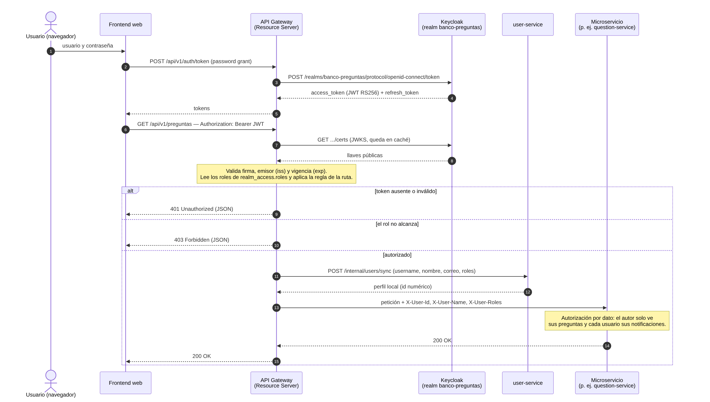

# Seguridad: autenticación y autorización con JWT y Keycloak (RNF #1, Corte 3)

> Requisito: *"Implementar autenticación y autorización basada en tokens JWT utilizando un sistema
> externo como Keycloak. No se requiere interfaz de gestión de usuarios y roles: esto se hará por
> Postman."*

## 1. Decisión de diseño

| Decisión | Motivo |
|---|---|
| **Keycloak 26** como proveedor de identidad (realm `banco-preguntas`) | Las contraseñas, los usuarios y los roles salen del sistema: ningún microservicio guarda credenciales |
| **El API Gateway es el único Resource Server OAuth2** (autenticación en el borde) | Hay un solo punto de entrada publicado; los microservicios no son alcanzables desde fuera de la red de Docker |
| El gateway valida el JWT con las **llaves públicas (JWKS)** de Keycloak | No hay secreto compartido ni llamada a Keycloak por petición: la firma RS256 se verifica localmente |
| **Propagación de identidad** con `X-User-Id`, `X-User-Name` y `X-User-Roles` | Los microservicios siguen trabajando con el identificador numérico del usuario y no dependen de Spring Security |
| **Aprovisionamiento justo a tiempo** del perfil en `user-service` | Un usuario creado en Keycloak por Postman queda disponible la primera vez que entra, sin pasos manuales |
| Inicio de sesión con *password grant* a través del gateway | El frontend no conoce la URL de Keycloak: solo habla con el gateway |

## 2. Flujo



1. El frontend envía usuario y contraseña a `POST /api/v1/auth/token`. El gateway reenvía la
   petición al endpoint de tokens de Keycloak, que devuelve el `access_token` (JWT firmado con
   RS256, 15 minutos) y el `refresh_token`.
2. Cada petición a `/api/v1/*` lleva `Authorization: Bearer <JWT>`.
3. El gateway valida la **firma**, el **emisor** (`iss`) y la **vigencia** (`exp`), lee los roles
   del claim `realm_access.roles` y aplica la regla de la ruta. Sin token responde **401**; sin el
   rol necesario, **403** (ambos en JSON).
4. Si la petición pasa, el gateway sincroniza el perfil con `user-service`
   (`POST /internal/users/sync`, con caché de 60 s) y agrega las cabeceras `X-User-*`. Las que
   envíe el cliente se descartan, así que no se pueden falsificar.
5. El microservicio aplica la **autorización por dato**: un autor solo lista sus preguntas y
   cada usuario solo lee sus notificaciones.

## 3. Reglas de autorización del gateway

Definidas en [`SecurityConfig`](../microservicios/api-gateway/src/main/java/co/unicauca/iso2/taller09/apigateway/security/SecurityConfig.java).

| Ruta | Método | Quién puede |
|---|---|---|
| `/api/v1/auth/**`, Swagger, `/actuator/health` | — | Público |
| `/api/v1/preguntas` | POST | AUTOR |
| `/api/v1/preguntas/{id}` | PUT | AUTOR |
| `/api/v1/preguntas/{id}/submit-review` | POST | AUTOR |
| `/api/v1/asignaciones/**` | Todos | ADMINISTRADOR |
| `/api/v1/usuarios/me` | GET | Cualquier usuario autenticado |
| `/api/v1/usuarios/**` | Todos | ADMINISTRADOR |
| `/api/v1/ciclo-vida/**` | POST | ADMINISTRADOR |
| `/api/v1/revisiones/asignadas` | GET | REVISOR |
| `/api/v1/revisiones/evaluar` | POST | REVISOR |
| `/actuator/**` | Todos | ADMINISTRADOR |
| Cualquier otra ruta | Todos | Cualquier usuario autenticado |

Autorización por dato (en los microservicios, con
[`RequestIdentity`](../microservicios/shared-contracts/src/main/java/co/unicauca/iso2/taller09/common/security/RequestIdentity.java)):

| Recurso | Regla |
|---|---|
| `GET /api/v1/preguntas` | Quien no es administrador solo ve sus propias preguntas, aunque pida otro `authorId` |
| `GET /api/v1/notificaciones/recipient/{id}` | Solo el destinatario o un administrador (403 para los demás) |
| `GET /api/v1/revisiones/pregunta/{id}/historial` | El autor de la pregunta, un revisor que participó o un administrador |

## 4. Clases

| Clase (api-gateway, paquete `security`) | Responsabilidad |
|---|---|
| `SecurityConfig` | Cadena de filtros: Resource Server JWT, reglas por rol, respuestas 401/403 en JSON y CORS |
| `KeycloakJwtAuthenticationConverter` | Convierte `realm_access.roles` en autoridades `ROLE_*` de Spring Security |
| `KeycloakIdentity` | Objeto de valor con los datos del token (usuario, nombre, correo y roles de la aplicación) |
| `UserIdentityResolver` | Puerto: obtiene el perfil local a partir de la identidad del token |
| `UserServiceIdentityResolver` | Adaptador: llama a `user-service` con WebClient y guarda el resultado en caché |
| `IdentityPropagationFilter` | Filtro global: descarta las cabeceras `X-User-*` entrantes y agrega las del token |

| Clase (otros módulos) | Responsabilidad |
|---|---|
| `user-service` · `InternalUserController` | `POST /internal/users/sync`: crea o actualiza el perfil (no está publicado en el gateway) |
| `user-service` · `User` | Ya no tiene contraseña; `synchronizeWith(...)` actualiza nombre, correo y roles |
| `shared-contracts` · `RequestIdentity` | Lee `X-User-Id` y `X-User-Roles` y resuelve la autorización por dato |

## 5. Realm

El archivo [`microservicios/keycloak/realm-banco-preguntas.json`](../microservicios/keycloak/realm-banco-preguntas.json)
se importa al arrancar el contenedor (`start-dev --import-realm`).

- **Roles del realm:** `ADMINISTRADOR`, `AUTOR`, `REVISOR`, `DOCENTE`, `ESTUDIANTE`.
- **Cliente:** `banco-preguntas-frontend` (público, *direct access grants*).
- **Usuarios de prueba:**

| Usuario | Contraseña | Roles |
|---|---|---|
| `admin` | `admin123` | ADMINISTRADOR |
| `autor1`, `autor2` | `autor123` | AUTOR, DOCENTE |
| `revisor1`, `revisor2` | `revisor123` | REVISOR, DOCENTE |
| `estudiante1` | `estudiante123` | ESTUDIANTE |

Consola de administración de Keycloak: http://localhost:8180 (`admin` / `admin`, realm `master`).

## 6. Gestión de usuarios y roles con Postman

Colección: [`microservicios/banco-preguntas-corte3.postman_collection.json`](../microservicios/banco-preguntas-corte3.postman_collection.json).

| Carpeta | Contenido |
|---|---|
| 0. Keycloak — gestión de usuarios y roles | Token del administrador, listar roles, **crear usuario**, **asignar rol**, ver roles, cambiar contraseña, **quitar rol**, listar usuarios |
| 1. Autenticación | Token de cada rol a través del gateway, credenciales incorrectas, *refresh token*, perfil y cierre de sesión |
| 2. Seguridad | 401 sin token, 401 con token alterado, 403 por rol y cabeceras `X-User-*` falsificadas |
| 3. Flujo completo | HU-01 a HU-06 con los tokens de autor, administrador y revisor |

Las mismas llamadas con `curl` (ejecutadas el 15 de noviembre de 2026 contra los contenedores):

```bash
# 1. Token del administrador de Keycloak
ADMIN=$(curl -s -X POST http://localhost:8180/realms/master/protocol/openid-connect/token \
  -d grant_type=password -d client_id=admin-cli -d username=admin -d password=admin | jq -r .access_token)

# 2. Crear el usuario                                                          -> 201 Created
curl -X POST http://localhost:8180/admin/realms/banco-preguntas/users \
  -H "Authorization: Bearer $ADMIN" -H 'Content-Type: application/json' \
  -d '{"username":"revisor3","enabled":true,"emailVerified":true,"firstName":"Laura","lastName":"Revisora",
       "email":"revisor3@unicauca.edu.co","credentials":[{"type":"password","value":"revisor123","temporary":false}]}'

# 3. Asignarle el rol REVISOR                                                  -> 204 No Content
ROL=$(curl -s http://localhost:8180/admin/realms/banco-preguntas/roles/REVISOR -H "Authorization: Bearer $ADMIN")
curl -X POST http://localhost:8180/admin/realms/banco-preguntas/users/$ID/role-mappings/realm \
  -H "Authorization: Bearer $ADMIN" -H 'Content-Type: application/json' -d "[$ROL]"

# 4. El usuario nuevo inicia sesión por el gateway y queda aprovisionado
TOKEN=$(curl -s -X POST http://localhost:8080/api/v1/auth/token -d grant_type=password \
  -d client_id=banco-preguntas-frontend -d username=revisor3 -d password=revisor123 | jq -r .access_token)
curl http://localhost:8080/api/v1/usuarios/me -H "Authorization: Bearer $TOKEN"
# {"id":100,"username":"revisor3","fullName":"Laura Revisora","email":"revisor3@unicauca.edu.co","roles":["REVISOR"]}
```

Resultados observados:

| Caso | Respuesta |
|---|---|
| Petición sin token | 401 |
| Token alterado | 401 |
| Un revisor intenta crear una pregunta | 403 |
| Un autor intenta asignar revisores | 403 |
| Un estudiante intenta listar usuarios | 403 |
| Un autor consulta las notificaciones de otro usuario | 403 |
| Credenciales incorrectas | 400 `invalid_grant` |
| Usuario recién creado en Keycloak con rol REVISOR | 200 en `/usuarios/me` y en `/revisiones/asignadas` |

## 7. Pruebas automáticas

| Clase de prueba | Qué comprueba |
|---|---|
| `GatewaySecurityTest` (7) | 401 sin token, 403 por rol para cada grupo de rutas, rutas públicas y acceso con el rol correcto |
| `KeycloakIdentityTest` (3) | Lectura de los claims y filtrado de los roles que no son de la aplicación |
| `IdentityPropagationFilterTest` (5) | Cabeceras propagadas, cabeceras falsificadas descartadas y 503 si no se puede resolver el perfil |
| `GatewayRoutesTest` | Ruta `/api/v1/auth/token` hacia Keycloak |
| `UserControllerTest`, `UserDomainTest`, `JpaUserRepositoryTest` | Sincronización del perfil y dominio sin contraseña |
| `RequestIdentityTest`, `NotificationControllerTest` | Autorización por dato |

## 8. Limitaciones conocidas

- Keycloak corre en modo desarrollo (`start-dev`, HTTP). En producción se usaría `start` con HTTPS.
- El *password grant* es suficiente para el alcance del curso; en producción se recomienda
  *Authorization Code + PKCE*.
- Los microservicios confían en las cabeceras `X-User-*` porque solo el gateway puede alcanzarlos
  dentro de la red de Docker. Con `docker-compose.debug.yml` (puertos publicados) esa garantía no aplica.
