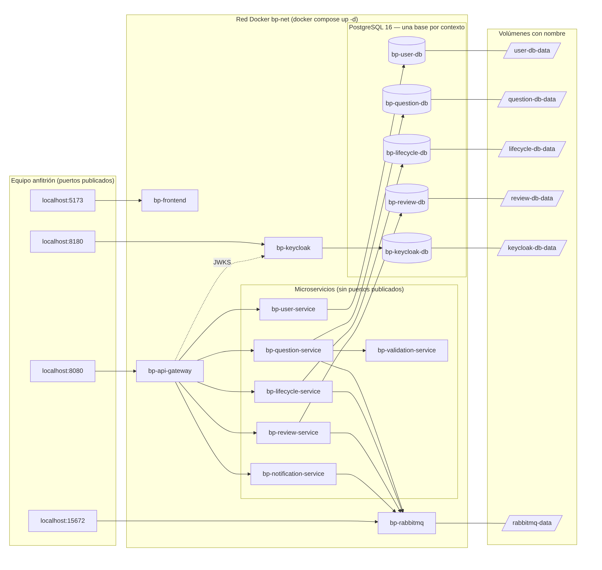

# Despliegue con Docker Compose y volúmenes (RNF #3, Corte 3)

> Requisito: *"Dockerizar los microservicios utilizando Docker Compose."* El documento de
> arquitectura debe evidenciar el uso de **volúmenes para las bases de datos**.

## 1. Qué se despliega

Un solo comando levanta los 15 contenedores del sistema:

```bash
cd microservicios
docker compose up -d --build
```



| Contenedor | Imagen | Puerto publicado | Volumen |
|---|---|---|---|
| `bp-frontend` | `banco-preguntas/frontend:corte3` (Node 20 Alpine) | 5173 | — |
| `bp-api-gateway` | `banco-preguntas/api-gateway:corte3` | 8080 | — |
| `bp-user-service` | `banco-preguntas/user-service:corte3` | — | — |
| `bp-question-service` | `banco-preguntas/question-service:corte3` | — | — |
| `bp-validation-service` | `banco-preguntas/validation-service:corte3` | — | — |
| `bp-lifecycle-service` | `banco-preguntas/lifecycle-service:corte3` | — | — |
| `bp-review-service` | `banco-preguntas/review-service:corte3` | — | — |
| `bp-notification-service` | `banco-preguntas/notification-service:corte3` | — | — |
| `bp-user-db` | `postgres:16-alpine` | — | `user-db-data` |
| `bp-question-db` | `postgres:16-alpine` | — | `question-db-data` |
| `bp-lifecycle-db` | `postgres:16-alpine` | — | `lifecycle-db-data` |
| `bp-review-db` | `postgres:16-alpine` | — | `review-db-data` |
| `bp-keycloak` | `quay.io/keycloak/keycloak:26.8.1` | 8180 | (usa `bp-keycloak-db`) |
| `bp-keycloak-db` | `postgres:16-alpine` | — | `keycloak-db-data` |
| `bp-rabbitmq` | `rabbitmq:3.13-management` | 5672, 15672 | `rabbitmq-data` |

## 2. Decisiones

| Decisión | Motivo |
|---|---|
| **Un Dockerfile multi-etapa para los siete servicios** (`ARG SERVICE`) | La etapa de compilación (Maven + JDK 21) es común y queda en caché; la imagen final solo lleva el JRE 21 Alpine y el jar |
| **Una base de datos PostgreSQL por contexto delimitado** | Ningún servicio lee la base de otro (regla del Corte 2); cada una tiene su usuario y su volumen |
| **Volúmenes con nombre** | Los datos sobreviven a `docker compose down` y a la recreación de los contenedores |
| **Solo se publican frontend, gateway, Keycloak y RabbitMQ** | Los microservicios y las bases de datos quedan dentro de la red `bp-net`: el único camino a la API es el gateway, que valida el JWT |
| **Healthchecks y `depends_on`** | Los servicios esperan a que su base de datos y RabbitMQ estén listos; el gateway espera a Keycloak |
| Usuario sin privilegios y límite de memoria por contenedor | Buenas prácticas de ejecución |
| `lifecycle-service` con JPA + Flyway | Antes guardaba el estado en memoria y se perdía al reiniciar el contenedor |
| Frontend con `API_BASE` por variable de entorno | La misma imagen sirve para cualquier URL del gateway |

Archivos: [`microservicios/Dockerfile`](../microservicios/Dockerfile),
[`frontend/Dockerfile`](../frontend/Dockerfile),
[`microservicios/docker-compose.yml`](../microservicios/docker-compose.yml) y
[`microservicios/docker-compose.debug.yml`](../microservicios/docker-compose.debug.yml) (opcional: publica
el puerto de cada servicio para depurar).

## 3. Uso

```bash
docker compose up -d --build      # construir y levantar todo
docker compose ps                 # estado y salud
docker compose logs -f api-gateway
docker compose down               # detener (los datos se conservan)
docker compose down -v            # detener y borrar los volúmenes
```

| Entrada | URL | Credenciales |
|---|---|---|
| Frontend | http://localhost:5173 | `autor1` / `autor123`, `admin` / `admin123`, `revisor1` / `revisor123` |
| API Gateway y Swagger | http://localhost:8080/swagger-ui.html | JWT |
| Keycloak | http://localhost:8180 | `admin` / `admin` |
| RabbitMQ | http://localhost:15672 | `guest` / `guest` |

Los puertos del equipo se cambian con variables (`GATEWAY_PORT`, `FRONTEND_PORT`, `KEYCLOAK_PORT`,
`RABBITMQ_AMQP_PORT`, `RABBITMQ_CONSOLE_PORT`); ver [`.env.example`](../microservicios/.env.example).
Por ejemplo, si el 8080 está ocupado: `GATEWAY_PORT=8088 docker compose up -d`.

Para desarrollar con Maven solo se levanta la infraestructura: `docker compose up -d rabbitmq keycloak`.

## 4. Evidencia (15 de noviembre de 2026)

Salida real de los comandos. En el equipo de prueba el puerto 8080 estaba ocupado por otra
aplicación, por eso el gateway se publicó en el 8088 con `GATEWAY_PORT=8088`.

### 4.1. Contenedores y volúmenes

```text
$ GATEWAY_PORT=8088 docker compose ps   # 8080 estaba ocupado en el equipo de prueba
NAME                      IMAGE                                         STATUS                    PORTS
bp-api-gateway            banco-preguntas/api-gateway:corte3            Up 12 seconds (healthy)   0.0.0.0:8088->8080/tcp
bp-frontend               banco-preguntas/frontend:corte3               Up 12 seconds             0.0.0.0:5173->5173/tcp
bp-keycloak               quay.io/keycloak/keycloak:26.8.1              Up 33 seconds (healthy)   8443/tcp, 9000/tcp, 0.0.0.0:8180->8080/tcp
bp-keycloak-db            postgres:16-alpine                            Up 39 seconds (healthy)   5432/tcp
bp-lifecycle-db           postgres:16-alpine                            Up 39 seconds (healthy)   5432/tcp
bp-lifecycle-service      banco-preguntas/lifecycle-service:corte3      Up 26 seconds (healthy)   
bp-notification-service   banco-preguntas/notification-service:corte3   Up 27 seconds (healthy)   
bp-question-db            postgres:16-alpine                            Up 38 seconds (healthy)   5432/tcp
bp-question-service       banco-preguntas/question-service:corte3       Up 26 seconds (healthy)   
bp-rabbitmq               rabbitmq:3.13-management                      Up 38 seconds (healthy)   4369/tcp, 5671/tcp, 0.0.0.0:5672->5672/tcp, 15671/tcp, 15691-15692/tcp, 25672/tcp, 0.0.0.0:15672->15672/tcp
bp-review-db              postgres:16-alpine                            Up 38 seconds (healthy)   5432/tcp
bp-review-service         banco-preguntas/review-service:corte3         Up 26 seconds (healthy)   
bp-user-db                postgres:16-alpine                            Up 38 seconds (healthy)   5432/tcp
bp-user-service           banco-preguntas/user-service:corte3           Up 32 seconds (healthy)   
bp-validation-service     banco-preguntas/validation-service:corte3     Up 38 seconds (healthy)   

$ docker volume ls
DRIVER    VOLUME NAME
local     banco-preguntas_keycloak-db-data
local     banco-preguntas_lifecycle-db-data
local     banco-preguntas_question-db-data
local     banco-preguntas_rabbitmq-data
local     banco-preguntas_review-db-data
local     banco-preguntas_user-db-data
```

### 4.2. Persistencia tras recrear los contenedores

Se ejecutó el flujo completo (crear la pregunta 4, enviarla, rechazarla, crear la versión 2,
segunda ronda y aprobación), luego `docker compose down` y `docker compose up -d`. Los
contenedores son nuevos y los datos siguen ahí:

```text
$ docker compose down && docker compose up -d   # los contenedores se eliminan y se crean de nuevo
$ curl -H "Authorization: Bearer $TOKEN" http://localhost:8088/api/v1/ciclo-vida/4
{"id":1,"questionId":4,"state":"APPROVED","changedAt":"2026-11-15T23:02:47.884505","changedBy":"Revisor 5","message":"Resultado de la revisión por pares: APPROVED"}
$ curl -H "Authorization: Bearer $TOKEN" http://localhost:8088/api/v1/revisiones/pregunta/4/historial
{"questionId": 4, "totalRounds": 2, "improvedVersionAllowed": false} [(1, 'REJECTED'), (2, 'APPROVED')]
$ docker exec bp-question-db psql -U question_db -c "select id, version, author_id from question order by id"
 id | version | author_id 
----+---------+-----------
  1 |       1 |         2
  2 |       1 |         2
  3 |       1 |         3
  4 |       2 |         2
(4 rows)

$ docker exec bp-lifecycle-db psql -U lifecycle_db -c "select question_id, state, changed_by from question_state"
 question_id |  state   | changed_by 
-------------+----------+------------
           2 | DRAFT    | SYSTEM
           1 | DRAFT    | SYSTEM
           4 | APPROVED | Revisor 5
(3 rows)

```

### 4.3. Flujo funcional dentro de Docker

| Paso | Petición (por el gateway, con JWT) | Respuesta |
|---|---|---|
| HU-01 | `POST /preguntas` (autor) | 201, estado DRAFT |
| HU-02 | `POST /preguntas/4/submit-review` | 202 + `operationId`; la operación queda COMPLETED y el estado PENDING_REVIEW |
| HU-04 | `POST /asignaciones` (administrador) | 201, ronda 1 |
| HU-05 | `POST /revisiones/evaluar` REJECTED con observaciones (revisor) | 200 |
| HU-06 | `GET /revisiones/pregunta/4/historial` (autor) | 200, ronda 1 Rechazada, `improvedVersionAllowed: true` |
| HU-06 | `POST /preguntas/4/submit-review` sin corregir | 409 |
| HU-06 | `PUT /preguntas/4` (versión mejorada) | 200, versión 2 en DRAFT |
| HU-06 | Reenvío, asignación de la ronda 2 y dos aprobaciones | 202, 201, 200 y estado final APPROVED |
| Notificaciones | `GET /notificaciones/recipient/2` (autor) | 5 avisos: envío, rechazo, versión mejorada, evaluación y aprobación |

## 5. Limitaciones conocidas

- `notification-service` guarda el historial de notificaciones en memoria: los correos se envían,
  pero la lista de avisos se vacía al reiniciar ese contenedor.
- Las contraseñas del `docker-compose.yml` son valores de desarrollo; se sobrescriben con variables
  de entorno o un archivo `.env`.
- El perfil `escalado` del Corte 2 (dos instancias de question-service) sigue disponible con Maven;
  en Compose se ejecuta una instancia por servicio.
